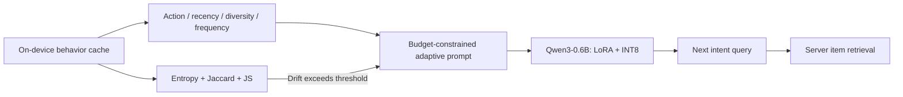
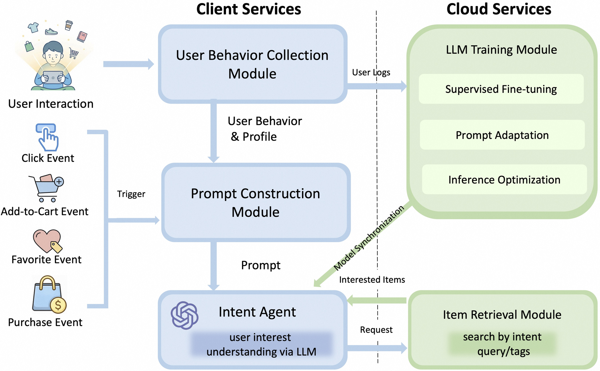

# RecGPT-Mobile: On-Device User Intent Understanding

<!-- source-sha256: b91dac0f7b235155d3f0ea19dbb318892f756ee9ffd90251982a40d5e5a50fe3 -->

[简体中文](README.md)

> **Fidelity: core mechanism.** The run executes causal LM LoRA SFT, budget-constrained adaptive prompting, drift-triggered generation, and INT8 weight quantization. It reduces the data and mobile deployment system.

## Paper information

| Field | Details |
|---|---|
| Paper | [arXiv 2605.04726](https://arxiv.org/abs/2605.04726) |
| Organization | Alibaba / Taobao |
| First public release | 2026-05-06 (arXiv v1) |
| Authors' code | No official or author implementation is linked by the paper (checked 2026-08-09). |
| Adapter / method | `recgpt-mobile` |
| Local reproduction code | [`src/auto_research/reproductions/recgpt_mobile/`](https://github.com/daiwk/auto-research/tree/main/src/auto_research/reproductions/recgpt_mobile/) |

## Original paper

### Motivation and method

Cloud LLMs turn implicit clicks, cart events, favorites, and purchases into explicit search intents, but frequent uploads and inference increase cost, latency, and privacy risk. RecGPT-Mobile places a quantized Qwen3-0.6B on a phone to collect behavior locally, assemble a prompt, generate the next query, and pass it to server retrieval.

The training mixture is behavior/search logs 60%, co-purchase 20%, GPT rewrites 15%, and human labels 5%. LoRA SFT learns behavior-to-query mapping. Prompting chooses a template from action, recency, diversity, and frequency, then adds only positive-marginal-utility components within budget. Entropy, Jaccard, and JS divergence determine whether intent drift warrants regeneration.



<!-- paper-figure:start -->
### Key figure from the paper

[](https://arxiv.org/html/2605.04726v1/framework.png)

> **Figure 1:** Core architecture, its modules, and their connections. From the [original paper](https://arxiv.org/abs/2605.04726); copyright remains with the authors.
<!-- paper-figure:end -->

### Core equations

$$
q^*=\arg\max_{q\in\mathcal Q}P(q\mid\mathcal B)
\quad\text{s.t. resource constraints}.
$$

$$
\Delta_{\mathrm{intent}}=
\lambda_1\lvert H(P_t)-H(P_{t-1})\rvert+
\lambda_2(1-JA(Z_t,Z_{t-1}))+
\lambda_3\operatorname{JS}(P_t,P_{t-1}).
$$

The paper uses $\lambda=(0.4,0.3,0.3)$ and $\tau=0.8$; it regenerates only if $\Delta_{\mathrm{intent}}>\tau$.

### Paper results

With Qwen3-4B as evaluator, Qwen3-0.6B Base/LoRA/LoRA+Quant score 0.677 / 0.829 / 0.794; with the 8B evaluator, 0.613 / 0.783 / 0.760. Quantization costs modest quality. A month-long test covering tens of millions of users across four Taobao feed settings reports average CLICK +1.8%, PAY +2.7%, and GMV +2.5%.

## Local reproduction

> **Local comparison.** Zero-shot intent completion by the same SmolLM2-135M-Instruct versus q/v LoRA over the same 18 candidates. Semantic accuracy increases **+100.00%** relative. The quantized arm uses the same LoRA weights with per-output-channel INT8.

MovieLens-1M produces 23,472 behavior-to-next-genre examples with up to 96 prompt tokens and 32 evaluation users. A first 24-step run reduces loss but not accuracy. At 80 steps, base primary/semantic accuracy is 0.0625 / 0.2500, LoRA 0.4062 / 0.5000 (**+100.00%** semantic), and INT8 0.3750 / 0.4688 (**-6.25%** semantic relative to LoRA). Serialized size drops from 513.24 to 237.72 MiB (**-53.68%**). On 290 test users the paper's formula gives mean drift 0.4302 and trigger rate 3.79%, so 96.21% of requests reuse an old intent.

Mac PyTorch did not enable an INT8 linear kernel. Weights are stored in INT8 but dequantized for forward, yielding 573 ms versus 197 ms for FP32 LoRA. That latency is not a smartphone measurement. See [stable metrics](metrics/movielens-1m-seed42.json).

```bash
auto-research reproduce --paper recgpt-mobile --seed 42
```

## Limits

The local model is a real causal LM with LoRA, not a genre-classification MLP. Adaptive prompting, three-term drift, and quantization all execute. MovieLens genre substitutes for Taobao queries, without GPT rewrites, manual annotations, production retrieval, or a phone fleet. The experiment checks the method and relative trends only.
