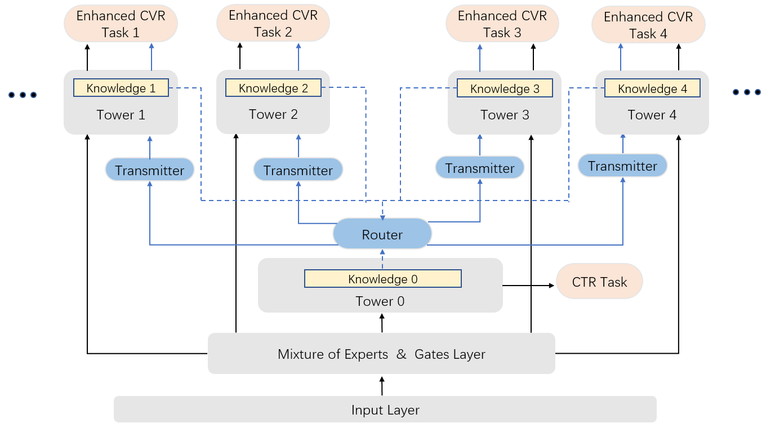

# Effective Knowledge Transfer for Multi-Task Recommendation Models

<!-- source-sha256: 6d6355c9443b1b6bdf16f7208dea6e961eef7dfc11f5c26899504ec17130dfbc -->

[简体中文](README.md)

> Core transfer mechanism on public data.

## Paper information

| Field | Details |
|---|---|
| Paper | [arXiv 2605.05730](https://arxiv.org/abs/2605.05730) |
| Institution | Huawei Technologies. |
| First public release | 2026-05-07 (arXiv v1) |
| Author code | No official author code linked by the paper as checked on 2026-08-24. |
| Local adapter or method key | `ektm` |
| Local reproduction code | [`src/auto_research/reproductions/ektm/`](https://github.com/daiwk/auto-research/tree/main/src/auto_research/reproductions/ektm/) |

## Paper method and evidence

Transfer CTR representations into multiple conversion towers according to CVR-task similarity. A hard-example-aware loss limits negative transfer while keeping multi-task serving cost manageable.


<!-- paper-figure:start -->
### Original paper figure

[](https://arxiv.org/html/2605.05730v1/EKTM.PNG)

The original figure shows task-aware transfer. From the [original paper](https://arxiv.org/abs/2605.05730); copyright remains with the authors.
<!-- paper-figure:end -->

### Core equation

$$
F_i=\operatorname{mean}(f_{ctr},\hat s_{i1}f^1_{cvr},\ldots,\hat s_{iT}f^T_{cvr})
$$

### Reported results

Section 4.4.2/Figure 3 reports **eCPM +3.93%**, with traffic expanding 5%→20%→50%→100%. This production metric is not the local outcome.

## Local reproduction

NDCG@10 **0.0540→0.0599 (+10.98%)**, Hit@10 **0.1091→0.1182**. Same MovieLens-100K 220 users/360 items, full catalog, split and seed 42, using a shared transition + content baseline. Validation selects only blend weight; test does not tune. The local model has independent state and scoring. No private features, production checkpoint or online serving; retain negative results.

```bash
auto-research reproduce --paper ektm --dataset-dir data --seed 42
```

[Fixed metrics](metrics/public-seed42.json).
