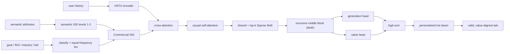
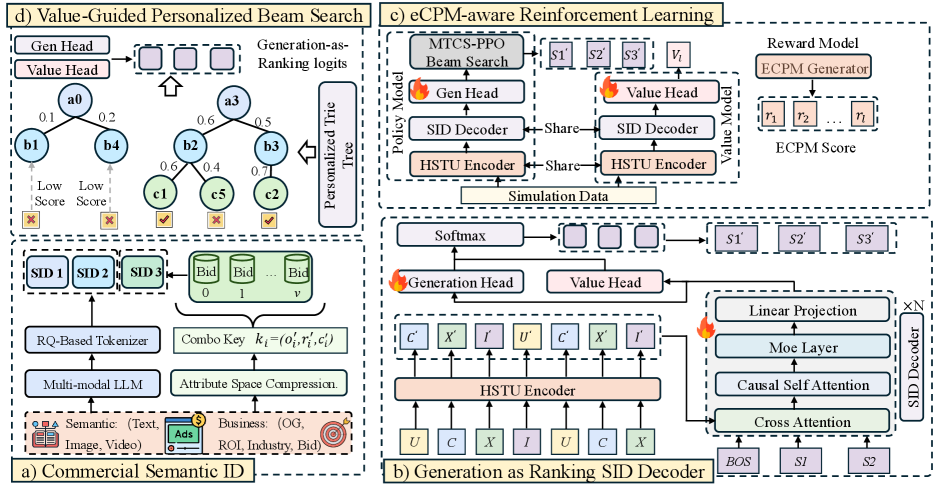

# UniVA: Unified value alignment for industrial generative ad recommendation

<!-- source-sha256: ab6127edaec6c9c2a2951964e09d1e51f73d6fa79802f75d6d36ca350ef10b34 -->

[简体中文](README.md)

> **Fidelity: Full core pipeline** The local run executes Commercial SID, HSTU user encoding, cross-attention followed by causal self-attention, MoR, shared experts plus top-k Sparse MoE, generation and value heads, alternating supervised and PPO/value training, and value-guided personalized trie beam search. Deterministic public-data proxies replace Tencent's private ad attributes, eCPM simulator, candidate inventory, MCTS data, and live traffic.

## Paper information

| Field | Value |
| --- | --- |
| Paper link | [arXiv 2605.05803](https://arxiv.org/abs/2605.05803) |
| Organization | Tencent / WeChat Channels |
| First published | 2026-05-07 (arXiv v1) |
| Original author code | No official or author code was provided in the paper (checked 2026-08-09). |
| Adapter | `univa` |
| Local reproduction code | [`src/auto_research/reproductions/univa/`](https://github.com/daiwk/auto-research/tree/main/src/auto_research/reproductions/univa/) |

## Original paper summary

### Background and main changes

Conventional generative recommenders chiefly match user behavior and do not directly represent bids, ROI, and optimization goals. Industrial ads also require valid generation paths and request-level inventory constraints. UniVA puts user preference, commercial value, and eligibility in one model. Commercial SID encodes business attributes after semantic tokens; Generation-as-Ranking combines the generation and value heads to score paths; eCPM-aware RL favors relatively high-value ads in each request; and a personalized trie restricts beam expansion to ads eligible for that request.

1. The SID has two semantic levels and one commercial token. Commercial attributes define classes, and bids are divided into equal-frequency buckets per class under a shared vocabulary budget.
2. After HSTU history encoding, the decoder runs cross-attention, causal self-attention, and Sparse MoE. Mixture of Recursion (MoR) reuses middle blocks; the generation and value vocabulary heads add logits elementwise.
3. SFT is followed by alternating supervised and PPO/value updates. Serving uses value-guided beam search over the request-specific trie.



<!-- paper-figure:start -->
### Key figure from the paper

[](https://arxiv.org/html/2605.05803v1/x1.png)

**Original Figure 1 (architecture):** The main modules and their connections. Image from the [original paper](https://arxiv.org/abs/2605.05803); copyright belongs to the authors. Click the image for its source.
<!-- paper-figure:end -->

### Core equations

Commercial SID retains the first two semantic levels and derives the last level from the business class and its bid bucket:

$$
SID_i=(s_i^{(1)},s_i^{(2)},c_i),\qquad
c_i=\operatorname{offset}(a_i)+\operatorname{EqFreqBin}(b_i\mid a_i),
$$

Here $a_i$ combines attributes such as optimization goal, ROI tier, and industry. Bucket counts satisfy $\sum_a n_a\leq V_c$.

Generation-as-Ranking normalizes the sum of relevance and value logits:

$$
p(s_t\mid x,s_{<t})=\operatorname{softmax}\!\left(z^{gen}_t+z^{value}_t\right).
$$

The supervised stage minimizes token negative log-likelihood. The RL stage standardizes eCPM rewards $r$ over candidates from the same request, updates the policy with clipped PPO, and regresses the value head:

$$
\mathcal L_{PPO}=-\mathbb E\left[\min(\rho_t A_t,\operatorname{clip}(\rho_t,1-\epsilon,1+\epsilon)A_t)\right],
$$

$$
\mathcal L_V=\mathbb E[(V_\theta-r)^2],\qquad
\mathcal L_{RL}=\mathcal L_{PPO}+\lambda_V\mathcal L_V.
$$

The personalized trie extends only prefixes present in the current inventory $\mathcal I_u$, accumulating the fused score:

$$
S(s_{1:L})=\sum_{t=1}^{L}\log p(s_t\mid x,s_{<t}),\qquad s_{1:L}\in Trie(\mathcal I_u).
$$

### Offline and online results in the paper

Tencent reports per-module lifts on private industrial ads. These percentages are relative to its production baseline and are not local results.

| Paper configuration | HR@100 relative lift |
|---|---:|
| + Commercial SID | +5.78% |
| + Mixture of Recursion | +13.56% |
| + Sparse MoE | +18.40% |
| UniVA full | **+37.04%** |

The full model also reports ValueHR@100 **+37.01%** and wNDCG@100 **+26.20%**. The online experiment covered 5% of WeChat Channels ad traffic from 2026-03-07 to 2026-03-11:

| Online A/B | GMV | GMV(normal) |
|---|---:|---:|
| v1: without Generation-as-Ranking | +1.03% | +1.17% |
| v2: UniVA full | **+1.50%** | **+1.42%** |

## Local reproduction

> **Control:** The baseline `semantic_sid_sl` uses the original three-level Semantic SID and supervised learning on the same MiniOneRec Office data, HSTU/decoder capacity, training steps, seeds, and full catalog. `univa_full` uses Commercial SID, generation/value heads, and alternating PPO/value updates. The validation-selected variant reaches **+4.76%** HR@100 and **+6.56%** ValueHR@100 on held-out test, but **-8.43%** wNDCG@100. This is a matched local ablation with public proxies, not a DIN comparison or the paper's online A/B.

The experiment uses 12,000 training examples, 32 validation users, 32 test users, the full 3,459-item catalog, and seeds 42/43/44. Each variant trains for 80 steps. Selection is fixed in advance to validation ValueHR@100, then HR@100; test is not used for selection.

| Local variant | Test HR@10 | HR@50 | HR@100 | ValueHR@100 | wNDCG@100 |
|---|---:|---:|---:|---:|---:|
| semantic_sid_sl (baseline) | 0.09375 | 0.16667 | 0.21875 | 0.39709 | **0.15464** |
| commercial_sid_sl | **0.10417** | **0.18750** | **0.26042** | **0.46227** | 0.13625 |
| univa_full (validation selection) | 0.09375 | **0.18750** | 0.22917 | 0.42315 | 0.14161 |

On validation, `univa_full` wins with ValueHR@100 of 0.32079 versus 0.30894 for the semantic baseline and 0.30933 for Commercial SID alone. On test, Commercial SID alone has the highest HR and ValueHR: the small-budget PPO/value stage did not reliably improve on it. The full model also lowers top-ranked value-weighted NDCG, so the paper's gains were not fully reproduced.

The commercial token provides a positive mechanism diagnostic: grouping by the first two semantic codes, mean within-group bid-proxy standard deviation drops from 0.34956 to 0.09773 (-72.04%). Without the serving trie, just 13.42/50 beam paths on average map to real items; the personalized trie gives 50/50. Value guidance changes mean eCPM proxy from 0.42554 to 0.42510 (-0.10%), so no additional value lift was measured.

```bash
# The first run reuses or downloads the public MiniOneRec Office files.
AUTO_RESEARCH_UNIVA_STEPS=80 \
AUTO_RESEARCH_UNIVA_TRAIN_ROWS=12000 \
AUTO_RESEARCH_UNIVA_EVAL_USERS=32 \
AUTO_RESEARCH_UNIVA_SEEDS=3 \
auto-research reproduce --paper univa --seed 42
```

Stable metrics: [metrics/office-seeds42-44.json](metrics/office-seeds42-44.json). Data, raw runs, and checkpoints are not committed. The command above reproduces the local experiment.

## Reproduction limits

- The implementation runs all four core stages. It does not approximate the network, RL, or trie by weighting final scores.
- Public data lacks ad optimization goals, ROI, industry, bids, and pCTR/pCVR snapshots. Local substitutes use brand, popularity quantiles, Qwen embedding clusters, and deterministic bid/eCPM proxies.
- Tencent's 2048-codebook setup, 256-dimensional four-layer decoder, 64 experts/top-16, large-scale MCTS data, and production inventory are not reproduced. The Mac setup uses 48 dimensions, 4 experts/top-2, and 2 MoR passes.
- These results validate the pipeline and its behavior on public proxies, not GMV or live ad gains.
