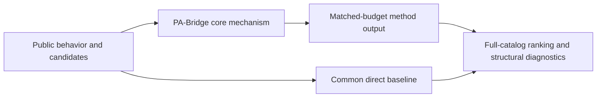
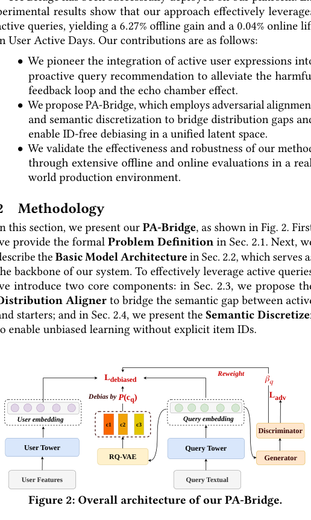

# PA-Bridge: bridging distributions of active expression and passive behavior

<!-- source-sha256: e645b2434fda683711dccc82b7d0d9b35223644cabf7efb9abe5d495b8c7730e -->

[简体中文](README.md)

> **Fidelity: core mechanism.** Runs the defining mechanism verifiable on public data. Private data, production models, and serving remain outside scope.

## Paper information

| Field | Details |
|---|---|
| Paper | [arXiv 2605.05855](https://arxiv.org/abs/2605.05855) |
| Organization | ByteDance |
| First public release | 2026-05-07 (arXiv v1) |
| Authors' code | No public author code was found on 2026-09-02. |
| Adapter / method | `pa-bridge` |
| Local reproduction code | [`src/auto_research/reproductions/pa_bridge/`](https://github.com/daiwk/auto-research/tree/main/src/auto_research/reproductions/pa_bridge/) |

## Original paper

### Motivation and method

A distribution aligner transfers passive browsing behavior into the active query space. Semantic discretization and reweighting weaken exposure feedback loops and improve conversation-starter coverage and diversity.



<!-- paper-figure:start -->
### Key figure from the paper

[](https://arxiv.org/pdf/2605.05855#page=2)

> **Figure 2:** Core architecture, modules, and connections. From the [original paper](https://arxiv.org/abs/2605.05855); copyright remains with the authors.
<!-- paper-figure:end -->

### Core equations

$$
z=\\operatorname{Align}(h_{passive},h_{active}),\\qquad \\mathcal L=\\sum_i \\omega(c_i)\\ell(f(z_i),y_i).
$$

### Paper results

Online A/B reports feature penetration +0.54% and user active days +0.04%. Unique exposed and clicked queries rise +30.65% and +56.50%, respectively. This is paper evidence, not a local public-data outcome.

## Local reproduction

> **Local comparison:** Under the same full-catalog protocol, baseline NDCG@10 is 0.05401 and PA-Bridge NDCG@10 is 0.04938, **-8.57%** relative. The local proxy does not extrapolate to online lift.

See the [three-seed artifact](metrics/public-seeds42-44.json) for complete results, means, standard deviations, and 95% confidence intervals.

```bash
auto-research reproduce --paper pa-bridge --dataset-dir data --seeds 42,43,44
```

## Reproduction boundaries

The local run uses a public MovieLens-1M subset and auditable proxies to validate the core computation. It does not reproduce private logs, production models, online traffic assignment, or serving. No claim is made to reproduce absolute paper metrics or online gains.
