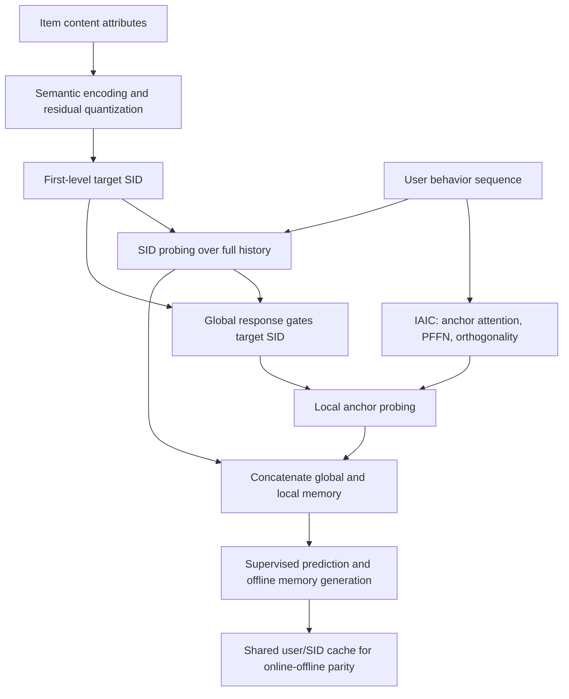
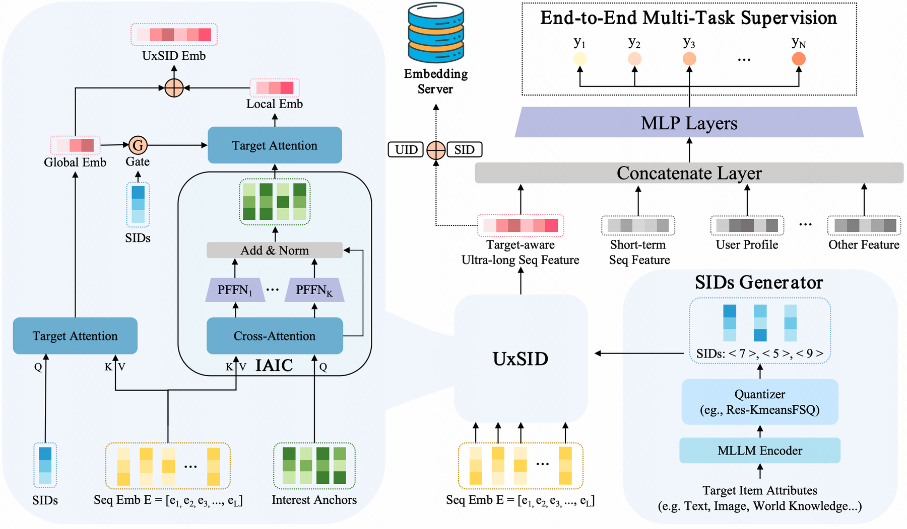

# UxSID: Shared Interest Memory for Ultra-Long Sequences via Target Semantic Groups

<!-- source-sha256: c4673e0c711a711b5521fb174dfff8bb08a8e1ce8ea8ca786baacd5536628fa8 -->

[简体中文](README.md)

## Paper information

| Field | Details |
|---|---|
| Paper | [arXiv 2605.09040](https://arxiv.org/abs/2605.09040) |
| Organization | Kuaishou |
| First public release | 2026-05-09 (arXiv v1) |
| Authors' code | No public implementation from the authors was found on 2026-10-13. The local implementation follows v4. |
| Adapter / method | `uxsid` |
| Local reproduction code | [`src/auto_research/reproductions/uxsid/`](https://github.com/daiwk/auto-research/tree/main/src/auto_research/reproductions/uxsid/) |

This implementation follows the 2026-10-09 [v4 text](https://arxiv.org/html/2605.09040v4). The original v1 release and the substantive update are recorded separately; this is not a new October v1.

> **Local comparison.** Global-only, item-agnostic, ungated, and UxSID are all trained with the same frozen semantic encoder, SID side information, initialization, samples, and budget. Epoch and architecture selection use validation only before test reporting. No stable gain was observed. MovieLens rating prediction cannot stand in for KuaiRec/XLong ultra-long histories, CTR/CTCVR, or online business effects.

## Original paper

### Motivation and method

UxSID inserts target-semantic-group memory between retrieval for every candidate and entirely candidate-agnostic history compression. A target item's first-level SID queries the full history and learnable interest anchors, with the global interest response gating the second semantic probe. Similar candidates share the user's interest representation, so end-to-end offline training and online user/SID lookups use the same memory.

IAIC applies cross-attention from learned anchors to the behavior sequence, then independent sigmoid PFFNs for each anchor, a residual, and LayerNorm. An orthogonality term discourages interest collapse. A target SID reads the global sequence response, which gates that SID before it queries the compressed anchors. The concatenated global and local representations drive supervised training.



<!-- paper-figure:start -->
### Key figure from the paper

[](https://arxiv.org/html/2605.09040v4/Fig/Overview.png)

> **Figure 2:** The core architecture, its modules, and their connections. From the [original paper](https://arxiv.org/abs/2605.09040v4); copyright remains with the authors.
<!-- paper-figure:end -->

### Core equations

Equation 2 defines residual quantization:

$$
z_i\approx\sum_m\mathcal C_m(k_m),\quad k_m=\arg\min_j\|r_{m-1}-c_{m,j}\|_2.
$$

The local implementation uses two residual k-means stages followed by a seven-level finite scalar residual, not the paper's LETTER protocol with four 256-entry codebooks. Codebook centers and scalar ranges are fitted on training item attributes only. Inference uses first-level code IDs.

IAIC anchor compression and the orthogonality penalty in Eq. 5 are:

$$
H=\operatorname{softmax}\left((Q_{anc}W_Q)(EW_K)^T/\sqrt d\right)EW_V,
$$

$$
\mathcal L_{ortho}=\left\|PP^T/\|P\|_2^2-I\right\|_F.
$$

The denominator is the squared L2 norm of the whole anchor matrix, not a cosine matrix with individually normalized rows. Every anchor retains its own PFFN parameters.

Equations 6–9 retain both probes: the target SID queries original behavior representations for $e_g$, then $q_{ref}=c_{target}\odot\sigma(\mathrm{MLP}(e_g))$ queries the anchors for $e_l$. Prediction concatenates $[e_g;e_l]$ with user, item, context, and short-history features and backpropagates through $\mathrm{BCE}+\lambda\mathcal L_{ortho}$.

### Paper results

| Metric | UxSID | Comparison / location |
| --- | ---: | --- |
| XLong AUC | 0.8408 | TWIN 0.8154; C-Former 0.8135; Table 1 |
| KuaiRec-Big AUC | 0.8348 | TWIN 0.8269; C-Former 0.8276; Table 1 |
| Industrial CTR AUC | 0.8728 | TWIN 0.8712; Table 2 |
| Industrial CTCVR AUC | 0.8626 | TWIN 0.8609; Table 2 |
| Relative online revenue | +0.337% | One-week production A/B on Kuaishou short-video ads; Table 3 |

The same production test reports Exposure +0.111% and Advertising Cost +0.231%. The paper calls the gains significant without giving p-values or confidence intervals in the table. Its $O(1)$ online lookup and 10k-history scaling results apply to the original production system, not local serving latency or capacity.

## Local reproduction

```bash
python -m pip install -e '.[neural-recs,llm-evolution]'
PYTHONPATH=src python scripts/run_uxsid.py \
  --dataset-dir data --device cpu --seed 42 --epochs 3 \
  --output runs/uxsid-42
# NVIDIA A100/A30 使用 --device cuda；可指定带 provenance.json 的本地公开 encoder mirror。
```

The default encoder is Qwen2.5-0.5B-Instruct at `7ae557604adf67be50417f59c2c2f167def9a775`. Only public movie titles and genres enter the encoder. All encoder parameters remain frozen; masked mean pooling is followed by normalization. Ratings and validation/test labels are not read by the encoder. These public text features do not approximate a private MLLM aligned with video or world knowledge.

Per-user chronological splits hold out the last interaction for test and the penultimate for validation. Each prediction uses only items rated earlier. Labels are observed rating ≥4, maximum history is 256, and timestamp normalization is fitted on training only. This is neither full-catalog click ranking nor a private ads dataset.

All four variants are trained: `global-only`, `agnostic`, `ungated`, and `uxsid`. They receive the same SID side features so extra information is not mistaken for a compression gain. A local SID probe is not a DIN baseline.

### Local results

An early CPU diagnostic with seed 42, 100 users, and one epoch obtained test AUC 0.5848 for UxSID and 0.5916 for validation-selected `agnostic`. The negative result is retained. The later A100 runs on all users with frozen Qwen and seeds 42/43/44 are separate and are not pooled with it.

The A100 runs on 2026-10-13 used all 943 users, 97,171/943/943 train/validation/test examples, and three epochs per variant. Three-seed means ± sample standard deviations:

| Architecture | Test ROC-AUC | Test PR-AUC |
| --- | ---: | ---: |
| global-only | 0.74123±0.01134 | 0.73018±0.01589 |
| agnostic | 0.74045±0.01299 | 0.72732±0.01712 |
| ungated | 0.74142±0.01008 | 0.73252±0.01529 |
| UxSID | 0.74102±0.01019 | 0.73091±0.01435 |

Validation selected UxSID, global-only, and global-only, respectively. UxSID did not consistently beat the controls. All variants updated real parameters, and the maximum cached-versus-direct error was 0. Three seeds diagnose execution stability; overlapping results do not reproduce the paper's gains.

[Per-seed training and metrics](metrics/public-a100-seeds42-44.json); [sanitized A100 receipt tied to executed source](../../gpu-validations/uxsid-a100-20261013.json).

### Code mapping and limits

| Paper mechanism | Local implementation |
| --- | --- |
| Eq. 2 semantic residual quantization | `model.py:ResidualKmeansFSQ` |
| Eqs. 3–5 IAIC, PFFN, orthogonality | `InterestCompressor` / `orthogonality_loss` |
| Eqs. 6–11 two probes, gate, supervision | `UxSID.memory` / `UxSID.score` / `objective` |
| Shared user/SID memory and invalidation | `SemanticMemoryCache`; key also includes history and model digests |
| Chronological split, training, validation selection | `experiment.py` |

Only eval-mode models can populate the cache. Memory computation does not receive target item IDs. Candidates with the same SID share memory; changes to the history or model invalidate old keys. Numerical agreement between direct computation and cached inference does not measure production Embedding Server throughput.

This is core-mechanism/L2 public-data training and a small-model rating diagnostic. The original LETTER, XLong/KuaiRec protocol, private MLLM and ads features, multitask CTCVR head, distributed ES, and production A/B were not reproduced. No business uplift is claimed, and the operator is not eligible for Evolve promotion.
