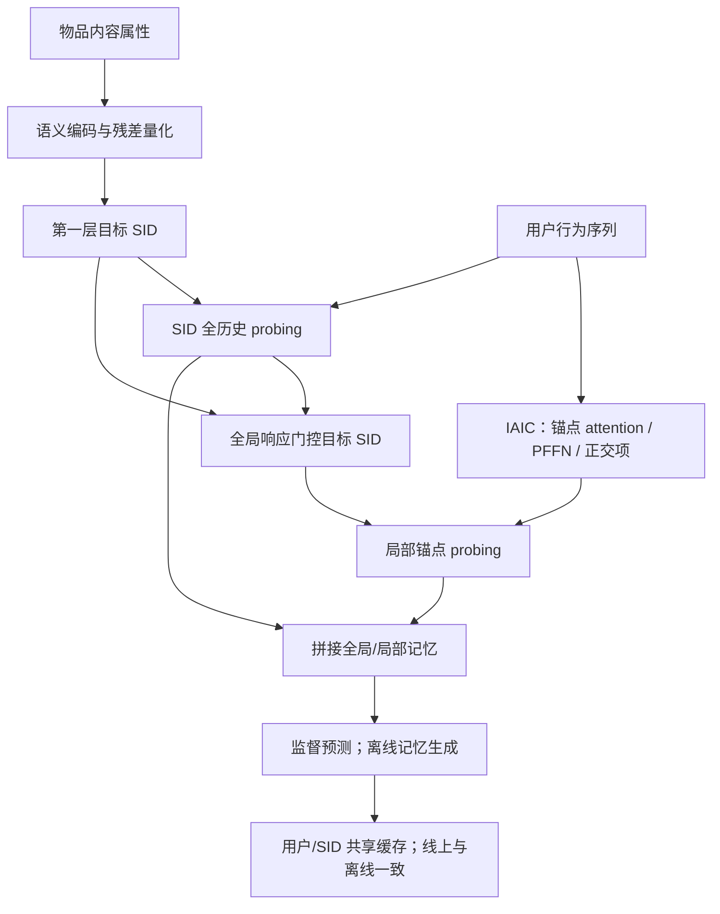
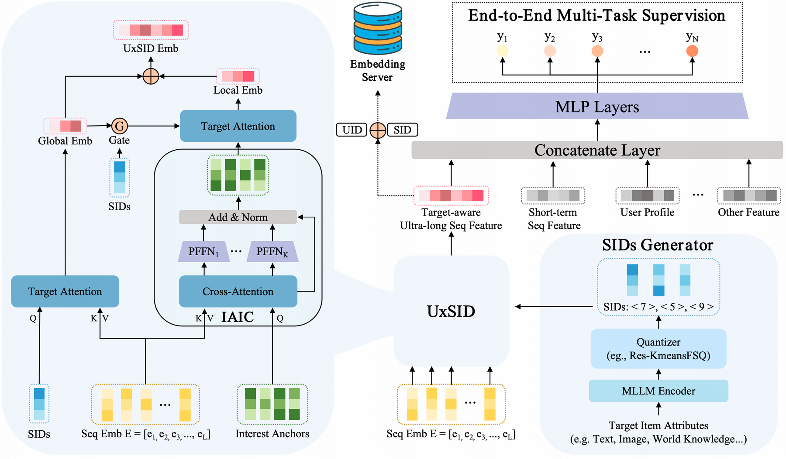

# UxSID：以目标语义组共享超长序列兴趣记忆

## 论文信息

| 项目 | 内容 |
| --- | --- |
| 论文链接 | [arXiv 2605.09040](https://arxiv.org/abs/2605.09040) |
| 公司/机构 | Kuaishou；一作 Hongwei Zhang |
| 首次公开日期 | 2026-05-09（arXiv v1） |
| 原文开源代码 | 否：未找到原作者公开实现（核查日期：2026-10-13） |
| Adapter | `uxsid` |
| 本地复现代码 | [`src/auto_research/reproductions/uxsid/`](https://github.com/daiwk/auto-research/tree/main/src/auto_research/reproductions/uxsid/) |

本轮依据 2026-10-09 的 [v4 正文](https://arxiv.org/html/2605.09040v4) 实现；v1 与实质更新日期分开记录，不将旧文更新计作十月新 v1。

> **本地对照口径**：基线为 global-only、item-agnostic 与 ungated，实验组为 UxSID；四种真实训练结构共享同一冻结语义编码、SID 侧信息、初始参数、样本和训练预算，仅用 validation 选择 epoch/结构，之后报告 test。本轮未见稳定提升，稳定相对收益不适用。MovieLens 评分预测不能替代原论文 KuaiRec/XLong 超长历史、CTR/CTCVR 或线上收益。

## 原始论文总结

### 背景与主要改动

UxSID 在逐候选检索和完全候选无关的历史压缩之间加入“目标语义组共享记忆”：用目标物品第一层 SID 查询全历史与可学习兴趣锚点，利用全局兴趣门控第二层语义探针。语义相近的候选共享用户兴趣表示，使离线端到端训练与线上按用户/SID 查表使用同一记忆。

IAIC 先用可学习锚点对行为序列做交叉注意力，再为每个锚点配置独立 Sigmoid PFFN、残差及 LayerNorm；正交项抑制兴趣坍缩。目标 SID 对原序列取全局响应，并以该响应门控 SID 后查询压缩锚点，最后拼接两级兴趣表示进行监督训练。



<!-- paper-figure:start -->
### 原论文关键图

[](https://arxiv.org/html/2605.09040v4/Fig/Overview.png)

> **原论文 Figure 2（关键图）**：展示原论文提出的核心架构、主要模块及其连接关系。图片来自[原论文](https://arxiv.org/abs/2605.09040v4)，版权归原作者所有；点击图片可查看来源。
<!-- paper-figure:end -->

### 核心公式

原文 Eq.2 的残差量化为

$$
z_i\approx\sum_m\mathcal C_m(k_m),\quad k_m=\arg\min_j\|r_{m-1}-c_{m,j}\|_2.
$$

本地明确使用两级 residual k-means 加七级 finite scalar residual，而不是冒称原文公开实验的 LETTER 四个 256 码本。码本中心与 scalar 范围仅在训练物品属性上拟合，推理使用第一层码 ID。

IAIC 的锚点压缩和原文 Eq.5 正交项为

$$
H=\operatorname{softmax}\left((Q_{anc}W_Q)(EW_K)^T/\sqrt d\right)EW_V,
$$

$$
\mathcal L_{ortho}=\left\|PP^T/\|P\|_2^2-I\right\|_F.
$$

分母是整个锚点矩阵的 squared L2 norm，不是逐行单位化后的余弦矩阵。每个锚点保留独立参数的 PFFN，而非用一个共享 FFN 替代。

两级探针保持 Eq.6–9：目标 SID 先查询原行为表示取得 $e_g$，$q_{ref}=c_{target}\odot\sigma(\mathrm{MLP}(e_g))$ 再查询锚点取得 $e_l$。预测端以 $[e_g;e_l]$ 与 user/item/context/短历史特征拼接，使用 $\mathrm{BCE}+\lambda\mathcal L_{ortho}$ 实际反向传播。

### 论文离线与线上效果

| 原论文指标 | UxSID | 对照/位置 |
| --- | ---: | --- |
| XLong AUC | 0.8408 | TWIN 0.8154；C-Former 0.8135；Table 1 |
| KuaiRec-Big AUC | 0.8348 | TWIN 0.8269；C-Former 0.8276；Table 1 |
| 工业 CTR AUC | 0.8728 | TWIN 0.8712；Table 2 |
| 工业 CTCVR AUC | 0.8626 | TWIN 0.8609；Table 2 |
| 线上 Revenue 相对提升 | +0.337% | 快手短视频广告一周生产 A/B；Table 3 |

同一生产实验 Exposure +0.111%、Advertising Cost +0.231%。正文称收益显著，未给该表的 p-value/置信区间。论文 $O(1)$ 在线查表和 10k 历史扩展结果属于原生产系统，本地不据此宣称服务延迟或容量改善。

## 本地复现与运行

```bash
python -m pip install -e '.[neural-recs,llm-evolution]'
PYTHONPATH=src python scripts/run_uxsid.py \
  --dataset-dir data --device cpu --seed 42 --epochs 3 \
  --output runs/uxsid-42
# NVIDIA A100/A30 使用 --device cuda；可指定带 provenance.json 的本地公开 encoder mirror。
```

默认 encoder 是固定版本 Qwen2.5-0.5B-Instruct `7ae557604adf67be50417f59c2c2f167def9a775`；仅输入公开电影标题和 genre。所有 encoder 参数冻结，mask mean pooling 后归一化，不读取评分/验证/测试标签。公开文本语义不是私有视频/世界知识对齐 MLLM。

按每个用户时间排序，最后一条 test、倒数第二条 validation，之前均为 train；每次预测只使用此前已发生的评分物品作为历史。监督标签为 observed rating≥4，最长历史 256。timestamp 归一化只拟合 train；不做全库点击排名，也不是私有广告数据。

四组均实际训练：`global-only`、`agnostic`、`ungated`、`uxsid`。各组都直接接收相同 SID 侧特征，避免把额外信息当成压缩结构收益。不是“DIN 基线”，因为没有将局部 SID 探针误名为 DIN。

### 本地结果

一次早期 CPU/seed42/100 用户/1 epoch 诊断中，UxSID test AUC 0.5848，validation 选择的 `agnostic` 为 0.5916；负结果原样保留。后续完整用户、冻结 Qwen 编码、A100 的 42/43/44 实跑结果单独保存，不与该早期 CPU 配置合并统计。

2026-10-13 的 A100 实跑使用全部 943 用户，train/validation/test 为 97,171/943/943，每组各训练 3 epochs。以下为三种子的均值±样本标准差：

| 结构 | Test ROC-AUC | Test PR-AUC |
| --- | ---: | ---: |
| global-only | 0.74123±0.01134 | 0.73018±0.01589 |
| agnostic | 0.74045±0.01299 | 0.72732±0.01712 |
| ungated | 0.74142±0.01008 | 0.73252±0.01529 |
| UxSID | 0.74102±0.01019 | 0.73091±0.01435 |

三个种子的 validation 选择分别为 UxSID/global-only/global-only；UxSID 没有稳定超过对照。各组均有真实参数更新，缓存/直接计算最大误差为 0。三种子是执行稳定性诊断，不把这些重叠的结果宣称为原论文收益。

[逐种子训练与指标](metrics/public-a100-seeds42-44.json)；[绑定实际执行源码的脱敏 A100 回执](../../gpu-validations/uxsid-a100-20261013.json)。

### 代码映射与复现边界

| 论文部分 | 本地代码 |
| --- | --- |
| Eq.2 语义残差量化 | `model.py:ResidualKmeansFSQ` |
| Eq.3–5 IAIC/PFFN/正交项 | `InterestCompressor` / `orthogonality_loss` |
| Eq.6–11 双层探针/门控/监督 | `UxSID.memory` / `UxSID.score` / `objective` |
| 用户/SID 同记忆与失效 | `SemanticMemoryCache`；key 还包含历史和模型摘要 |
| 时间切分、真实训练、验证选择 | `experiment.py` |

缓存只有 eval-mode 模型才能填充，记忆计算不接收 target item ID；相同 SID 候选共享记忆，历史或模型变化使旧 key 失效。原序列训练与缓存推理检查数值一致，不是生产 Embedding Server 吞吐测量。

核心机制/L2 公开数据训练，所有结果仍为小模型评分诊断。未复刻原文公开 LETTER、XLong/KuaiRec 协议、私有 MLLM/广告特征、多任务 CTCVR head、分布式 ES 与生产 A/B；不宣称复现原业务收益，evolve 尚未登记为可晋级算子。
