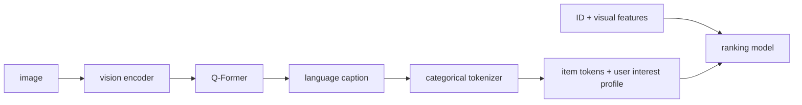
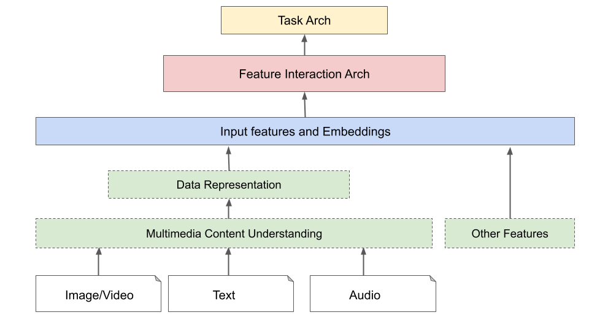

# MM-LLM: multimedia understanding features for industrial recommendation

<!-- source-sha256: cb7e586cb7011d9acaafbf46081713eb9a49741db197be21ca3d834e7a1ad6c0 -->

[简体中文](README.md)

> **Fidelity: core mechanism.** Trains content encoding, query cross-attention, discrete caption tokens, semantic user interests, and ranking fusion with ID and visual features. Private images and BLIP-2/LLaMA2-1.5B scale are not reproduced.

## Paper information

| Field | Details |
|---|---|
| Paper | [arXiv 2605.09338](https://arxiv.org/abs/2605.09338) |
| Organization | Meta |
| First public release | 2026-05-10 (arXiv v1) |
| Authors' code | The paper did not provide official or author code when checked on 2026-08-09. |
| Adapter / method | `mm-llm` |
| Local reproduction code | [`src/auto_research/reproductions/mm_llm/`](https://github.com/daiwk/auto-research/tree/main/src/auto_research/reproductions/mm_llm/) |

## Original paper

### Motivation and method

Visual embeddings struggle to express fine-grained semantics. A visual encoder and Q-Former align LLaMA2 for caption generation, and captions are normalized to categorical token IDs. Item tokens and user-history token profiles join ID and visual features in the production ranker. LLM inference stays off the online critical path.

<!-- paper-figure:start -->
### Key figure from the paper

> **Figure 1:** Core architecture, modules, and connections. From the [original paper](https://arxiv.org/abs/2605.09338); copyright remains with the authors.
<!-- paper-figure:end -->

### Core equations

Caption learning uses $L_{cap}=BCE(\hat a,a)$. Ranking fuses $e_i=e_{id}+e_{visual}+g(e_{id},e_{cap})\odot e_{cap}$, then trains next-item prediction with full-catalog cross-entropy.

### Paper results

MM-LLM token features gain up to 0.16% AUC and 0.07% NE. The abstract reports offline AUC **+0.35%**. Online engagement is **+0.02%**, with roughly neutral training and serving QPS.

## Local reproduction

> **Local comparison:** Against common DIN, NDCG@10 is **-13.23%**. Adding caption tokens to the internal ID+content baseline gains only **+0.03%** and reduces Hit@10. Near parity internally is not superiority over a classic model.

MovieLens content vectors stand in for private images. Lightweight query cross-attention generates four caption tokens. DIN (100 steps) has Hit/NDCG 0.0481/0.02167 and MM-LLM 0.0352/0.01880, or **-13.23%** relative NDCG. The internal caption comparison is only **+0.03%** and Hit drops, so the local run does not establish a meaningful gain. See the [metrics](metrics/movielens-100k-seeds42-44.json).
