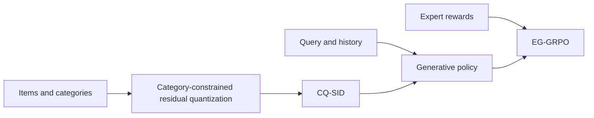
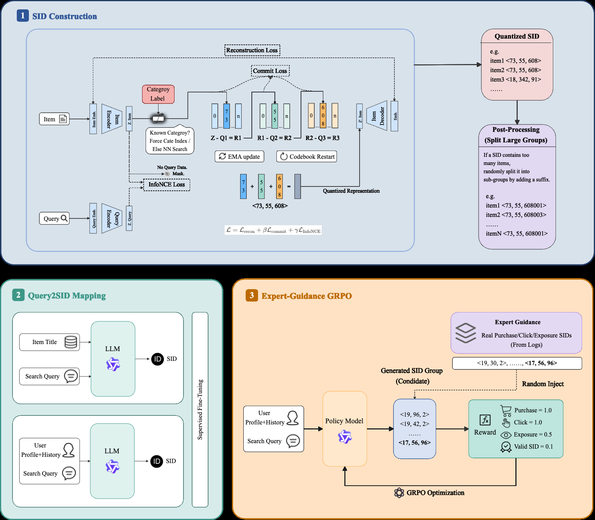

# CQ-SID

<!-- source-sha256: a1cb1e6da0527e5ffd500a02550aa8e95d84870f5162cd8a9180f4b7fb32feee -->

[简体中文](README.md)

> Core mechanism: category-constrained semantic IDs, residual quantization, multi-signal rewards and EG-GRPO updates.

## Paper information

| Field | Details |
|---|---|
| Paper | [arXiv 2605.14434](https://arxiv.org/abs/2605.14434) |
| Institution | Alibaba Taobao & Tmall Group. |
| First public release | 2026-05-14 (arXiv v1) |
| Author code | No official author code linked by the paper as checked on 2026-08-09. |
| Local adapter or method key | `cq-sid` |
| Local reproduction code | [`src/auto_research/reproductions/cq_sid/`](https://github.com/daiwk/auto-research/tree/main/src/auto_research/reproductions/cq_sid/) |

## Paper method and evidence

Constrain the first semantic-ID level by product category and encode within-category variation with residual codes. Expert-guided RL combines clicks, purchases, semantics and constraints for generative retrieval.



<!-- paper-figure:start -->
### Original paper figure

[](https://arxiv.org/html/2605.14434v1/framework.png)

Figure 1 shows category-constrained IDs and expert-guided training. From the [original paper](https://arxiv.org/abs/2605.14434); copyright remains with the authors.
<!-- paper-figure:end -->

### Core equation

$$
s_i=(c_i,q_i^{(1)},q_i^{(2)}),\qquad
A_j=\frac{r_j-\operatorname{mean}(r_{1:G})}{\operatorname{std}(r_{1:G})+\epsilon}.
$$

### Reported results

Two-week TmallAPP Search A/B: GMV **+1.15%**, UCTCVR **+0.40%**. The paper also reports semantic click hit rate **+26.76%**.

## Local reproduction

Against collaborative item-ID retrieval, CQ-SID with 240 group-relative updates gives +1.66% local NDCG@10. [Structured metrics](metrics/movielens-100k-seed42.json).

```bash
auto-research reproduce --paper cq-sid
```

EG-GRPO updates execute, but the 64-GPU curriculum, private Tmall query logs, and production beam service were not reproduced.
