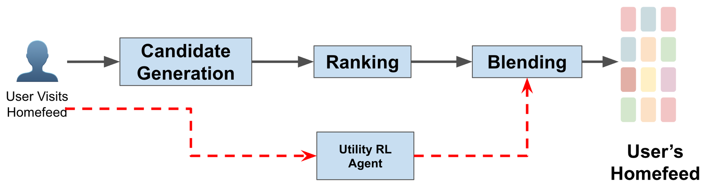

# A Production-Ready RL Framework for Personalized Utility Tuning with Pareto Sweeping in Pinterest Recommender Systems

<!-- source-sha256: 66c54c2b0cfb4be2a7d8a46183d8f3700173366ee91ea6e27404daad8d368a61 -->

[简体中文](README.md)

> Core public-data utility tuning.

## Paper information

| Field | Details |
|---|---|
| Paper | [Paper or original source](https://arxiv.org/abs/2605.16344) |
| Institution | Pinterest. |
| First public release | 2026-05-08 (arXiv v1) |
| Author code | No official author code linked by the paper as checked on 2026-08-24. |
| Local adapter or method key | `prl-puts` |
| Local reproduction code | [`src/auto_research/reproductions/prl_puts/`](https://github.com/daiwk/auto-research/tree/main/src/auto_research/reproductions/prl_puts/) |

## Paper method and evidence

A dual-head Q-network estimates Repin and P2P utility. Pareto sweeping filters nondominated policies offline, so serving swaps governed utility weights without replacing the model.


<!-- paper-figure:start -->
### Original paper figure

[](https://arxiv.org/html/2605.16344v1/content/resources/production_structure.png)

Figure shows dual utility and Pareto policy selection. From the [original paper](https://arxiv.org/abs/2605.16344); copyright remains with the authors.
<!-- paper-figure:end -->

### Core equation

$$
a^*=\arg\max_a[\alpha Q_{repin}(s,a)+(1-\alpha)Q_{p2p}(s,a)]
$$

### Reported results

Section 6.4/Table 1: P2P impressions **+0.30%**, 1% per arm for two weeks.

## Local reproduction

Matched MovieLens-100K, 220 users/360 items, full catalog, seed 42: shared transition+content baseline versus PRL-PUTS. NDCG@10 **0.0540→0.0754 (+39.64%)**, Hit@10 **0.1091→0.1318**. Validation chooses blend; no test tuning. [Fixed metrics](metrics/public-seed42.json). No private logs, traffic, checkpoints or production serving; local results do not reproduce paper lift.

```bash
auto-research reproduce --paper prl-puts --dataset-dir data --seed 42
```
