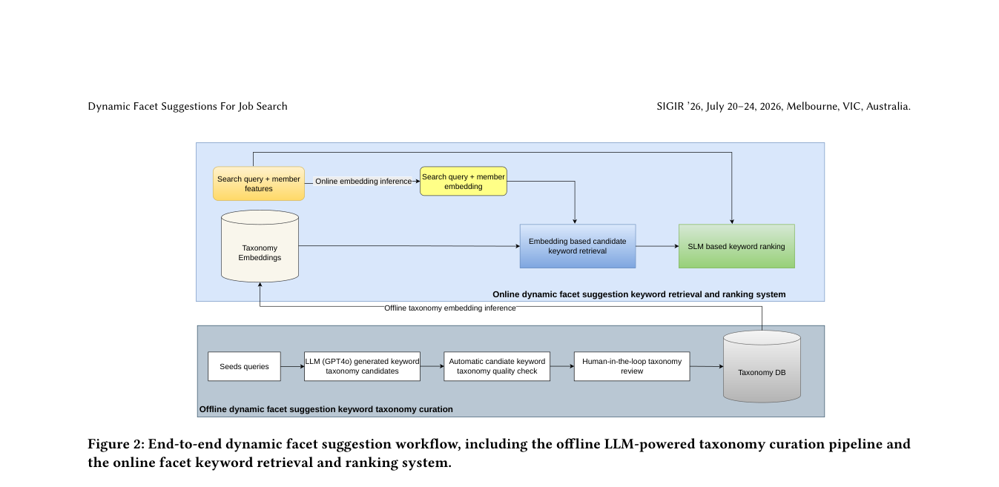

# Policy-Constrained Dynamic Facet Recommendation for Job Search

<!-- source-sha256: d8fdae73f2656404b054283d905d9b68b4d797ede07e1d8615ee137d964bf0de -->

[简体中文](README.md)

> Core public-data facet mechanism.

## Paper information

| Field | Details |
|---|---|
| Paper | [Paper or original source](https://arxiv.org/abs/2605.16479) |
| Institution | LinkedIn. |
| First public release | 2026-05-15 (arXiv v1) |
| Author code | No public author code found as of 2026-09-02. |
| Local adapter or method key | `policy-facet` |
| Local reproduction code | [`src/auto_research/reproductions/policy_facet/`](https://github.com/daiwk/auto-research/tree/main/src/auto_research/reproductions/policy_facet/) |

## Paper method and evidence

Humans and LLMs maintain a policy-compliant facet taxonomy. An embedding SLM retrieves facets, and a generative SLM scores them pointwise with one token. Prefix caching and batching serve the latency target.


<!-- paper-figure:start -->
### Original paper figure

[](https://arxiv.org/pdf/2605.16479#page=3)

Figure shows taxonomy, retrieval and scoring. From the [original paper](https://arxiv.org/abs/2605.16479); copyright remains with the authors.
<!-- paper-figure:end -->

### Core equation

$$
\mathcal C_K=\operatorname{TopK}_{c\in\mathcal T}\cos(e_{u,q},e_c),\qquad s_c=\log p_\theta(\mathrm{Okay}\mid u,q,c).
$$

### Reported results

LinkedIn Job Search A/B: facet CTR +34.8%, applications per impression +2.6%, successful search sessions +1.6%.

## Local reproduction

MovieLens-1M full catalog: NDCG@10 **0.05401→0.04713 (-12.73%)**. [Three-seed metrics, mean, SD, and 95% CI](metrics/public-seeds42-44.json). No private logs, production models, bucketing or serving. Public proxies cannot establish online lift.

```bash
auto-research reproduce --paper policy-facet --dataset-dir data --seeds 42,43,44
```
