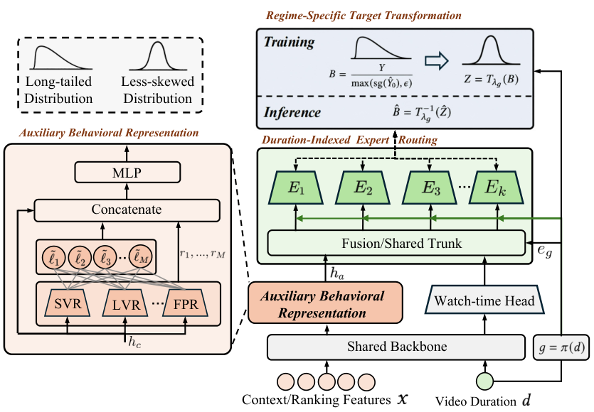

# DADF: A Distribution-Aware Debiasing Framework for Watch-Time Regression in Recommender Systems

<!-- source-sha256: bdcbb5ce200437d0ac81765fba61a9f9bec5fda70ae901ef4ab9872e993fe910 -->

[简体中文](README.md)

> Core public-data debiasing mechanism.

## Paper information

| Field | Details |
|---|---|
| Paper | [Paper or original source](https://arxiv.org/abs/2605.17863) |
| Institution | Kuaishou Technology. |
| First public release | 2026-05-18 (arXiv v1) |
| Author code | [liuzhao09/DADF](https://github.com/liuzhao09/DADF). |
| Local adapter or method key | `dadf` |
| Local reproduction code | [`src/auto_research/reproductions/dadf/`](https://github.com/daiwk/auto-research/tree/main/src/auto_research/reproductions/dadf/) |

## Paper method and evidence

Freeze a mature first-stage watch-time predictor. Learn a distribution-conditioned multiplicative residual without changing the scalar serving interface.


<!-- paper-figure:start -->
### Original paper figure

[](https://arxiv.org/html/2605.17863v3/03_framework.png)

The original figure shows the conditional residual stage. From the [original paper](https://arxiv.org/abs/2605.17863); copyright remains with the authors.
<!-- paper-figure:end -->

### Core equation

$$
\hat y=\hat y_0\,b_\phi(x,\hat y_0),\quad b^*=y/\max(\hat y_0,\epsilon)
$$

### Reported results

Seven-day production A/B then full rollout: average time per device +0.65%. Not comparable to MovieLens.

## Local reproduction

Matched MovieLens-100K 220 users/360 items, full catalog, seed 42: shared transition+content baseline and DADF both NDCG@10 **0.0540 (+0.00%)** and Hit@10 **0.1091**. Blend chosen on validation only. [Fixed metrics](metrics/public-seed42.json). No private logs, production models, live traffic, or serving; public-data measures do not establish online lift.

```bash
auto-research reproduce --paper dadf --dataset-dir data --seed 42
```
