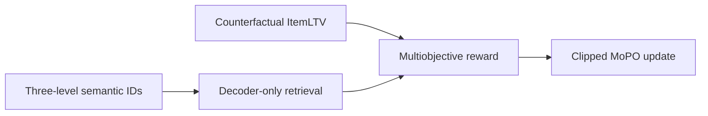
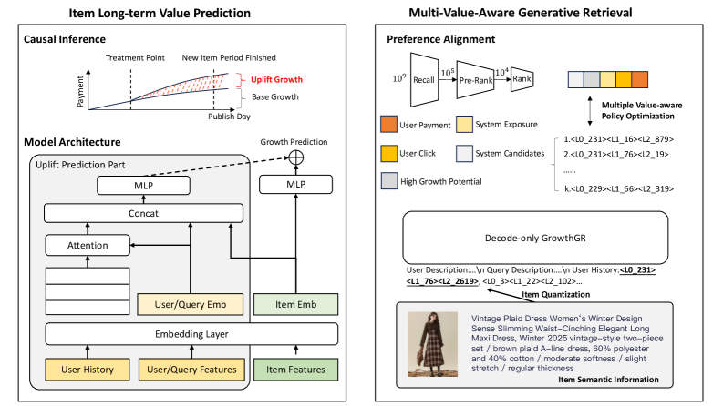

# GrowthGR: Generative retrieval for long-term value of new products

<!-- source-sha256: a5675b9cfec794dea99b6efad379ee2a50b4b826ddb2080287d521236f98249d -->

[简体中文](README.md)

> ItemLTV, three-level SIDs, next-token prediction, clipped MoPO/GRPO, and valid-SID constraints execute locally.

## Paper information

| Field | Details |
|---|---|
| Paper | [arXiv 2605.17994](https://arxiv.org/abs/2605.17994) |
| Institution | Alibaba Group / Taobao & Tmall. |
| First public release | 2026-05-18 (arXiv v1) |
| Author code | No official author code linked by the paper as checked on 2026-08-09. |
| Local adapter or method key | `growthgr` |
| Local reproduction code | [`src/auto_research/reproductions/growthgr/`](https://github.com/daiwk/auto-research/tree/main/src/auto_research/reproductions/growthgr/) |

## Paper method and evidence

Optimizing immediate sales can starve new items of exposure. Counterfactual ItemLTV estimates incremental long-term orders from clicks. An RQ-VAE SID and decoder-only generator retrieve items. MoPO combines purchase, click, exposure, ranking, and uplift labels with clipped inverse propensity for rare valuable items.



<!-- paper-figure:start -->
### Original paper figure

[](https://arxiv.org/html/2605.17994v1/x2.png)

The original figure shows long-term value and generative retrieval. From the [original paper](https://arxiv.org/abs/2605.17994); copyright remains with the authors.
<!-- paper-figure:end -->

### Core equation

$$
\hat y=G_{base}(X)+W\,G_{uplift}(X),\qquad r_i=\operatorname{Clip}(-\log\pi_{old}(o_i|x),1,M)\sum_kw_ks_k.
$$

$$
\mathcal J^{CLIP}=\min(\rho A,\operatorname{clip}(\rho,1-\epsilon,1+\epsilon)A).
$$

### Reported results

Taobao/Tmall reports new-product GMV **+5.3%** and sitewide search GMV **+0.3%** online.

## Local reproduction

```bash
auto-research reproduce --paper growthgr --seed 42
```

On the same transition policy, add ItemLTV and eight MoPO rounds to NTP retrieval. Local Hit@10 **+0.00%**, NDCG@10 **+2.05%**, head share down **3.06%**; validation selects blend `0.1`. [Metrics](metrics/movielens-100k-seed42.json). Future positive-frequency proxies seven-day orders; no actual search funnel or multimodal product embeddings.
