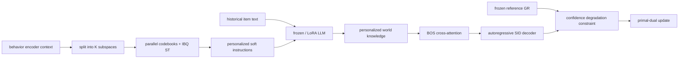
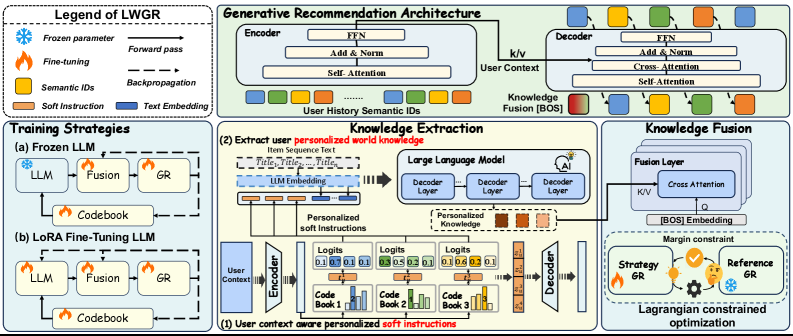

# LWGR: Personalized world knowledge for generative recommendation with Lagrangian constraints

<!-- source-sha256: cebdaa48c2d30fe490d2e82e88a488bebbc6d24e6b76d5754eee76c749f6c3ca -->

[简体中文](README.md)

> **Fidelity: Full core pipeline.** The local run executes parallel codebooks, straight-through IBQ, personalized soft instructions through a frozen causal LLM, BOS cross-attention, a frozen generative reference, and stepwise primal–dual updates. Static text embeddings do not replace the personalized LLM forward pass.

## Paper information

| Field | Value |
| --- | --- |
| Paper link | [arXiv 2605.18771](https://arxiv.org/abs/2605.18771) |
| Organization | Alibaba International / CAS |
| First published | 2026-04-16 (arXiv v1) |
| Original author code | No official or author code was provided in the paper (checked 2026-08-09). |
| Adapter | `lwgr` |
| Local reproduction code | [`src/auto_research/reproductions/lwgr/`](https://github.com/daiwk/auto-research/tree/main/src/auto_research/reproductions/lwgr/) |

## Original paper summary

### Background and main changes

LLM knowledge extracted with a fixed manual prompt cannot express varying user interests and may conflict with behavior. LWGR partitions user context into subspaces and selects a codeword from a separate codebook per subspace, producing end-to-end learned soft instructions. The LLM consumes those tokens with historical item text to generate user-level world knowledge. The generative recommendation decoder cross-attends to that knowledge at BOS and limits harmful fusion by constraining confidence degradation relative to a frozen reference.

Production precomputes the LLM world knowledge on a seconds-to-minutes nearline schedule and stores it in a user vector store. Requests need one lookup and one cross-attention layer.



<!-- paper-figure:start -->
### Key figure from the paper

[](https://arxiv.org/html/2605.18771v1/x3.png)

**Original Figure 3 (architecture):** Core modules and their connections. Image from the [original paper](https://arxiv.org/abs/2605.18771); copyright belongs to the authors. Click the image for its source.
<!-- paper-figure:end -->

### Core equations

For subspace $k$, the codeword soft distribution and straight-through index are:

$$
p_j^k=\frac{\exp(\operatorname{sim}(u^k,C_k[j])/\tau)}{\sum_l\exp(\operatorname{sim}(u^k,C_k[l])/\tau)},
$$

$$
e^k=e_{hard}^k-\operatorname{sg}[p^k]+p^k,\quad t_u^k=W_L^k(e^k)^TC_k.
$$

The LLM output $H_u$ is fused at decoder BOS:

$$
\tilde q_0=\operatorname{CrossAttn}(q_0,H_u).
$$

Degradation in average token log-probability relative to the frozen reference is:

$$
C=\mathbb E\left[\max(0,s_{ref}(u,i^+)-s_\theta(u,i^+)-\delta)\right].
$$

The optimization objective and dual update are:

$$
\min_\theta\max_{\lambda\ge0}\ \mathcal L_{rec}+\lambda(C-\epsilon),
$$

$$
\lambda\leftarrow\max(0,\lambda+\eta_\lambda(C-\epsilon)).
$$

### Offline and online results in the paper

| Beauty model | Recall@5 | NDCG@5 | Recall@10 | NDCG@10 |
|---|---:|---:|---:|---:|
| TIGER | 0.0534 | 0.0341 | 0.0912 | 0.0630 |
| strongest prompt baseline | 0.0543 | 0.0347 | 0.0931 | 0.0642 |
| LWGR | **0.0595** | **0.0376** | **0.1026** | **0.0701** |

The largest relative lift across three datasets is `11.23%`. From 2025-12-19 to 12-30, the Southeast Asian ads platform allocated 15% of users each to control and treatment. Revenue rose `+1.35%`, GMV `+0.83%`, and CTR `+1.17%`, all p<0.05. Latency changed from 13.35ms to 13.55ms.

## Local reproduction

> **Control:** The frozen `reference` uses the same Office SID, 48-dimensional GR backbone, and seeds 42/43/44. `lwgr` initializes from that checkpoint and adds the real LLM soft instructions, cross-attention, and primal–dual training. Validation still selects the reference. Both get test Recall@10 of 0.04861 (**0.00%** change); LWGR changes NDCG@10 from 0.01853 to 0.01774 (**-4.29%**). This is the paper's reference-constraint control, not DIN or online A/B.

The run uses 12,000 training examples, 48 validation and 48 test users, and all 3,459 catalog items. The reference trains for 180 steps; each knowledge variant trains for 100.

| Local variant | Recall@5 | NDCG@5 | Recall@10 | NDCG@10 |
|---|---:|---:|---:|---:|
| reference (validation selection) | **0.02778** | **0.01184** | 0.04861 | **0.01853** |
| unconstrained fusion | 0.02083 | 0.00945 | 0.04861 | 0.01881 |
| LWGR primal-dual | 0.02083 | 0.00867 | 0.04861 | 0.01774 |

The constrained run's Lagrange multiplier rises from 0.05 to about 0.0534, confirming the dual update. Its mean confidence degradation constraint is about 0.0674, no lower than the unconstrained run's roughly 0.0659. This verifies the implementation and gradient path, not constraint effectiveness or the paper's accuracy gains.

```bash
AUTO_RESEARCH_LWGR_REFERENCE_STEPS=180 \
AUTO_RESEARCH_LWGR_POLICY_STEPS=100 \
AUTO_RESEARCH_LWGR_EVAL_USERS=48 \
AUTO_RESEARCH_LWGR_SEEDS=3 \
auto-research reproduce --paper lwgr --seed 42
```

Stable metrics: [metrics/office-seeds42-44.json](metrics/office-seeds42-44.json). Checkpoints and raw runs are not committed.

## Reproduction limits

- A real SmolLM2-135M forward pass allows soft-instruction gradients through the frozen LLM to the codebook. No precomputed constants stand in for this step.
- Qwen3-4B, full Beauty/Toys, and 2.95 billion industrial interactions are scaled down to the local Office budget. Model size can change usable knowledge.
- The paper's $\delta=\epsilon=10^{-4}$, $\lambda_0=0.05$, and dual LR `5e-4` are retained.
- No production nearline repository is implemented. Local serving state can be cached after the LLM forward pass; this does not establish millisecond production latency.
