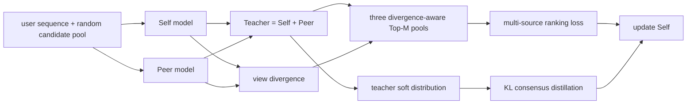
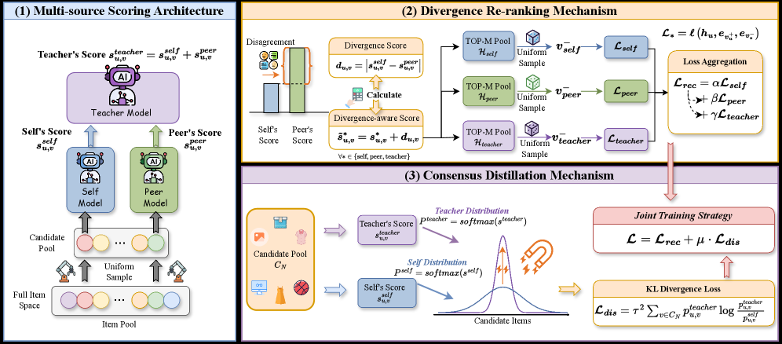

# MDCNS: Divergence Meets Consensus

<!-- source-sha256: a6f5ac3952c80bab7dc3194842f94fd470b1c7b226856ddf16c5df9785cec4e7 -->

[简体中文](README.md)

> **Fidelity: Core mechanism.** The local run executes three-source negative sampling, two-model disagreement and consensus selection, and parameter updates. The recommender backbone is scaled down for local training.

## Paper information

| Field | Value |
| --- | --- |
| Paper link | [arXiv 2605.19651](https://arxiv.org/abs/2605.19651) |
| Organization | Paper author team (no company listed) |
| First published | 2026-05-19 (arXiv v1) |
| Original author code | Yes: [official author code](https://github.com/Lyz103/SIGIR26-MDCNS). |
| Adapter | `mdcns` |
| Local reproduction code | [`src/auto_research/reproductions/mdcns/`](https://github.com/daiwk/auto-research/tree/main/src/auto_research/reproductions/mdcns/) |

## Original paper summary

### Background and main changes

Random negatives are often too easy. Dynamic negative sampling (DNS) from one model's highest scores can introduce false negatives, low diversity, and model bias. Inspired by the zone of proximal development, MDCNS uses three views: Self, a heterogeneous Peer, and a Teacher that sums their scores. Disagreement favors informative hard negatives. The Teacher's distribution over the entire pool is distilled back to Self, using more information than a single selected negative.

<!-- paper-figure:start -->
### Key figure from the paper

**Original Figure 2 (architecture):** Main modules and their connections. Image from the [original paper](https://arxiv.org/abs/2605.19651); copyright belongs to the authors. Click the image for its source.
<!-- paper-figure:end -->

### Core equations

Sample candidates uniformly from items with no interaction. Self/Peer scores and disagreement are:

$$
s_{u,v}^{self}=h_u^{self}\cdot e_v,\quad s_{u,v}^{peer}=h_u^{peer}\cdot e_v,
$$

$$
s_{u,v}^{teacher}=s_{u,v}^{self}+s_{u,v}^{peer},\quad d_{u,v}=|s_{u,v}^{self}-s_{u,v}^{peer}|.
$$

Each view reranks by $\widetilde s_{u,v}^{*}=s_{u,v}^{*}+d_{u,v}$ and samples one negative uniformly from the top M. The joint objective is:

$$
\mathcal L_{rec}=\alpha\mathcal L_{self}+\beta\mathcal L_{peer}+\gamma\mathcal L_{teacher},
$$

$$
p_{u,v}^{*}=\operatorname{softmax}(s_{u,v}^{*}/\tau),\quad
\mathcal L=\mathcal L_{rec}+\mu\tau^2 KL(p^{teacher}\Vert p^{self}).
$$

### Offline and online results in the paper

The paper uses Beauty, Toys, Sports, Health, LastFM, and KuaiRand with a 70/20/10 split, reporting Recall and NDCG@5/10/20. Examples from the main table:

| Dataset | Best baseline NDCG@10 | MDCNS | Relative lift |
|---|---:|---:|---:|
| Beauty | 0.0497 | 0.0685 | +37.83% |
| Toys | 0.0586 | 0.0765 | +30.55% |
| Sports | 0.0269 | 0.0340 | +26.39% |
| Health | 0.0393 | 0.0516 | +31.29% |

These are public offline experiments, with no online A/B.

## Local reproduction

> **Control:** Uniform negative sampling is the main baseline and DNS is secondary. MDCNS improves NDCG@10 from 0.003016 to 0.006175 (**+104.75%**) over Uniform. This is a sampling-strategy ablation, not a DIN comparison.

Instead of the MovieLens proxy, the run downloads the authors' Beauty split: 123,086/4,472/2,237 train/validation/test sequences and 12,101 items. A lightweight dual-embedding backbone implements three-source sampling, disagreement reranking, and KL distillation. To cap Mac runtime, use 50,000 training examples, 4 epochs, 30 candidates, and Top-M=5.

| Sampler | Hit@10 | NDCG@10 |
|---|---:|---:|
| Uniform | 0.003576 | 0.003016 |
| DNS | 0.003576 | 0.002507 |
| MDCNS | **0.008046** | **0.006175** |

MDCNS improves NDCG@10 **+104.75%** over Uniform. Absolute results remain below the paper, with a lightweight first-order Markov backbone and a training-sample cap, not SASRec/Mamba4Rec. This supports only the core sampling path on the same public source data. See [metrics/amazon-beauty-seed42.json](metrics/amazon-beauty-seed42.json).
