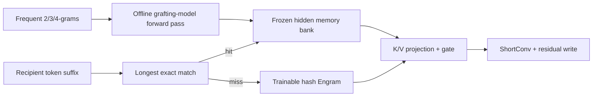
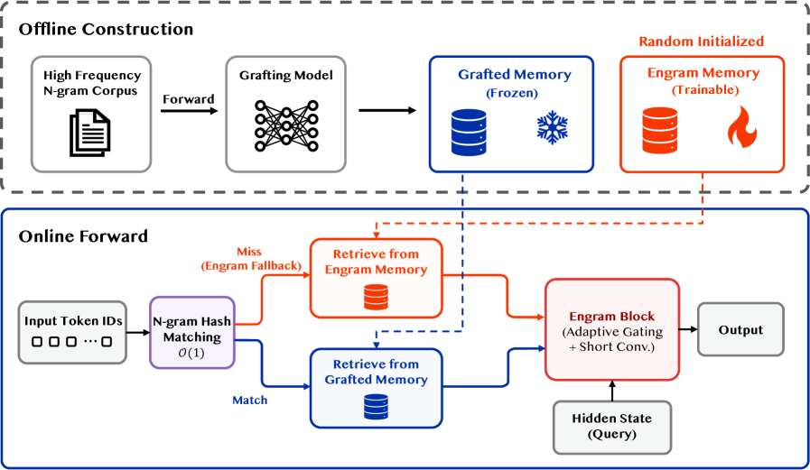

<!-- source-sha256: c1e61bd811bfd506846b127614efb359ddba7a1dcfe7c6213c7e05957322c851 -->

[简体中文](README.md) · English

# Memory Grafting: Offline conditional memory expands LLM capacity

> **Fidelity: core-mechanism reproduction.** Trains a grafting model and recipient, then runs a frozen n-gram hidden bank, longest exact match, Engram fallback, query-key gating, short convolution, and a residual write.

## Paper information

| Field | Details |
| --- | --- |
| Paper | [arXiv 2605.20948](https://arxiv.org/abs/2605.20948) |
| Institution | Tsinghua University / Microsoft Research Asia |
| First public release | 2026-05-20 (arXiv v1) |
| Author code | No official or author-released code found in the paper (checked 2026-08-09). |
| Local adapter or method key | `memory-grafting` |
| Local reproduction code | [`src/auto_research/reproductions/memory_grafting/`](https://github.com/daiwk/auto-research/tree/main/src/auto_research/reproductions/memory_grafting/) |

## Original paper summary

### Background and main changes

Engram's high-capacity conditional memory must be trained from scratch with the main model. Memory Grafting counts frequent 2/3/4-grams, uses a pretrained grafting model offline to encode each phrase's last-token intermediate state, and freezes the result. The recipient performs longest exact suffix lookup in expected $O(1)$ time. Misses fall back to trainable hash Engram; hits use separate projection, context gating, and short convolution before being written to the residual stream.



<!-- paper-figure:start -->
### Key figure from the paper

[](https://arxiv.org/html/2605.20948v1/x1.png)

> **Figure 1:** The overall workflow, stages, and data flow in the paper. From the [paper](https://arxiv.org/abs/2605.20948); copyright belongs to the authors. Click for the source.
<!-- paper-figure:end -->

### Core equations

$$
W_{\mathrm{mem}}[i]=F_G(\mathrm{text}(m_i))_{\mathrm{last}}^{(r)},
$$

$$
\alpha=\sigma\!\left(\frac{\langle\operatorname{RMSNorm}(K),\operatorname{RMSNorm}(H)\rangle}{\sqrt D}\right),\qquad
\widetilde H=H+\alpha V+\operatorname{ShortConv}(\alpha V).
$$

### Offline and online results

On nine benchmarks at 2.8B, average scores are MoE `51.95`, vanilla Engram `52.43`, and Memory Grafting `53.86`. Several grafting models also beat the baseline at 0.92B. A 3M-entry bank reaches `0.92×/0.95×` MoE training/inference throughput. This standalone LLM pretraining paper has no online A/B; the project uses public benchmarks and matched-budget training comparisons to screen it.

## Local reproduction

> **Local comparison:** The baseline is a standard Transformer with the same architecture. Memory Grafting reduces validation PPL `470.121 → 453.257`, a relative **`3.59%`** reduction. Against matched-parameter Engram, `453.117 → 453.257` is **`-0.03%`** relative improvement, so it does not beat Engram.

WikiText-2 uses 180k training and 24k validation tokens, BPE-1024, hidden size 64, and 45 recipient steps. The teacher trains for 30 additional steps. The 192 frozen n-grams have `8.33%` validation exact hit rate. The full grafting path works and beats no memory, but the bank is small and shows no gain over Engram. See [`metrics/wikitext2-seed42.json`](metrics/wikitext2-seed42.json).

```bash
pip install -e '.[llm-evolution]'
auto-research reproduce --paper memory-grafting --seed 42 --device auto
```

## Scope

A 64-dimensional dense recipient, tiny teacher, and 192-entry bank replace the paper's 0.92B/2.8B MoE, Qwen3.5/DeepSeek grafting model, 50B/100B tokens, and 3M-entry bank. Local PPL does not stand in for paper benchmark scores.
