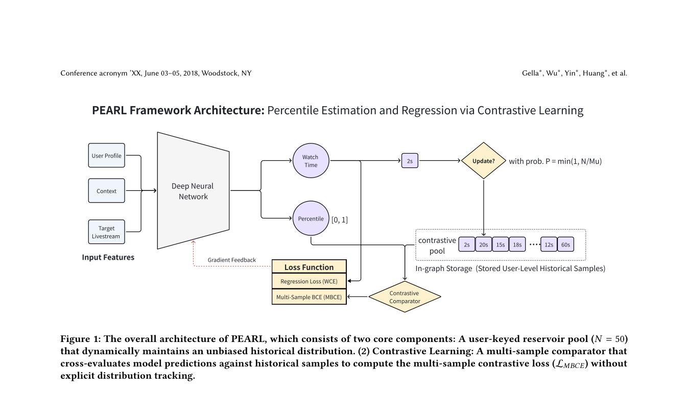

# PEARL: Unbiased Percentile Estimation via Contrastive Learning for Industrial-Scale Livestream Recommendation

<!-- source-sha256: 44eeaf4cd6d7cb175941e9efa051abc0939d3b14c4c2ad7be6fd2ffadac040ae -->

[简体中文](README.md)

> **Fidelity: core mechanism.** Paper results, local public-data measurements, and omissions are separate.

## Paper information

| Field | Details |
|---|---|
| Paper | [arXiv 2605.21752](https://arxiv.org/abs/2605.21752) |
| Organization | TikTok |
| First public release | 2026-05-20 (arXiv v1) |
| Authors' code | The paper did not provide official or author code when checked on 2026-08-24. |
| Adapter / method | `pearl-percentile` |
| Local reproduction code | [`src/auto_research/reproductions/pearl_percentile/`](https://github.com/daiwk/auto-research/tree/main/src/auto_research/reproductions/pearl_percentile/) |

## Original paper

### Motivation and method

Estimate behavior percentiles from multiple comparisons rather than one biased label. Value weighting, bootstrapping, and long-term co-training extend the method to multiple ranking objectives.


<!-- paper-figure:start -->
### Key figure from the paper

[](https://arxiv.org/pdf/2605.21752#page=4)

> **Figure 1:** Core architecture, modules, and connections. From the [original paper](https://arxiv.org/abs/2605.21752); copyright remains with the authors.
<!-- paper-figure:end -->

### Core equations

$$
\hat p_i=\frac1N\sum_{j=1}^{N}\mathbf1[y_i>y_j],\quad Var(\hat p)=p(1-p)/N
$$

### Paper results

The main online result is **Watch Duration +2.10%** in a week-long A/B test. Offline tables and online metrics use private or paper-specific protocols. The private paper protocol is not directly comparable with local MovieLens measurements.

## Local reproduction

> **Local comparison:** The baseline is the shared transition + content scorer. The treatment adds only pearl-percentile on the same users, items, full-catalog candidates, and seed.

MovieLens-100K, 220 users and 360 items, seed 42: NDCG@10 0.0540 → **0.0483 (-10.65%)**; Hit@10 0.1091 → 0.1000. Validation selects mixture weights only; the test set is not used for tuning.

```bash
auto-research reproduce --paper pearl-percentile --dataset-dir data --seed 42
```

See the [fixed metrics](metrics/public-seed42.json).

## Reproduction boundaries

The core mechanism runs on MovieLens-100K with the same split, fixed full-catalog candidates, and seed. Private features, the production foundation model, and online traffic are unavailable. The implementation has independent model state and scoring, rather than mapping a paper name to a shared weighted formula. Omitted parts are in the adapter's `omitted_core_components`. Local changes and paper A/B gains are reported separately.
