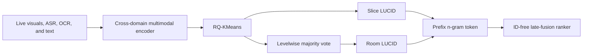
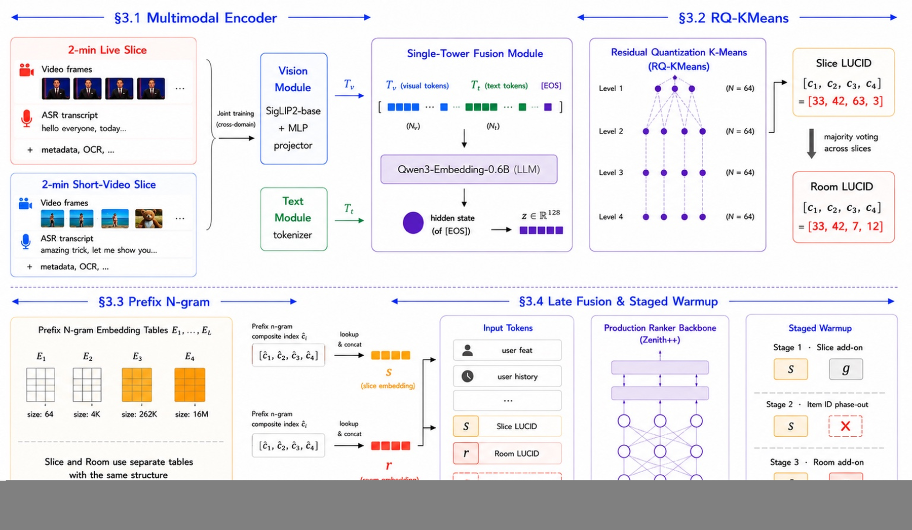

# FLUID: Replacing ephemeral livestream room IDs with multimodal semantic codes

<!-- source-sha256: 53a96f6710072403d66ff694cbb50dd4942f1cebeaa062344adc898ba7235dc3 -->

[简体中文](README.md)

> **Fidelity: Core mechanism.** The run executes cross-domain content fusion, slice- and room-level LUCID, RQ-KMeans, prefix n-grams, ID-free late fusion, and three-stage warmup. Public data stands in for live multimodal traffic.

## Paper information

| Field | Value |
| --- | --- |
| Paper link | [arXiv 2605.21832](https://arxiv.org/abs/2605.21832) |
| Organization | TikTok / ByteDance |
| First published | 2026-05-20 (arXiv v1) |
| Original author code | No official or author code was provided in the paper (checked 2026-08-09). |
| Adapter | `fluid` |
| Local reproduction code | [`src/auto_research/reproductions/fluid/`](https://github.com/daiwk/auto-research/tree/main/src/auto_research/reproductions/fluid/) |

## Original paper summary

### Background and main changes

Livestream rooms often last only tens of minutes, too short for candidate item IDs to accumulate collaborative signals. FLUID encodes short videos and two-minute live slices across domains with SigLIP2 and Qwen3-Embedding, then uses four-level RQ-KMeans for LUCID. Slice LUCID represents current content; room LUCID is a level-by-level majority vote over past slices. The two are separate late-fusion tokens. Candidate IDs are removed through three stages: add slice, remove ID, add room.



<!-- paper-figure:start -->
### Key figure from the paper

[](https://arxiv.org/html/2605.21832v2/figs/FLUID_Figure1_8x_real1.jpg)

**Original Figure 2 (overview):** The overall design and key components. Image from the [original paper](https://arxiv.org/abs/2605.21832); copyright belongs to the authors. Click the image for its source.
<!-- paper-figure:end -->

### Core equations

Use a complete prefix index at level $l$, not an isolated codeword:

$$
\bar c_l=\sum_{k=1}^{l}c_kN^{l-k},\qquad
e_{\mathrm{LUCID}}=E_1(\bar c_1)\Vert\cdots\Vert E_L(\bar c_L).
$$

The final candidate tokens exclude item ID $g$:

$$
\mathcal T_{\mathrm{FLUID}}=\{r,s\},\qquad g\notin\mathcal T_{\mathrm{FLUID}}.
$$

### Offline and online results in the paper

Deployment in a livestream recommender serving more than one billion users globally reports Quality Watch Duration `+0.55%`, Cold-Start Room Views `+2.05%`, and Active Hours `+0.05%`. The paper also analyzes diversity, retention, and matching quality after ID removal. These production metrics are not directly convertible to MovieLens results.

## Local reproduction

> **Control:** ID ranker with item-transition and popularity signals versus a ranker using content and slice/room prefix behavior tables. Hit@10 changes `-29.17%`, NDCG@10 **`-20.63%`**, and fresh Hit@10 **`+100.00%`**.

MovieLens-100K uses 220 users, 360 items, and full-catalog ranking. Four perturbed content views proxy live slices; genres and collaborative content projections proxy the multimodal encoder. Three-stage validation NDCG is `0.06007 → 0.03850 → 0.03725`. Removing IDs lowers head share, but public content does not replace memorized ID signals. See [metrics/movielens-100k-seed42.json](metrics/movielens-100k-seed42.json).

```bash
auto-research reproduce --paper fluid --seed 42
```

## Reproduction limits

No SigLIP2, Qwen3-Embedding-0.6B, live ASR/OCR, real two-minute slicing, or production incremental training. The run shows that LUCID, ID removal, and staged migration work locally, not that live gains are reproduced.
