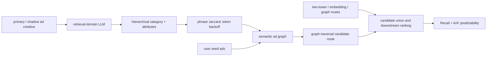
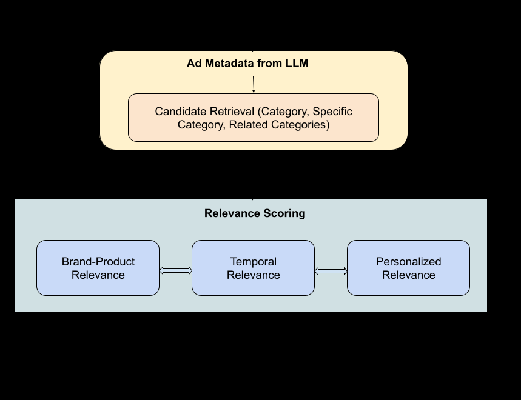

<!-- source-sha256: eb25652cba8763e34f620c39e0ca59a4695624e1dd1cb18ee27906b36c6f1f45 -->

[简体中文](README.md) · English

# LLM Retrieval: Stable, predictable semantic ad retrieval

> **Fidelity: core-mechanism reproduction.** Runs domain SFT on paired creatives, an LLM hidden-state attribute head, hierarchical discrete semantics, phrase-to-token Jaccard graph construction, collaborative graph fusion, validation-based weighting, and perturbation stability evaluation. It does not reproduce Meta's private ad corpus, Llama-3-8B, distributed inference, online conversion, or shadow-ad traffic system.

## Paper information

| Field | Details |
| --- | --- |
| Paper | [arXiv 2605.21969](https://arxiv.org/abs/2605.21969) |
| Institution | Meta |
| First public release | 2026-05-21 (arXiv v1) |
| Author code | No official or author-released code found in the paper (checked 2026-08-09). |
| Local adapter or method key | `llm-ad-retrieval` |
| Local reproduction code | [`src/auto_research/reproductions/llm_ad_retrieval/`](https://github.com/daiwk/auto-research/tree/main/src/auto_research/reproductions/llm_ad_retrieval/) |

## Original paper summary

### Background and main changes

Ad candidate generation usually optimizes click and conversion predictions and Recall. Small creative edits can nonetheless change IDs or sparse features and yield very different delivery. The paper adds an A/A' predictability protocol: clone each primary ad into a shadow ad, apply meaning-preserving input perturbations, and compare conversions and impressions. A retrieval-domain LLM extracts hierarchical category, brand, product, and context attributes from titles, descriptions, and other creative fields. Category-based retrieval is followed by deeper attribute reranking and ad-to-ad semantic graph construction, then graph expansion from user seed ads.



<!-- paper-figure:start -->
### Key figure from the paper

[](https://arxiv.org/html/2605.21969v1/images/ad_to_ad_pipeline_2.png)

> **Figure 1:** Overall design and components. From the [paper](https://arxiv.org/abs/2605.21969); copyright belongs to the authors. Click for the source.
<!-- paper-figure:end -->

### Core equations

For the relative conversion difference $\Delta$ between primary and shadow ads, the paper defines the significant difference outside a 90% confidence interval:

$$
StatSigDiff(ad^p,ad^s)=\max\left(0,\Delta-1.65\sqrt{\frac{2}{conv(ad^p)+conv(ad^s)}}\right).
$$

The system metric weights by the square root of ad revenue:

$$
StatSigDiff=\frac{\sum_i StatSigDiff(ad_i^p,ad_i^s)\sqrt{rev(ad_i^p)+rev(ad_i^s)}}{\sum_i\sqrt{rev(ad_i^p)+rev(ad_i^s)}}.
$$

The semantic graph compares phrase sets first and backs off to token sets below the threshold:

$$
S_R(Ad_1,Ad_2)=\begin{cases}J(P_1,P_2),&J(P_1,P_2)\ge\theta\\J(T_1,T_2),&\text{otherwise}\end{cases}.
$$

Shared categories with confidence scores can also be aggregated by dot product:

$$
S_R(Ad_1,Ad_2)=\sum_{c\in C_1\cap C_2}s_{1,c}s_{2,c}.
$$

### Offline and online results

The paper uses open Llama-3-8B-Instruct to run inference on tens of millions of text-only ads. The control is the production ensemble of two-tower, embedding, and graph candidate generators; the experimental arm adds only the LLM semantic route, leaving the rest of delivery unchanged.

| Metric | Paper result |
|---|---:|
| Online top-line performance | **+0.45%**, statistically significant |
| Final-stage recall | **+1.2%** |
| A/A' StatSigDiff | **-8.62%** |
| Daily impression-difference MAD | **+45% improvement** |
| Incremental recall potential, Top-200 vs Top-5 | 1.89× vs 1.00× |

## Local reproduction

> **Local comparison:** The baseline is the Collaborative Item Graph. The experimental arm adds the LLM Semantic Graph under a fixed candidate budget: Recall@20 **+11.90%**, NDCG@20 **+3.03%**, and edge-score drift **-77.36%**. This is an incremental retrieval-route ablation, not a ranking comparison with DIN.

MovieLens-100K title/genre acts as public creative. Chronological ratings ≥4 supply seeds and held-out relevant items. The run uses the 180 most frequently interacted items and 150 users, holding out each user's last two items for validation and test, respectively. Perturbing only punctuation and phrasing of title years produces meaning-preserving shadow creatives.

SmolLM2-135M-Instruct runs 80 domain-SFT steps on primary/shadow pairs for the first 80% of items, using the same taxonomy target within each pair. A multilabel attribute head trains for 160 steps on LLM hidden states. The collaborative graph is a public proxy for the production ensemble. The LLM graph weight is selected on validation only from $\{0,0.25,0.5,1,2\}$. Test uses fixed candidate budget K=20.

```bash
for seed in 42 43 44; do
  AUTO_RESEARCH_LLM_AD_USERS=150 \
  AUTO_RESEARCH_LLM_AD_ITEMS=180 \
  AUTO_RESEARCH_LLM_AD_K=20 \
  AUTO_RESEARCH_LLM_AD_TUNING_STEPS=80 \
  auto-research reproduce --paper llm-ad-retrieval --seed "$seed"
done
```

| Route | Recall@20 | NDCG@20 |
|---|---:|---:|
| Collaborative item graph | 0.2800 | 0.11438 |
| + LLM semantic graph | **0.3133** | **0.11785** |
| Relative change | **+11.90%** | **+3.03%** |

| Stability proxy | Lexical graph | LLM semantic graph |
|---|---:|---:|
| Primary/shadow neighbor Jaccard@20 ↑ | 0.5464 | **0.7419** |
| Mean edge-score difference ↓ | 0.04282 | **0.00970** |

Tie-breaking seeds 42/43/44 give identical results because there are no actual score ties; `±0` is not presented as stochastic training variance. SFT loss decreases from 0.46820 to 0.000365, attribute-head loss from 0.66460 to 0.01467, and primary/shadow attribute sets match exactly 93.89% of the time. The semantic graph cuts edge-score drift **77.36%** and improves recall under a fixed budget, supporting both core directions of the paper.

Local results are not an online ad A/B test. MovieLens genres are more structured than free-form ad text, lack conversion/revenue, and cannot measure revenue-weighted StatSigDiff. SmolLM2 and the lightweight attribute head do not represent Llama-3-8B or Meta's tens-of-millions scale. Checkpoints, attribute caches, and raw runs stay local. See [`metrics/movielens-100k-seeds42-44.json`](metrics/movielens-100k-seeds42-44.json).
