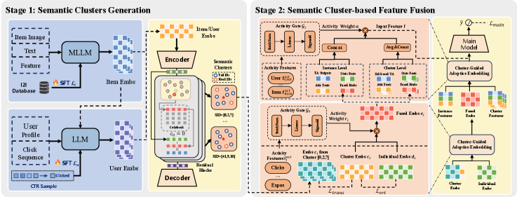

# AKT-Rec: Asymmetric long-tail knowledge transfer with LLM semantic IDs

<!-- source-sha256: 8c7485cf2b530b205a48fb3e0abf931a51072b6ec453e6fa2a054ac331aa2d5d -->

[简体中文](README.md)

> **Fidelity: core mechanism reproduction.** Trains LoRA on SmolLM2-135M, with item co-engagement contrastive tuning, future-interest/category supervision, residual semantic IDs, dual views, asymmetric stop-gradient, orthogonality and both activity gates.

## Paper information

| Field | Details |
|---|---|
| Paper | [Paper or original source](https://arxiv.org/abs/2605.23310) |
| Institution | Alibaba Group / Peking University |
| First public release | 2026-05-22 (arXiv v1) |
| Author code | No official author code identified (checked 2026-08-09). |
| Local adapter or method key | `akt-rec` |
| Local reproduction code | [`src/auto_research/reproductions/akt_rec/`](https://github.com/daiwk/auto-research/tree/main/src/auto_research/reproductions/akt_rec/) |

## Paper method and evidence

Sparse, noisy tail representations can degrade frequent entities if they share knowledge symmetrically. AKT-Rec aligns content with collaborative signals through an MLLM and quantizes users and items into hierarchical semantic IDs via RQ-VAE; shared high-level codes define clusters. Ranker features combine cluster and individual views. The stronger InfoNCE direction updates tail vectors against stop-gradient head teachers. One activity gate balances cluster vs individual embeddings; the other fuses instance-level target attention with cluster-level history for CTR.


<!-- paper-figure:start -->
### Original paper figure

[](https://arxiv.org/html/2605.23310v1/x1.png)

Figure 1 shows the architecture and relationships between its modules. From the [original paper](https://arxiv.org/abs/2605.23310); copyright remains with the authors.
<!-- paper-figure:end -->

### Core equation

$$
id_k=\arg\min_i\lVert r_{k-1}-e_i\rVert_2^2,\qquad
r_k=r_{k-1}-e_{id_k}.
$$

$$
\mathcal L_{trans}=\lambda_1\mathcal L_{info}(c^{head},\operatorname{sg}(c^{tail}))
+\lambda_2\mathcal L_{info}(c^{tail},\operatorname{sg}(c^{head})),
\qquad \lambda_1<\lambda_2.
$$

$$
\mathcal L_{ortho}=\left(\frac{c_i^Td_i}{\lVert c_i\rVert_2\lVert d_i\rVert_2}\right)^2.
$$

$$
e_i=r_i c_i+(1-r_i)d_i,\qquad r_i=G_1(f_i^{act}),
$$

$$
f=\alpha H_{clust}+(1-\alpha)H_{inst},\qquad
\alpha=G_2([f_u^{act};f_i^{act};f_{cross}^{act}]).
$$

### Reported results

On private Tmall data, baseline AUC/GAUC is 0.7510/0.6385 and AKT-Rec gives 0.7536/0.6483; the authors report relative gains of 0.346% and 1.53%, especially on the tail. In a two-week A/B with 10% per arm, clicks rise 2.73%, CTR 2.76%, CTCVR 1.70% and GMV 3.47%.

## Local reproduction

MovieLens-100K title and genre replace images, descriptions and industrial stats. SmolLM2-135M trains on adjacent positive items with InfoNCE, then learns to predict future-interest vectors and categories from user history; no static embedding substitute. Each positive has one fixed popularity-sampled negative. Tail means fewer than 10 positive training interactions. Both arms share negatives, budget and initialization. The baseline only uses individual embeddings and instance target attention.

| Test variant | AUC | GAUC | Tail AUC |
|---|---:|---:|---:|
| online_base | 0.45600 ± 0.02721 | 0.45208 ± 0.01881 | 0.50854 ± 0.03504 |
| AKT-Rec | **0.47170 ± 0.02199** | **0.47708 ± 0.01031** | **0.51949 ± 0.02081** |

Across three seeds relative gains are 3.44%, 5.53% and 2.15%. Validation AUC goes 0.47915 → 0.48472 and GAUC 0.46458 → 0.47083. Sampled negatives are often more popular than held-out positives, accounting for low absolute scores; compare only within protocol. Training updates 230,400 LoRA parameters, and user loss falls from 3.3054 to 2.1680. Forty autoencoder pretraining steps and staged k-means initialization precede 100 straight-through quantization steps; 1,682 items map to 470 three-level codes, and 320 users to 75 two-level codes, avoiding earlier codebook collapse. [Stable metrics](metrics/movielens-100k-seeds42-44.json). Checkpoints and raw runs are not committed. GME-Qwen2-VL-7B, Qwen3-30B-A3B, industrial RQ-VAE scale/data, Tmall's cluster feature store and online MMoE serving are not reproduced; no production latency or lift claim.

```bash
AUTO_RESEARCH_AKT_ITEM_STEPS=30 \
AUTO_RESEARCH_AKT_USER_STEPS=30 \
AUTO_RESEARCH_AKT_STEPS=400 \
AUTO_RESEARCH_AKT_SEEDS=3 \
auto-research reproduce --paper akt-rec --seed 42
```
