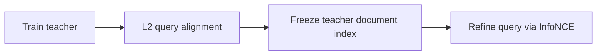
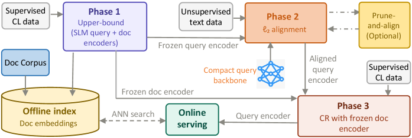

# HARNESS-LM: Three-stage retrieval with a strong document tower and lightweight query tower

<!-- source-sha256: 85223f598b26f4f1cdcf15d9f78919672eb2e8aa00315706029db0394454c281 -->

[简体中文](README.md)

> All three local stages execute, without rebuilding the document index.

## Paper information

| Field | Details |
|---|---|
| Paper | [Paper or original source](https://arxiv.org/abs/2605.23572) |
| Institution | Microsoft AI / Bing Ads. |
| First public release | 2026-05-22 (arXiv v1) |
| Author code | No official author code linked by the paper as checked on 2026-08-09. |
| Local adapter or method key | `harness-lm` |
| Local reproduction code | [`src/auto_research/reproductions/harness_lm/`](https://github.com/daiwk/auto-research/tree/main/src/auto_research/reproductions/harness_lm/) |

## Paper method and evidence

Sponsored Search can encode documents offline but needs a cheap online query encoder. Train a strong teacher, align a small query encoder to its embedding space via L2, then refine with supervised contrastive learning against the frozen teacher index.



<!-- paper-figure:start -->
### Original paper figure

[](https://arxiv.org/html/2605.23572v1/x1.png)

Figure shows the three-stage training pipeline. From the [original paper](https://arxiv.org/abs/2605.23572); copyright remains with the authors.
<!-- paper-figure:end -->

### Core equation

$$
s(q,d)=\langle f_Q(q),f_D(d)\rangle,\qquad \mathcal L_{align}=\sum_i\|f_Q^S(q_i)-f_Q^T(q_i)\|_2^2.
$$

For refinement, freeze $f_D^T$ and update only $f_Q^S$ with InfoNCE.

### Reported results

Bing Ads deployment reports revenue +1.0%, impressions +0.6%, clicks +0.4%, serving about 190 million ads.

## Local reproduction

```bash
auto-research reproduce --paper harness-lm --seed 42
```

Versus a small symmetric content retriever, Hit@10 **-23.08%**, NDCG@10 **-28.05%**. Alignment MSE **0.02375→0.02115**, contrastive loss **7.1900→5.8921**; optimization converges without test transfer. [Stable metrics](metrics/movielens-100k-seed42.json). Collaborative SVD+content proxies Qwen3-Embedding. No 4B/0.6B training, GPT expansion or CPU pruning frontier.
