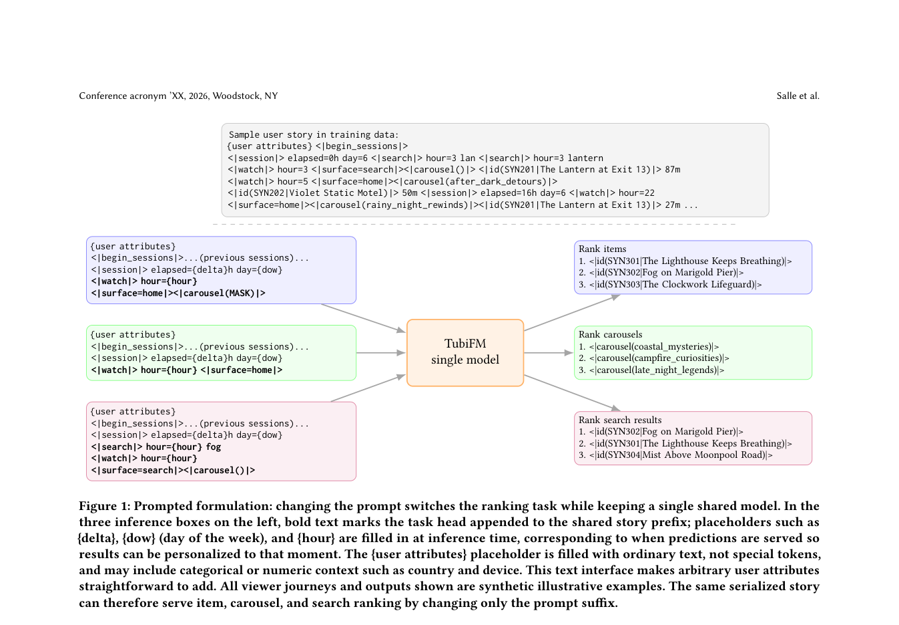

# TubiFM: Unified Item, Carousel, and Search Ranking for Streaming Discovery

<!-- source-sha256: 6bea81cd62e8944f2c59b7e647944fb3aae8cc2056d36efd5a77ec135936cda2 -->

[简体中文](README.md)

> Core public-data unified ranking mechanism.

## Paper information

| Field | Details |
|---|---|
| Paper | [Paper or original source](https://arxiv.org/abs/2605.23702) |
| Institution | Tubi. |
| First public release | 2026-05-22 (arXiv v1) |
| Author code | No official author code linked by the paper as checked on 2026-08-24. |
| Local adapter or method key | `tubifm` |
| Local reproduction code | [`src/auto_research/reproductions/tubifm/`](https://github.com/daiwk/auto-research/tree/main/src/auto_research/reproductions/tubifm/) |

## Paper method and evidence

Represent cross-page journeys as a shared user story. Task prompts let the same generative foundation model rank items, carousels and search.


<!-- paper-figure:start -->
### Original paper figure

[](https://arxiv.org/pdf/2605.23702#page=2)

Figure shows the shared user story and task paths. From the [original paper](https://arxiv.org/abs/2605.23702); copyright remains with the authors.
<!-- paper-figure:end -->

### Core equation

$$
s(i|h,\tau)=\log p_\theta([ITEM=i]|\operatorname{serialize}(h,\tau))
$$

### Reported results

Production A/B reports total viewing time +3.90%, p<0.05. Not comparable to MovieLens.

## Local reproduction

Matched MovieLens-100K 220 users/360 items, full-catalog split and seed 42: shared transition+content baseline versus TubiFM. NDCG@10 **0.0540→0.0543 (+0.45%)**, Hit@10 **0.1091→0.1045**. Validation chooses blend only; no test tuning. [Fixed metrics](metrics/public-seed42.json). No private logs, traffic, checkpoints or production serving; local results do not reproduce paper lift.

```bash
auto-research reproduce --paper tubifm --dataset-dir data --seed 42
```
