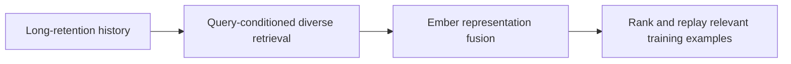
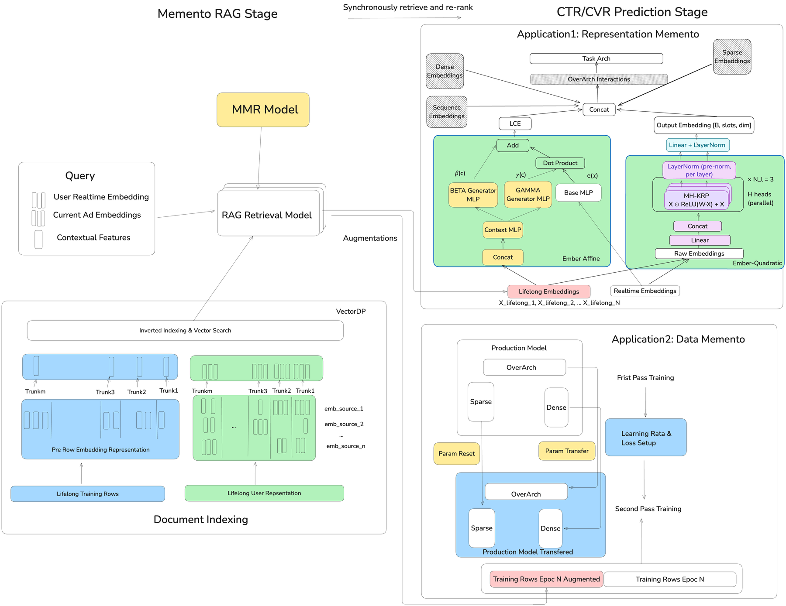

# Memento: RAG-style long-retention recommendation

<!-- source-sha256: 72e2cbbf5e5782027bee26109391fab5ed2f1229f6272c7266d251fc9111a40a -->

[简体中文](README.md)

> **Fidelity: core mechanism reproduction.** Runs query-conditioned MMR; no private Ember, replay or INT8 serving.

## Paper information

| Field | Details |
|---|---|
| Paper | [Paper or original source](https://arxiv.org/abs/2605.24051) |
| Institution | Meta |
| First public release | 2026-05-22 (arXiv v1) |
| Author code | No official author code identified (checked 2026-08-09). |
| Local adapter or method key | `memento` |
| Local reproduction code | [`src/auto_research/reproductions/memento/`](https://github.com/daiwk/auto-research/tree/main/src/auto_research/reproductions/memento/) |

## Paper method and evidence

Fixed recent history discards old relevant events, and one SGD update can forget useful examples. Representation Memento retrieves relevant, diverse events from up to 365 days of user embeddings and conditions them with Ember. Data Memento retrieves forgotten but currently relevant training examples for a second replay step. Maximal marginal relevance balances relevance with redundancy; Ember Affine scales and shifts, and Quadratic adds multiplicative interactions.

<!-- paper-figure:start -->
### Original paper figure

Figure 1 shows the representation and data memory paths. From the [original paper](https://arxiv.org/abs/2605.24051); copyright remains with the authors.
<!-- paper-figure:end -->

### Core equation

$$
d^*=\arg\max_{d\in D\setminus S}\left[\lambda\,sim(d,q)-(1-\lambda)\max_{s\in S}sim(d,s)\right].
$$

$$
e'(x;c)=\gamma(c)\odot e(x)+\beta(c).
$$

$$
\Psi(X^h)=X^h\odot ReLU(W_a^hX)+X^h.
$$

### Reported results

Training uses about 50 billion examples and evaluation the following billion; raw history up to about 190K events and embeddings up to about 20K. Lower normalized entropy is better:

| Variant | CTR NE | CVR NE |
|---|---:|---:|
| LITE | −0.05% | −0.08% |
| Retrieval V1 | −0.20% | −0.17% |
| Ember Affine | −0.22% | −0.23% |
| Ember Quadratic | −0.22% | −0.26% |
| Affine + Quadratic | −0.25% | −0.26% |

Data Memento results are MP −0.107%, RAND25-RS −0.120%, MMR25-ES −0.155%, MMR25-RS −0.195%. Across online A/B rounds, Facebook Feed/Reels CTR rises 1.0% and Offsite Conversion CVR 1.2%. Added latency <10 ms; inference QPS changes <5% and is not significant.

## Local reproduction

MovieLens uses ratings ≥4, leave-two-out and full-catalog ranking. Validation chooses MMR $\lambda\in\{0.3,0.5,0.7,0.9\}$; best $\lambda=0.30$. Against LastN, Hit@10 goes 0.0901→0.0966, NDCG@10 0.0443→0.0464 (+4.78%) and head share@10 0.2979→0.3093. This is a history selection ablation, not a DIN comparison. Meta data/serving, Ember, INT8 retrieval and Data Memento replay are out of scope. [Stable metrics](metrics/movielens-100k-seed42.json).
