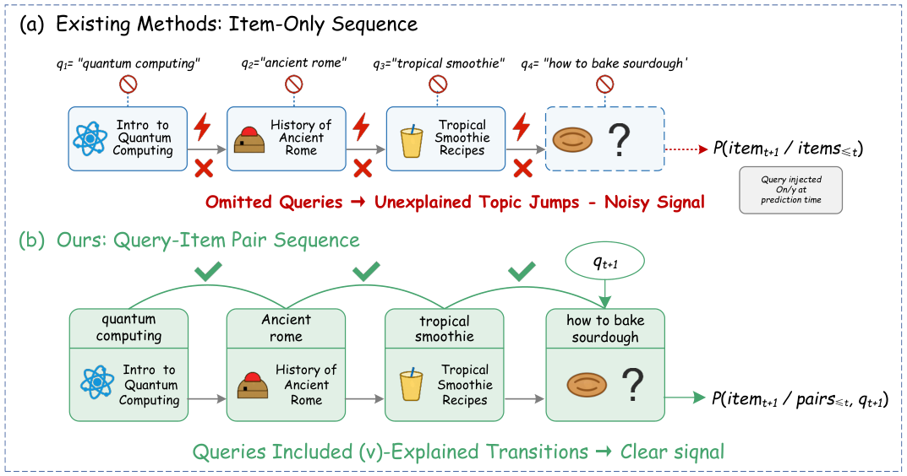

# From Item-Only to Query-Item: Query-Conditioned Generative Search with QGS in Quark

<!-- source-sha256: f398f9ccd5fd436bfe96d470fef4fb61e73b9405de7cf42d16ad62390fa545e1 -->

[简体中文](README.md)

> Core public-data search mechanism.

## Paper information

| Field | Details |
|---|---|
| Paper | [Paper or original source](https://arxiv.org/abs/2605.25514) |
| Institution | University of Science and Technology of China / Alibaba. |
| First public release | 2026-05-25 (arXiv v1) |
| Author code | No official author code linked by the paper as checked on 2026-08-24. |
| Local adapter or method key | `qgs` |
| Local reproduction code | [`src/auto_research/reproductions/qgs/`](https://github.com/daiwk/auto-research/tree/main/src/auto_research/reproductions/qgs/) |

## Paper method and evidence

Serialize query and item jointly for generative search. Linear HSTU encodes history at linear complexity and HFG-Attention fuses sparse crossed features.


<!-- paper-figure:start -->
### Original paper figure

[](https://arxiv.org/html/2605.25514v1/teaser.png)

Figure shows query-conditioned generation. From the [original paper](https://arxiv.org/abs/2605.25514); copyright remains with the authors.
<!-- paper-figure:end -->

### Core equation

$$
p(y|q,h)=\prod_t p(y_t|q,h,y_{<t})
$$

### Reported results

Production CTR +0.62% over seven days on 2% traffic; not a local metric.

## Local reproduction

Matched MovieLens-100K 220 users/360 items, full catalog and seed 42: shared transition+content baseline versus QGS. NDCG@10 **0.0540→0.0544 (+0.73%)**, Hit@10 **0.1091→0.0955**. Only validation chooses blend. [Fixed metrics](metrics/public-seed42.json). No private logs, traffic, checkpoints or production serving; local results do not reproduce paper lift.

```bash
auto-research reproduce --paper qgs --dataset-dir data --seed 42
```
