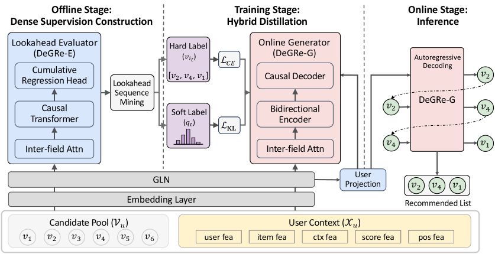

# DeGRe: generative reranking through offline lookahead distillation

<!-- source-sha256: 807aa26492aa647305a292922a86893b9450df638c30eea7ba76a6d96ae80de8 -->

[简体中文](README.md)

> **Fidelity: core mechanism.** Runs cumulative-value evaluation, lookahead beam mining, dense prefix labels, beam weighting, and single-pass online generation.

## Paper information

| Field | Details |
|---|---|
| Paper | [arXiv 2605.25749](https://arxiv.org/abs/2605.25749) |
| Organization | Alibaba Group / Zhejiang University |
| First public release | 2026-05-25 (arXiv v1) |
| Authors' code | The paper did not provide official or author code when checked on 2026-08-09. |
| Adapter / method | `degre` |
| Local reproduction code | [`src/auto_research/reproductions/degre/`](https://github.com/daiwk/auto-research/tree/main/src/auto_research/reproductions/degre/) |

## Original paper

### Motivation and method

A pointwise generator learns only the logged path and struggles to optimize long-term list value directly. DeGRe trains an offline cumulative-return evaluator and beam-searches high-value lists. For each prefix, it distills lookahead values of all remaining candidates into dense soft labels. Online only one greedy generator is retained.


<!-- paper-figure:start -->
### Key figure from the paper

[](https://arxiv.org/html/2605.25749v1/x2.png)

> **Figure 2:** Core architecture, modules, and connections. From the [original paper](https://arxiv.org/abs/2605.25749); copyright remains with the authors.
<!-- paper-figure:end -->

### Core equations

$$
q_t(v_i)=\frac{\exp \hat V([l_{<t};v_i])}{\sum_{v_j\notin l_{<t}}\exp \hat V([l_{<t};v_j])},\qquad w_l=\operatorname{softmax}(\hat V(l)/\tau_w).
$$

$$
\mathcal L=\sum_lw_l\sum_t\left[\operatorname{CE}(y_t,p_t)+\alpha\operatorname{KL}(q_t\|p_t)\right].
$$

### Paper results

Taobao Flash Shopping A/B, eight days at 2% traffic: CTR `+2.85%`, orders `+2.14%`, GMV `+3.75%`. The paper also reports Alipay GMV `+4.14%`.

## Local reproduction

> **Local comparison:** The baseline is a pointwise generator with the same candidates and features. Offline lookahead distillation changes Hit@10 by `+0.00%` and NDCG@10 by **+3.31%** relative.

MovieLens-100K uses 220 users and 360 items. Transaction value is proxied by public positive feedback, list diversity, and novelty. See the [stable metrics](metrics/movielens-100k-seed42.json).

```bash
auto-research reproduce --paper degre --seed 42
```

## Reproduction boundaries

Private transaction labels and industrial Transformer scale are not reproduced. The local result checks only the offline evaluator, beam mining, and dense distillation pipeline.
