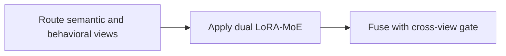
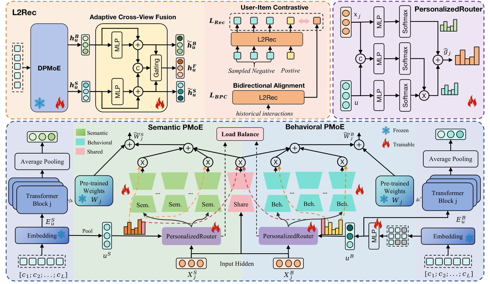

# L2Rec: Towards Dual-View Understanding of LLMs for Personalized Recommendation

<!-- source-sha256: 937562b0910bfe66a63a532735a9d7f8b4d977a89e8b5fbe1c56435eda015c7f -->

[简体中文](README.md)

> Core public-data two-view mechanism.

## Paper information

| Field | Details |
|---|---|
| Paper | [Paper or original source](https://arxiv.org/abs/2605.26717) |
| Institution | NetEase Cloud Music. |
| First public release | 2026-05-26 (arXiv v1) |
| Author code | No official author code linked by the paper as checked on 2026-08-24. |
| Local adapter or method key | `l2rec` |
| Local reproduction code | [`src/auto_research/reproductions/l2rec/`](https://github.com/daiwk/auto-research/tree/main/src/auto_research/reproductions/l2rec/) |

## Paper method and evidence

User-routed dual-view LoRA-MoE adapts a shared LLM to semantic and behavioral views, then adaptive cross-view gates fuse them.



<!-- paper-figure:start -->
### Original paper figure

[](https://arxiv.org/html/2605.26717v1/HARTforPDF.png)

Figure shows dual-view adapters and gating. From the [original paper](https://arxiv.org/abs/2605.26717); copyright remains with the authors.
<!-- paper-figure:end -->

### Core equation

$$
\Delta W_v(u)=\sum_{e\in TopK(g_v(u))}g_{v,e}(u)B_{v,e}A_{v,e}
$$

### Reported results

Online CTR +9.24%, 6% user traffic for a month, p<0.01. Not comparable to local ranking.

## Local reproduction

Matched MovieLens-100K, 220 users/360 items, seed 42, full catalog: shared transition+content vs L2Rec, NDCG@10 **0.0540→0.0513 (-5.04%)**, Hit@10 **0.1091→0.1045**. Validation chooses only blend. [Fixed metrics](metrics/public-seed42.json). No private logs, traffic, checkpoints or production serving; local results do not reproduce paper lift.

```bash
auto-research reproduce --paper l2rec --dataset-dir data --seed 42
```
