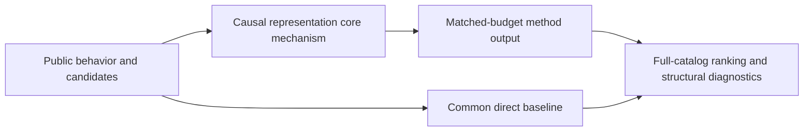
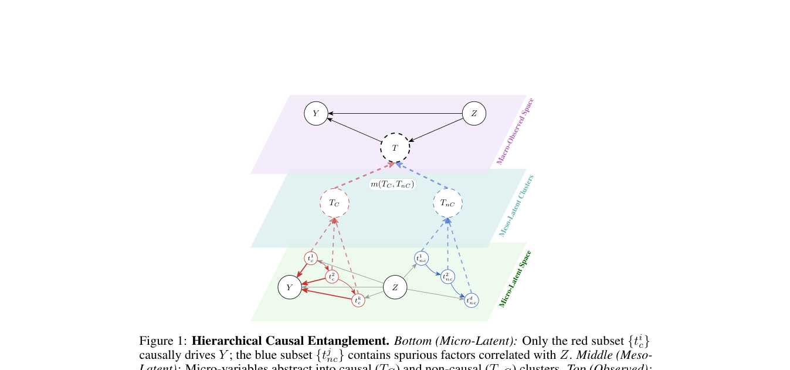

# Causal representation learning: generalizable recommendation under distribution shift

<!-- source-sha256: 502b84abed1875dcaae615f4dd46f4eca5c82d64c05f25139f13e67e6c71fc30 -->

[简体中文](README.md)

> **Fidelity: core mechanism.** Runs the defining mechanism verifiable on public data. Private data, production models, and serving remain outside scope.

## Paper information

| Field | Details |
|---|---|
| Paper | [arXiv 2605.27043](https://arxiv.org/abs/2605.27043) |
| Organization | University of Warwick |
| First public release | 2026-05-26 (arXiv v1) |
| Authors' code | No public author code was found on 2026-09-02. |
| Adapter / method | `causal-representation` |
| Local reproduction code | [`src/auto_research/reproductions/causal_representation/`](https://github.com/daiwk/auto-research/tree/main/src/auto_research/reproductions/causal_representation/) |

## Original paper

### Motivation and method

Information-theoretic deconfounding keeps causal outcome-related components of candidate representations and removes noncausal components from the exposure policy. There is no extra online inference cost after training.



<!-- paper-figure:start -->
### Key figure from the paper

[](https://arxiv.org/pdf/2605.27043#page=3)

> **Figure 1:** Overview of the paper's method and key components. From the [original paper](https://arxiv.org/abs/2605.27043); copyright remains with the authors.
<!-- paper-figure:end -->

### Core equations

$$
J(g)=I(g(T);Y\\mid Z)-\\lambda I(g(T);Z).
$$

### Paper results

A two-week Spotify experiment with millions of users reports Track Streams +0.75%, Skips -0.61%, and Minutes Played +0.50%, all significant at 95%. This is paper evidence, not a local public-data outcome.

## Local reproduction

> **Local comparison:** Under the same full-catalog protocol, baseline NDCG@10 is 0.05401 and Causal representation NDCG@10 is 0.05220, **-3.35%** relative. The local proxy does not extrapolate to online lift.

See the [three-seed artifact](metrics/public-seeds42-44.json) for complete results, means, standard deviations, and 95% confidence intervals.

```bash
auto-research reproduce --paper causal-representation --dataset-dir data --seeds 42,43,44
```

## Reproduction boundaries

The local run uses a public MovieLens-1M subset and auditable proxies to validate the core computation. It does not reproduce private logs, production models, online traffic assignment, or serving. No claim is made to reproduce absolute paper metrics or online gains.
