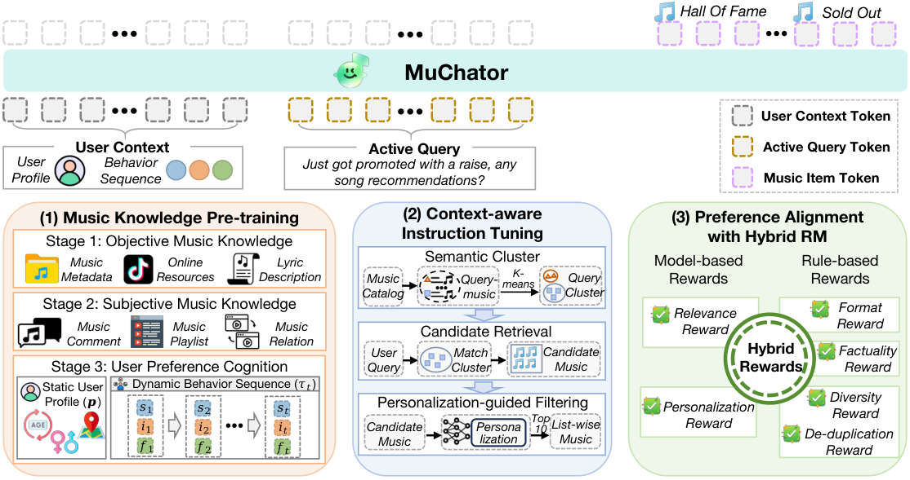

# MuChator: Conversational music discovery

<!-- source-sha256: 3abab53d923556eabae799eabcf02e4789306ac00559846bf8e3f991adc2e1f6 -->

[简体中文](README.md)

> Core public-data proxy, not private production dialogue.

## Paper information

| Field | Details |
|---|---|
| Paper | [arXiv 2605.27103](https://arxiv.org/abs/2605.27103) |
| Institution | ByteDance. |
| First public release | 2026-05-26 (arXiv v1) |
| Author code | No public author code found as of 2026-09-02. |
| Local adapter or method key | `muchator` |
| Local reproduction code | [`src/auto_research/reproductions/muchator/`](https://github.com/daiwk/auto-research/tree/main/src/auto_research/reproductions/muchator/) |

## Paper method and evidence

Continue pretraining, supervised fine-tuning and reinforcement learning in music so the conversational model can infer current intent and actively discover options instead of merely repeating past preferences.


<!-- paper-figure:start -->
### Original paper figure

[](https://arxiv.org/html/2605.27103v1/framework.png)

The original figure shows the discovery and training path. From the [original paper](https://arxiv.org/abs/2605.27103); copyright remains with the authors.
<!-- paper-figure:end -->

### Core equation

$$
\pi^*=\arg\max_\pi\\;\mathbb E[r_{intent}+r_{discovery}+r_{dialogue}]-\beta D_{KL}(\pi\Vert\pi_{ref}).
$$

### Reported results

About one month of Douyin Music A/B reports active days +46.49%, usage time +77.36%, and CTR +11.26%. These are paper online metrics only.

## Local reproduction

```bash
auto-research reproduce --paper muchator --dataset-dir data --seeds 42,43,44
```

Same public MovieLens-1M full-catalog protocol: NDCG@10 **0.05401→0.04477 (-17.09%)**. [Three-seed results, mean, SD, 95% CI](metrics/public-seeds42-44.json). Proxy objectives do not reproduce private logs, bucketing, model scale or serving.
