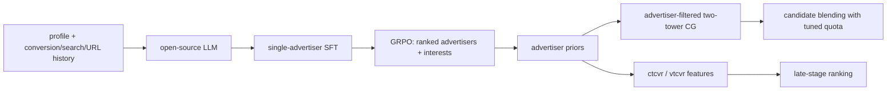
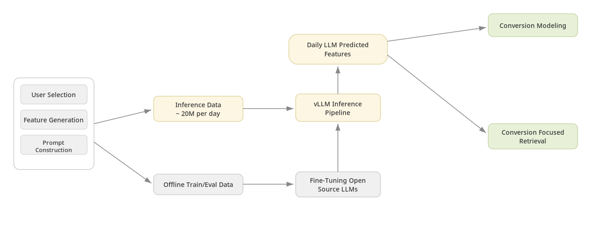

# Fine-Tuned LLM as a Complementary Predictor Improving Ads System

<!-- source-sha256: 00c6fd0377101400013c209b3cf18e188c287b920f41319643b2dc3b675e7643 -->

[简体中文](README.md)

> **Fidelity: Full core pipeline.** The local run executes LoRA SFT on a public causal LLM, clipped GRPO driven by the paper's rank/format rewards, constrained advertiser decoding, a trained two-tower model, supplemental retrieval with validation-selected quotas, and LLM advertiser scores as ranking features. Public product brands and purchase histories replace Pinterest's private ad and cross-site conversion data.

## Paper information

| Field | Value |
| --- | --- |
| Paper link | [arXiv 2605.27856](https://arxiv.org/abs/2605.27856) |
| Organization | Pinterest |
| First published | 2026-05-27 (arXiv v1) |
| Original author code | No official or author code was provided in the paper (checked 2026-08-09). |
| Adapter | `pinterest-ads-llm` |
| Local reproduction code | [`src/auto_research/reproductions/pinterest_ads_llm/`](https://github.com/daiwk/auto-research/tree/main/src/auto_research/reproductions/pinterest_ads_llm/) |

## Original paper summary

### Background and main changes

The LLM complements ad retrieval and ranking rather than replacing either. Given profiles, conversion histories, searches, URLs, categories, and brands, it predicts advertisers and interests associated with high conversion intent. The predictions create a supplemental advertiser-targeted retrieval channel and add ctcvr/vtcvr features to ranking.

First, SFT predicts one next advertiser. Then GRPO generates 20 advertisers and 5 interests, rewarding the hit position and enforcing output lengths. An extended model adds five-level PinCLIP/RQ-VAE SIDs through a three-stage CPT/SFT process. vLLM and Ray run daily batch inference, outside the online request path.



<!-- paper-figure:start -->
### Key figure from the paper

[](https://arxiv.org/html/2605.27856v1/overall_components_modified.png)

**Original Figure 1 (pipeline):** Key stages and data flow. Image from the [original paper](https://arxiv.org/abs/2605.27856); copyright belongs to the authors. Click the image for its source.
<!-- paper-figure:end -->

### Core equations

SFT minimizes autoregressive negative log-likelihood on the next advertiser $a^+$:

$$
\mathcal L_{SFT}=-\sum_t\log p_\theta(a_t^+\mid x,a_{<t}^+).
$$

The total GRPO reward is:

$$
R=R_{match}-P_{adv\_len}-P_{interest\_len},
$$

$$
R_{match}(i)=0.1(20-i)+2\cdot\mathbf 1[i\le4],
$$

$$
P_{len}(n,n^*)=\begin{cases}0,&n=n^*\\
\min(0.1|n-n^*|,1)+1,&n\ne n^*.\end{cases}
$$

The local configuration scales the same formula to a 5-advertiser group and uses group-normalized advantages with two rounds of clipped ratio updates. Supplemental retrieval filters by predicted advertisers $A_u$:

$$
\mathcal C_{LLM}(u)=\operatorname{TopK}_{i:a_i\in A_u}s_{2tower}(u,i),
$$

A validation-selected fixed quota blends those candidates with ordinary retrieval. Advertiser log-probability is an extra ranking feature.

### Offline and online results in the paper

| Paper V1 variant | Recall@1 | Recall@5 | Recall@20 |
|---|---:|---:|---:|
| Zero-shot | 0.117 | 0.301 | 0.422 |
| SFT (1 advertiser) | 0.214 | 0.413 | 0.501 |
| SFT + GRPO | 0.223 | 0.461 | 0.683 |
| SID-enabled SFT + GRPO | **0.248** | **0.515** | **0.755** |

The added LLM features improve ctcvr AUC by `+0.06%` and vtcvr AUC by `+0.09%`. The US Shopping Ads online results are:

| Online A/B | RoAS | Significance |
|---|---:|---:|
| US Shopping slice | +4.94% | p=0.021 |
| Opt-in US Shopping slice | +6.69% | p=0.029 |

## Local reproduction

> **Controls:** The predictor baseline is SFT on SmolLM2-135M with the same public advertiser set. SFT+GRPO continues from that checkpoint using the paper's reward. Test Recall@20 is 0.1250 for both (**0.00%** change), and validation chooses SFT. Against the downstream two-tower baseline, the LLM feature changes sampled AUC from 0.62613 to 0.64232 (**+2.59%**), but validation chooses a supplemental retrieval quota of 0 and Recall@50 stays 0.1250. These are separate comparisons, not the paper's A/B.

The run uses 12,000 training examples, 48 frequent advertisers, and 32 users each for validation and test. SFT runs 48 steps, GRPO 16, and two-tower training 160. Retrieval uses the full product catalog. Ranking AUC uses 1 positive and 19 fixed random negatives per request.

| Local advertiser predictor | Recall@1 | Recall@5 | Recall@20 | Mean rank |
|---|---:|---:|---:|---:|
| SFT (validation selection) | 0.0625 | 0.0625 | 0.1250 | 36.5625 |
| SFT + GRPO | 0.0625 | 0.0625 | 0.1250 | **34.6250** |

GRPO improves mean rank by 5.30% but not Recall@20. Validation Recall@20 drops from 0.1875 to 0.1250, so the better test mean rank cannot override selection. The selected quota of 0 indicates that this predictor did not safely replace ordinary two-tower candidates; the ranking feature gives a small positive signal.

```bash
AUTO_RESEARCH_PIN_ADS_SFT_STEPS=48 \
AUTO_RESEARCH_PIN_ADS_GRPO_STEPS=16 \
AUTO_RESEARCH_PIN_ADS_TOWER_STEPS=160 \
AUTO_RESEARCH_PIN_ADS_EVAL_USERS=32 \
auto-research reproduce --paper pinterest-ads-llm --seed 42
```

Stable metrics: [metrics/office-seed42.json](metrics/office-seed42.json). Models, checkpoints, data, and raw `runs/` are not committed.

## Reproduction limits

- A pretrained LM and trainable LoRA are used; rules or embedding scores do not substitute for SFT/GRPO.
- Amazon brands, titles, and purchases replace Pinterest advertisers, URLs, cross-site conversions, profiles, and ad spend. These proxies substantially weaken world knowledge and commercial intent signals.
- The advertiser group/list shrinks from 20 to 5 and the model from 4B to 135M. Rewards, group advantages, and clipped updates are retained.
- The private PinCLIP SID three-stage CPT is not run. Local AUC and recall do not establish RoAS.
