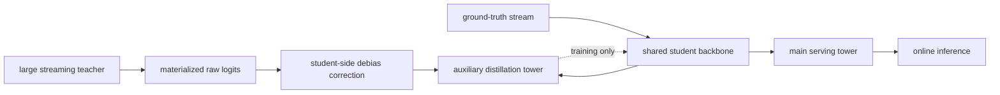
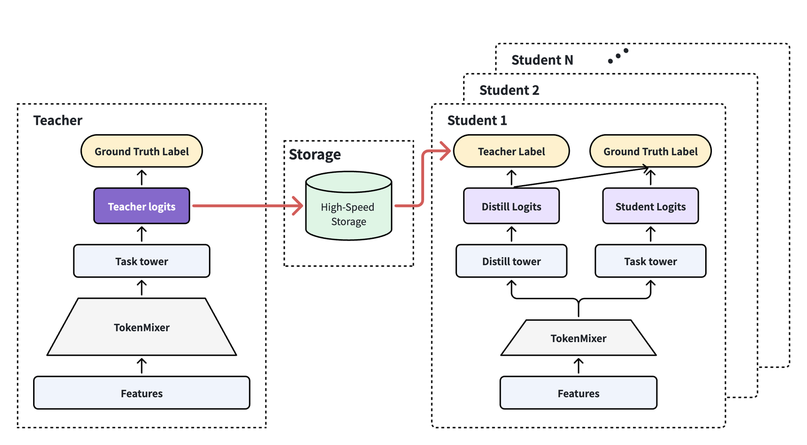

# Rec-Distill: Industrial Teacher-to-Serving-Student Transfer

<!-- source-sha256: cadfa26d75086d221a3a61eb04351cc999ca4fb908453a5911fc8141cd394c67 -->

[简体中文](README.md)

> **Fidelity: full core pipeline.** Trains a large teacher and smaller student, materializes black-box logits, applies student-side sampling correction and decoupled main/auxiliary towers, distills in batch then streaming stages, and selects loss ratios on validation.

## Paper information

| Field | Details |
|---|---|
| Paper | [arXiv 2605.29755](https://arxiv.org/abs/2605.29755) |
| Organization | ByteDance / Douyin / TikTok |
| First public release | 2026-05-28 (arXiv v1) |
| Authors' code | No official or author implementation is linked by the paper (checked 2026-08-09). |
| Adapter / method | `rec-distill` |
| Local reproduction code | [`src/auto_research/reproductions/rec_distill/`](https://github.com/daiwk/auto-research/tree/main/src/auto_research/reproductions/rec_distill/) |

## Original paper

### Motivation and method

Industrial teachers are too large for serving, and teacher and student data differ in sampling and recency. Rec-Distill materializes black-box logits during teacher forward so multiple students consume them asynchronously. The serving main tower receives ground-truth labels only. The auxiliary tower shares the backbone but receives both task and distillation losses. Raw teacher logits first receive student-side sampling correction to align probabilities. Batch training converges before consuming streaming teacher signals.



<!-- paper-figure:start -->
### Key figure from the paper

[](https://arxiv.org/html/2605.29755v2/fig/framework_0524_0045.png)

> **Figure 1:** Core architecture, its modules, and their connections. From the [original paper](https://arxiv.org/abs/2605.29755); copyright remains with the authors.
<!-- paper-figure:end -->

### Core equations

$$
\eta=\frac{P_S^{distill}-P_S^{raw}}{P_T-P_S^{raw}},
$$

$$
\mathcal L_{aux}=\mathcal L_{task}+\alpha\mathcal L_{distill},
$$

$$
\hat y=\frac{1}{1+\frac{r_s}{p_X}(e^{-z}+1-r_++b_s)},\qquad T'_2=f_S(T_1).
$$

### Paper results

The paper reports 65% transferability from a 24B teacher to a 1B student and positive batch/streaming and decoupled-tower ablations. Online ads ADVV rises +1.00%, recommendation Finish/U +1.2725%, and TikTok Live gift revenue +0.78%.

## Local reproduction

> **Local comparison.** The serving comparison is a raw student at the same schedule versus the distilled student. NDCG@10 falls 0.0039 to 0.0036 and transferability is **-4.11%**. The large teacher confirms a teacher gain, not a serving baseline. Lower head share is not a distillation improvement.

MovieLens-100K uses a 96-dimensional, three-layer teacher and a 48-dimensional, one-layer student. Materialized logits have 12,000 rows of 16 candidates (0.384 MB). Students share 160 batch and 80 stream steps. Search over `α∈{0.1,0.3,1,3}` uses validation only and test reports `α=3`.

| Model | Hit@10 | NDCG@10 | Head share@10 |
|---|---:|---:|---:|
| Large teacher | **0.0247** | **0.0121** | 0.5145 |
| Raw matched-schedule student | 0.0086 | 0.0039 | 0.2716 |
| Rec-Distill student | 0.0075 | 0.0036 | **0.2576** |

Despite the teacher advantage, corrected black-box logits did not transfer the gain on this small dataset. Validation rose slightly at larger α, without carrying to test. Lower head share does not change this negative result. See [structured metrics](metrics/movielens-100k-seed42.json).

```bash
auto-research reproduce --paper rec-distill --dataset-dir data --seed 42
```

Teacher signals, models, and runs stay in Git-ignored `runs/`.
