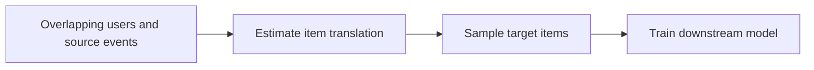
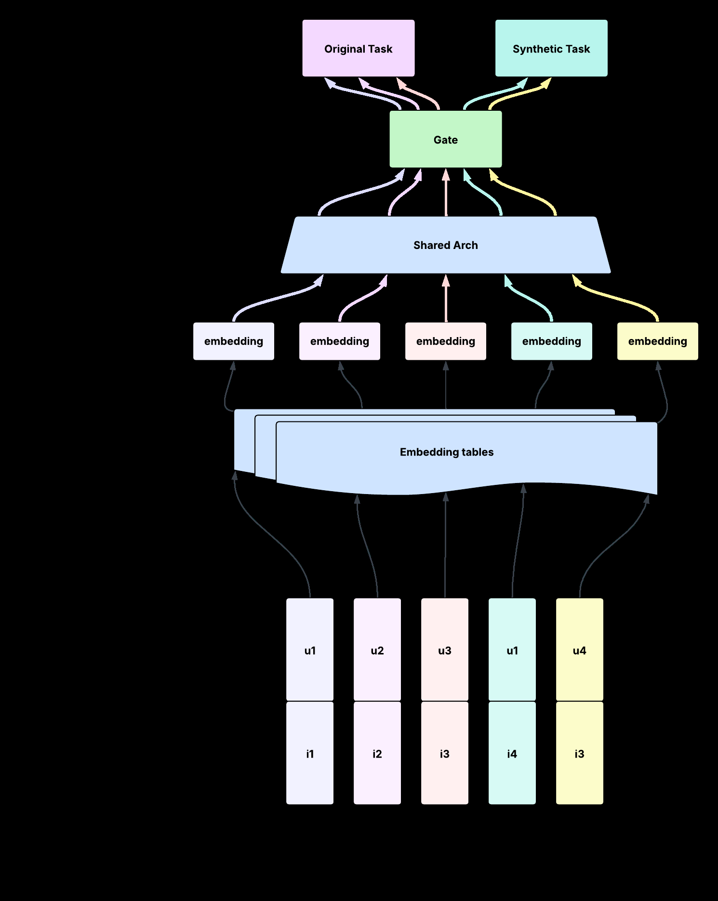

# SCALR: Translate cross-domain behavior into recommender training data

<!-- source-sha256: 1a3d95492e12bbf9a41b64a10d2d869c48abca37df92ad7cd9c9b61009426ca0 -->

[简体中文](README.md)

> **Fidelity: core mechanism reproduction.** Generates stochastic and deterministic top-k events from a learned distribution under a common downstream protocol.

## Paper information

| Field | Details |
|---|---|
| Paper | [Paper or original source](https://arxiv.org/abs/2606.00282) |
| Institution | Meta |
| First public release | 2026-05-29 (arXiv v1) |
| Author code | No official author code in paper or arXiv entry (checked 2026-09-01). |
| Local adapter or method key | `scalr` |
| Local reproduction code | [`src/auto_research/reproductions/scalr/`](https://github.com/daiwk/auto-research/tree/main/src/auto_research/reproductions/scalr/) |

## Paper method and evidence

Target conversions are sparse even when the same users have rich other-surface behavior. SCALR decouples transfer from the model: estimate an item translation distribution from overlapping users, sample target-domain item $i_k\sim\hat P(\cdot\mid u,j)$ for a source event, then add $(u,i_k,w_k)$ as ordinary synthetic training data. Sampling retains distribution/catalog diversity unlike repeated head-item top-k generation.



<!-- paper-figure:start -->
### Original paper figure

[](https://arxiv.org/html/2606.00282v1/SynRec_crossdomain.png)

Figure 3 shows cross-domain synthetic event translation. From the [original paper](https://arxiv.org/abs/2606.00282); copyright remains with the authors.
<!-- paper-figure:end -->

### Core equation

$$
\hat P(i\mid j)=\frac{\sum_{u\in U_{overlap}}\mathbf 1[(u,j)\in D_S]\mathbf 1[(u,i)\in D_T]}{\sum_{u\in U_{overlap}}\mathbf 1[(u,j)\in D_S]}.
$$

### Reported results

Multi-week live traffic shows statistically significant CVR gains about 0.14%–0.24%. Ablations favor stochastic sampling over top-k and show synthetic-volume saturation and the importance of distribution matching.

## Local reproduction

Matched source events and per-event generation budget. On disjoint MovieLens genre domains, stochastic sampling raises generated coverage 2.5%→100% and lowers head share, but seed 42 NDCG@10 drops 10.25% relative to top-k. [Three-seed metrics, SD and 95% CI](metrics/public-seeds42-44.json). This is probability translation and coverage evidence only; genre does not reproduce cross-product surfaces, conversion labels, privacy pipeline or multi-source production service.

```bash
auto-research reproduce --paper scalr --dataset-dir data --seed 42
```
