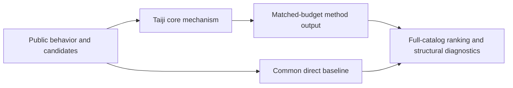
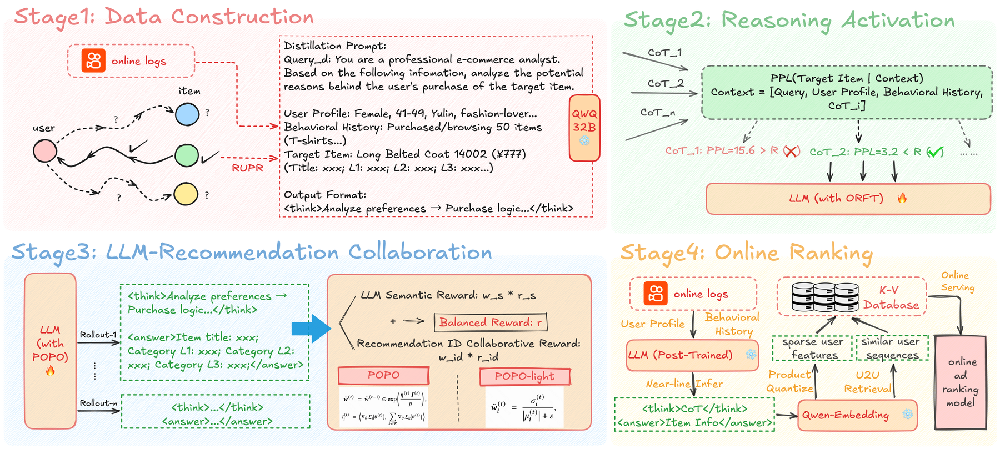

# Taiji: Pareto policy optimization for semantic and collaborative IDs

<!-- source-sha256: cd370dc1dabe123dacbbe431a1f42e28f4b29999cacb8d4b4c3f2734494f180d -->

[简体中文](README.md)

> **Fidelity: core mechanism.** Runs the defining mechanism verifiable on public data. Private data, production models, and serving remain outside scope.

## Paper information

| Field | Details |
|---|---|
| Paper | [arXiv 2606.03866](https://arxiv.org/abs/2606.03866) |
| Organization | Kuaishou Technology |
| First public release | 2026-06-02 (arXiv v1) |
| Authors' code | No public author code was found on 2026-09-02. |
| Adapter / method | `taiji` |
| Local reproduction code | [`src/auto_research/reproductions/taiji/`](https://github.com/daiwk/auto-research/tree/main/src/auto_research/reproductions/taiji/) |

## Original paper

### Motivation and method

Use reverse-engineered preference reasoning and rejection sampling to activate recommendation chain-of-thought. POPO then balances LLM semantic reward and collaborative-ID reward dynamically, avoiding the nonconvex Pareto-frontier blind spots of fixed weights.



<!-- paper-figure:start -->
### Key figure from the paper

[](https://arxiv.org/html/2606.03866v1/fig/g1_v2.png)

> **Figure 1:** Core architecture, modules, and connections. From the [original paper](https://arxiv.org/abs/2606.03866); copyright remains with the authors.
<!-- paper-figure:end -->

### Core equations

$$
r(x,y)=w_s(x,y)r_{sem}(x,y)+w_{id}(x,y)r_{collab}(x,y),\\qquad w\\in\\Delta^2.
$$

### Paper results

A one-week Kuaishou ads experiment with 10% traffic per arm reports overall ADVV +2.83% and revenue +3.30%; full deployment began in 2026-05. This is paper evidence, not a local public-data outcome.

## Local reproduction

> **Local comparison:** Under the same full-catalog protocol, baseline NDCG@10 is 0.05401 and Taiji NDCG@10 is 0.06448, **+19.39%** relative. The local proxy does not extrapolate to online lift.

See the [three-seed artifact](metrics/public-seeds42-44.json) for complete results, means, standard deviations, and 95% confidence intervals.

```bash
auto-research reproduce --paper taiji --dataset-dir data --seeds 42,43,44
```

## Reproduction boundaries

The local run uses a public MovieLens-1M subset and auditable proxies to validate the core computation. It does not reproduce private logs, production models, online traffic assignment, or serving. No claim is made to reproduce absolute paper metrics or online gains.
