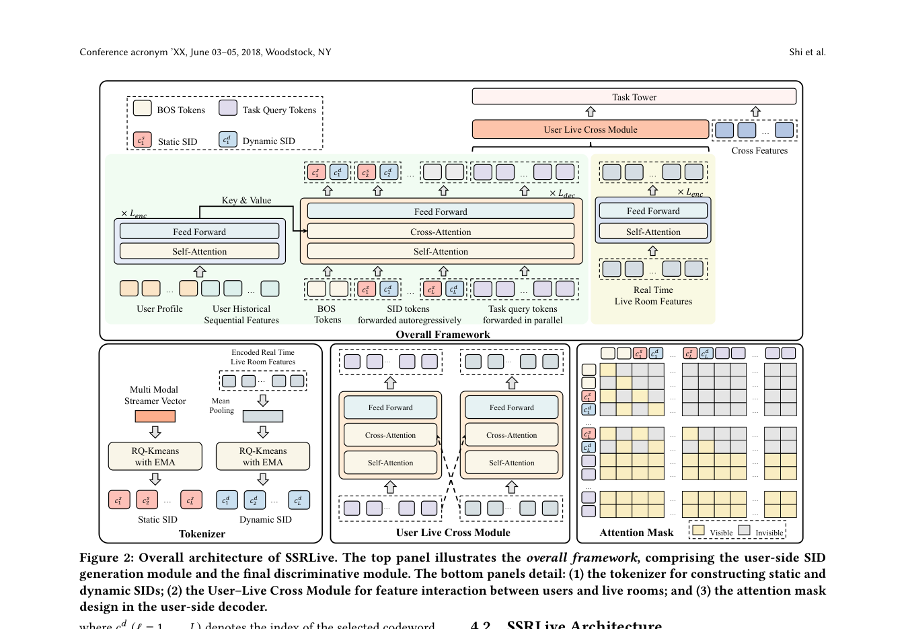

# SSRLive: Dynamic semantic IDs for live-stream recommendation

<!-- source-sha256: 8650fd3ac89dec449989e378fd00fc94785158380e2172867d6d7be2d29cfaf4 -->

[简体中文](README.md)

> Core public-data mechanism.

## Paper information

| Field | Details |
|---|---|
| Paper | [Paper or original source](https://arxiv.org/abs/2606.06970) |
| Institution | Taobao & Tmall Group, Alibaba. |
| First public release | 2026-06-05 (arXiv v1) |
| Author code | No public author code found as of 2026-09-02. |
| Local adapter or method key | `ssrlive` |
| Local reproduction code | [`src/auto_research/reproductions/ssrlive/`](https://github.com/daiwk/auto-research/tree/main/src/auto_research/reproductions/ssrlive/) |

## Paper method and evidence

Static SIDs encode creator content; dynamic SIDs capture current stream state. Fuse user–creator interactions for viewing, transaction and engagement tasks.


<!-- paper-figure:start -->
### Original paper figure

[](https://arxiv.org/pdf/2606.06970#page=4)

Figure shows static and dynamic live semantic features. From the [original paper](https://arxiv.org/abs/2606.06970); copyright remains with the authors.
<!-- paper-figure:end -->

### Core equation

$$
h_i=\operatorname{Fuse}(e^{static}_{sid},e^{dynamic}_{sid},e_{u\leftrightarrow s}),\qquad \hat y_t=f_t(h_i).
$$

### Reported results

Taobao Live A/B: watch time +3.38%, GMV +0.72%, follows +3.12%, engaged users +2.92%; optimized latency only 1.33% above DLRM.

## Local reproduction

MovieLens-1M full catalog: NDCG@10 **0.05401→0.05351 (-0.92%)**. [Three-seed metrics, mean, SD, and 95% CI](metrics/public-seeds42-44.json). No private logs, production models, bucketing or serving. Public proxies cannot establish online lift.

```bash
auto-research reproduce --paper ssrlive --dataset-dir data --seeds 42,43,44
```
