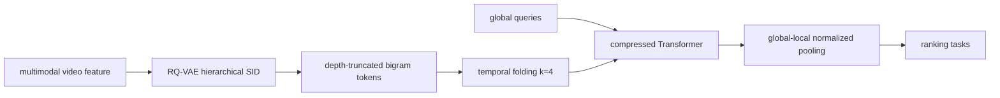
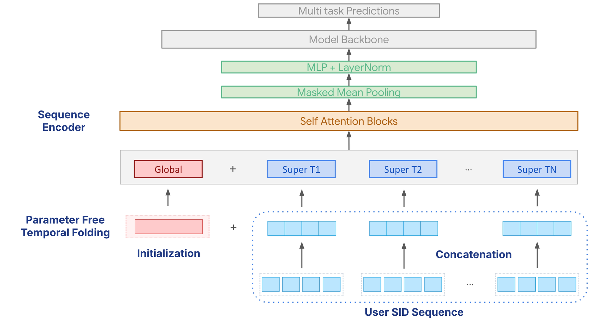

# Semantic-Native Long Sequence: SIDs and a Global-Aware Compressed Transformer

<!-- source-sha256: b33f5676f8eb6c71aa0ca325da8e21b0a5df56dff8df2ac5ae67600f5359144d -->

[简体中文](README.md)

> **Fidelity: core mechanism.** Constructs residual-quantized Semantic IDs, depth-truncated bigrams, parameter-free temporal folding, global-query attention, and global/local pooling.

## Paper information

| Field | Details |
|---|---|
| Paper | [SIGIR 2026 / arXiv 2606.07546](https://arxiv.org/abs/2606.07546) |
| Organization | Google |
| First public release | 2026-05-04 (arXiv v1) |
| Authors' code | No official or author implementation linked in the paper or on arXiv (checked 2026-09-01). |
| Adapter / method | `semantic-native-longseq` |
| Local reproduction code | [`src/auto_research/reproductions/semantic_native_longseq/`](https://github.com/daiwk/auto-research/tree/main/src/auto_research/reproductions/semantic_native_longseq/) |

## Original paper

### Motivation and method

Atomic video IDs memorize items, grow unbounded embedding tables as the corpus expands, and transfer no semantics to new videos. Full attention is also quadratic in thousand-event histories. The paper quantizes with RQ-VAE into coarse-to-fine SIDs, truncates to a bounded bigram vocabulary, folds every $k$ neighboring events into a parameter-free super-token, and adds shared global queries to preserve overall interests at longer histories.



<!-- paper-figure:start -->
### Key figure from the paper

[](https://arxiv.org/html/2606.07546v1/2026sigir.png)

> **Figure 2:** Overall design and key components. From the [original paper](https://arxiv.org/abs/2606.07546); copyright remains with the authors.
<!-- paper-figure:end -->

### Core equation

Window folding converts $L$ to $L'=L/k$. The paper rearranges window features along the channel dimension; local mean/recent aggregation is deterministic and preserves the tradeoff of temporal resolution for feature expressiveness. The final user vector is:

$$
u_{final}=\frac{\sum_{j=1}^{L'+N_g}H_{out}[j]M'_j}{\sum_{j=1}^{L'+N_g}M'_j+\epsilon}.
$$

The first $N_g$ positions are always-valid global queries; other positions are folded local history.

### Paper results

- SID improves freshness satisfied views by 6.81% versus Video ID.
- At $L=800,k=4$, training steps go from 41.1ms to 6.6ms (-83.9%) and peak HBM from 5758MiB to 448MiB (-92.2%).
- The full system expands online history from 800 video IDs to 2,000 SIDs: Actively Engaged Users +0.52%, Satisfied Watch Time +1.42%, and Satisfied Views +1.08%, all p<0.05.

## Local reproduction

> **Local comparison.** On the same public split, 12-event item-ID feature attention versus 48 SID events folded by four into 12 local tokens plus two global queries. Seed 42 NDCG@10 improves +25.42% relative.

Fourteen attention tokens reduce the pair-count proxy by about 91.49% versus full attention over 48 events. Three seeds retain variance from SID clustering; see [per-seed results, mean, standard deviation, and 95% CI](metrics/public-seeds42-44.json).

```bash
auto-research reproduce --paper semantic-native-longseq --dataset-dir data --seed 42
```

## Limits

MovieLens features proxy multimodal video. Google RQ-VAE, billion-user private traffic, 2,000-event serving, asynchronous long-history modules, and custom HBM kernels are not reproduced. Local and production business metrics are not directly comparable.
