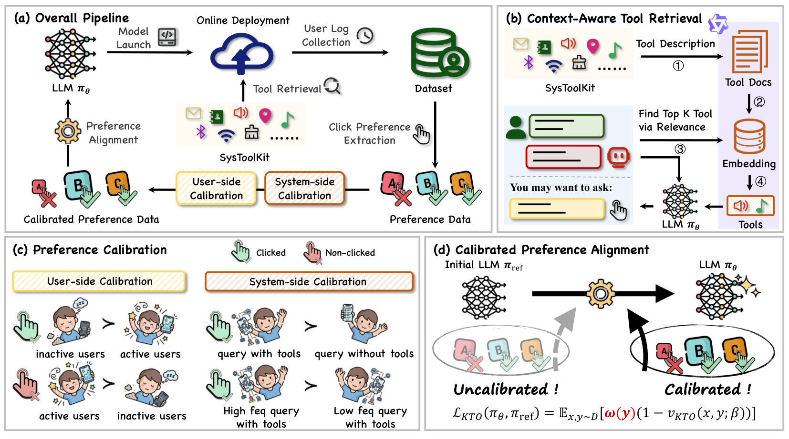

# ToolRec: Calibrated preference alignment for tool-query recommendation

<!-- source-sha256: 4b196e9012a89c2a39e5be587231a350455420c810f71011b4e58c4136b3d1a4 -->

[简体中文](README.md)

> Core public-data preference mechanism.

## Paper information

| Field | Details |
|---|---|
| Paper | [Paper or original source](https://arxiv.org/abs/2606.08466) |
| Institution | Huazhong University of Science and Technology. |
| First public release | 2026-06-07 (arXiv v1) |
| Author code | No public author code found as of 2026-09-02. |
| Local adapter or method key | `toolrec` |
| Local reproduction code | [`src/auto_research/reproductions/toolrec/`](https://github.com/daiwk/auto-research/tree/main/src/auto_research/reproductions/toolrec/) |

## Paper method and evidence

Augment a KTO-style objective with user calibration and frequency-driven dynamic system calibration. Improve tool-triggering queries while limiting contextual relevance loss.


<!-- paper-figure:start -->
### Original paper figure

[](https://arxiv.org/html/2606.08466v2/framework.png)

Figure shows both calibration paths. From the [original paper](https://arxiv.org/abs/2606.08466); copyright remains with the authors.
<!-- paper-figure:end -->

### Core equation

$$
\mathcal L=-w_u r_y\log\sigma(z)-w_s(f_{tool})(1-r_y)\log\sigma(-z).
$$

### Reported results

OPPO Xiaobu A/B, 2026-04-21 through 04-27, 5% per arm: clicks +4.74%, CTR +3.32%, relevance -1.44% relative.

## Local reproduction

```bash
auto-research reproduce --paper toolrec --dataset-dir data --seeds 42,43,44
```

MovieLens-1M fixed catalog: NDCG@10 **0.05401→0.04819 (-10.78%)**. [Three-seed metrics, mean, SD and 95% CI](metrics/public-seeds42-44.json). No private features, production traffic or serving. These local public-data results do not reproduce online lift.
