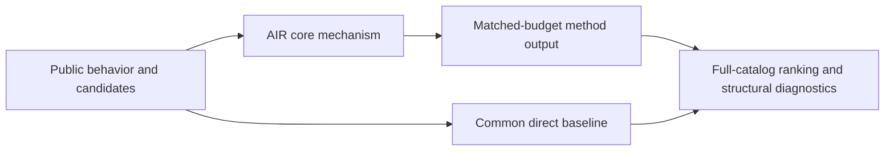
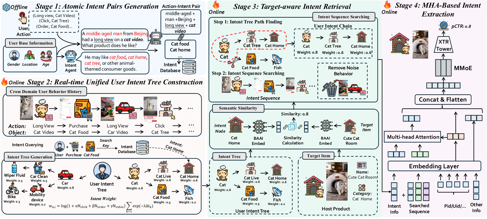

# AIR: atomic intent reasoning for cross-domain recommendation

<!-- source-sha256: 91bec531538ee394255a2d91e1781f12a0eb34afa5cc0a57b7002c27b0905f00 -->

[简体中文](README.md)

> **Fidelity: core mechanism.** Runs the defining mechanism verifiable on public data. Private data, production models, and serving remain outside scope.

## Paper information

| Field | Details |
|---|---|
| Paper | [arXiv 2606.10357](https://arxiv.org/abs/2606.10357) |
| Organization | The Hong Kong Polytechnic University |
| First public release | 2026-06-09 (arXiv v1) |
| Authors' code | No public author code was found on 2026-09-02. |
| Adapter / method | `atomic-intent` |
| Local reproduction code | [`src/auto_research/reproductions/atomic_intent/`](https://github.com/daiwk/auto-research/tree/main/src/auto_research/reproductions/atomic_intent/) |

## Original paper

### Motivation and method

Move expensive LLM reasoning offline and convert individual behaviors into cacheable hierarchical atomic intents. At serving time retrieve intent chains for the target product and aggregate cross-domain evidence with multi-head attention.



<!-- paper-figure:start -->
### Key figure from the paper

[](https://arxiv.org/html/2606.10357v1/model_final_out.png)

> **Figure 2:** Overall workflow, key stages, and data flow. From the [original paper](https://arxiv.org/abs/2606.10357); copyright remains with the authors.
<!-- paper-figure:end -->

### Core equations

$$
w_u=\\log(1+N(u))\\sum_k e^{-\\lambda\\Delta t_k},\\qquad \\operatorname{score}(u;v)=\\cos(e_u,e_v)\\log(1+w_u).
$$

### Paper results

Kuaishou e-commerce reports GMV +3.446% on 5.08% of production traffic, and about 400× higher throughput for offline intent caching versus real-time LLM calls. This is paper evidence, not a local public-data outcome.

## Local reproduction

> **Local comparison:** Under the same full-catalog protocol, baseline NDCG@10 is 0.05401 and AIR NDCG@10 is 0.05240, **-2.98%** relative. The local proxy does not extrapolate to online lift.

See the [three-seed artifact](metrics/public-seeds42-44.json) for complete results, means, standard deviations, and 95% confidence intervals.

```bash
auto-research reproduce --paper atomic-intent --dataset-dir data --seeds 42,43,44
```

## Reproduction boundaries

The local run uses a public MovieLens-1M subset and auditable proxies to validate the core computation. It does not reproduce private logs, production models, online traffic assignment, or serving. No claim is made to reproduce absolute paper metrics or online gains.
