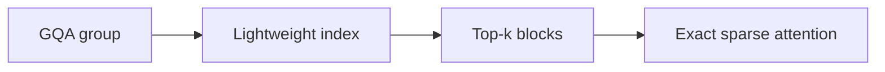
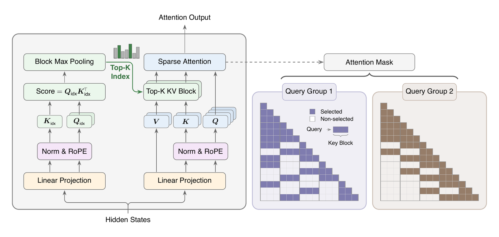

# MiniMax Sparse Attention: Block-Sparse GQA for Very Long Contexts

<!-- source-sha256: 87c2e373b5fca75034a5418378e2effe300722bcc82fe142311ad0ff424e2268 -->

[简体中文](README.md)

> **Core mechanism evidence.** Paper and local evaluations are separate.

## Paper information

| Field | Value |
| --- | --- |
| Paper | [arXiv 2606.13392](https://arxiv.org/abs/2606.13392) |
| Affiliations | MiniMax |
| First public release | 2026-06-11 (arXiv v1) |
| Authors' code | [MSA](https://github.com/MiniMax-AI/MSA). |
| Adapter / method | `minimax-sparse-attention` |
| Local code | [`src/auto_research/reproductions/minimax_sparse_attention/`](https://github.com/daiwk/auto-research/tree/main/src/auto_research/reproductions/minimax_sparse_attention/) |

## Original paper

### Background and contribution

Dense attention scales quadratically. Add a lightweight index per GQA group to select historical blocks before exact attention over their tokens. Train and infer with the same path.



<!-- paper-figure:start -->
### Key figure from the paper

[](https://arxiv.org/html/2606.13392v2/figures/msa_arch.png)

Original Figure 1: MiniMax Sparse Attention. From the [paper](https://arxiv.org/abs/2606.13392); copyright belongs to the authors. Not a local result.
<!-- paper-figure:end -->

### Core mechanism

$$
\mathcal B_q=\operatorname{TopK}_b\langle q_I,\bar k_{I,b}\rangle,\qquad
\operatorname{MSA}(q)=\sum_{j:\,b(j)\in\mathcal B_q}
\operatorname{softmax}(qk_j^\top/\sqrt d)v_j.
$$

### Paper results

For a 109B model at 1M context, the paper reports 28.4× less attention compute, H800 prefill 14.2× and decode 7.6×.

## Local reproduction

Matched initialization/budget WikiText-2 dense GQA vs. MSA with index loss: PPL 25.380→25.483 (+0.41%), pairs −79.95%, unfused PyTorch/MPS time +67.58%. See `metrics/wikitext-2-seed42.json`.

```bash
auto-research reproduce --paper minimax-sparse-attention --dataset-dir data --seed 42
```

## Reproduction limits

Actual index/sparse mechanism training, not the 109B training or fused H800 gains.
