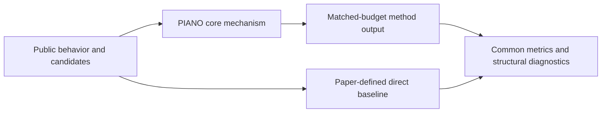
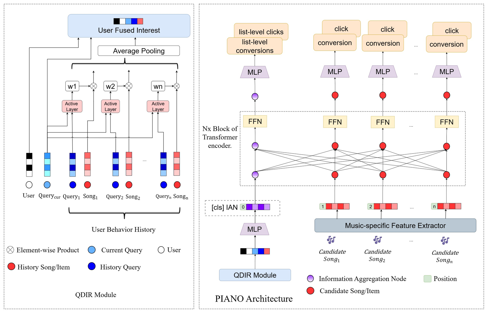

# PIANO: personalized music reranking with an information aggregation node

<!-- source-sha256: 4619ef31637f42188b3cf95773f0f452f115018b1f335e2083d33b1c1fc6be09 -->

[简体中文](README.md)

> **Fidelity: core mechanism.** Runs the defining mechanism verifiable on public data. Private data, production models, and serving remain outside scope.

## Paper information

| Field | Details |
|---|---|
| Paper | [arXiv 2606.16641](https://arxiv.org/abs/2606.16641) |
| Organization | NetEase Cloud Music |
| First public release | 2026-06-15 (arXiv v1) |
| Authors' code | The paper did not provide official or author code when checked on 2026-09-02. |
| Adapter / method | `piano` |
| Local reproduction code | [`src/auto_research/reproductions/piano/`](https://github.com/daiwk/auto-research/tree/main/src/auto_research/reproductions/piano/) |

## Original paper

### Motivation and method

The Query-Driven Interest Refiner extracts query-relevant interests from history. The Information Aggregation Node summarizes the entire candidate list and conditions item-level CTR/CVR predictions.



<!-- paper-figure:start -->
### Key figure from the paper

[](https://arxiv.org/html/2606.16641v1/PIANO-Architecture-v3.jpg)

> **Figure 1:** Core architecture, modules, and connections. From the [original paper](https://arxiv.org/abs/2606.16641); copyright remains with the authors.
<!-- paper-figure:end -->

### Core equations

$$
h_q=\\sum_t\\operatorname{softmax}(q^\\top h_t)h_t,\\quad z_{IAN}=\\operatorname{Attn}([v_1,\\ldots,v_n]).
$$

### Paper results

Stable multi-week traffic assignments at NetEase Cloud Music yield CTR +0.62% and CVR +4.45% in A/B, followed by rollout to 95% of traffic. This is paper evidence, not a local public-data outcome.

## Local reproduction

> **Local comparison:** Under the same full-catalog protocol, baseline NDCG@10 is 0.05401 and PIANO NDCG@10 is 0.04988, **-7.65%** relative, a negative proxy result. The local proxy does not extrapolate to online lift.

See the [three-seed artifact](metrics/public-seeds42-44.json) for complete results, means, standard deviations, and 95% confidence intervals.

```bash
auto-research reproduce --paper piano --dataset-dir data --seed 42
```

## Reproduction boundaries

The local run uses a public MovieLens-1M subset and auditable proxies to validate the core computation. It does not reproduce private logs, production models, online traffic assignment, or serving. No claim is made to reproduce absolute paper metrics or online gains.
