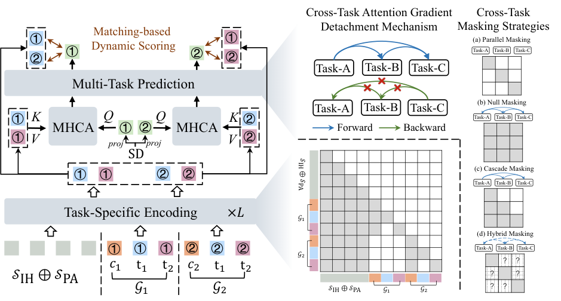

# OneRank: A native unified Transformer for multi-task ranking

<!-- source-sha256: 5a5acb4aba8e37461cf04a1dcf4ad9981405eeded6cf06dc1c7ad70e509c0fd0 -->

[简体中文](README.md)

> Core public-data ranking mechanism.

## Paper information

| Field | Details |
|---|---|
| Paper | [Paper or original source](https://arxiv.org/abs/2606.16838) |
| Institution | Renmin University of China. |
| First public release | 2026-06-15 (arXiv v1) |
| Author code | No official author code linked by the paper as checked on 2026-09-02. |
| Local adapter or method key | `onerank` |
| Local reproduction code | [`src/auto_research/reproductions/onerank/`](https://github.com/daiwk/auto-research/tree/main/src/auto_research/reproductions/onerank/) |

## Paper method and evidence

Put structured features and task tokens in one sequence instead of separating encoder and task predictors. Task-private channels and isolated gradients limit interference.


<!-- paper-figure:start -->
### Original paper figure

[](https://arxiv.org/html/2606.16838v1/overall.png)

Figure shows unified tokens and task-private paths. From the [original paper](https://arxiv.org/abs/2606.16838); copyright remains with the authors.
<!-- paper-figure:end -->

### Core equation

$$
h_k=\operatorname{Transformer}([x_1,\ldots,x_n,t_k];\theta,\phi_k),\quad \nabla_{\phi_j}L_k=0\\;(j\ne k).
$$

### Reported results

Shopee seven days, 10%/10% arms: GMV/UU +1.01%, paid GMV/UU +1.17%, ad revenue/UU +0.81%, bad-query rate -2.29%.

## Local reproduction

MovieLens-1M full catalog: NDCG@10 **0.05401→0.09540 (+76.65%)**. [Three-seed metrics, mean, SD, and 95% CI](metrics/public-seeds42-44.json). No private logs, production models, bucketing or serving. Public proxies cannot establish online lift.

```bash
auto-research reproduce --paper onerank --dataset-dir data --seed 42
```
