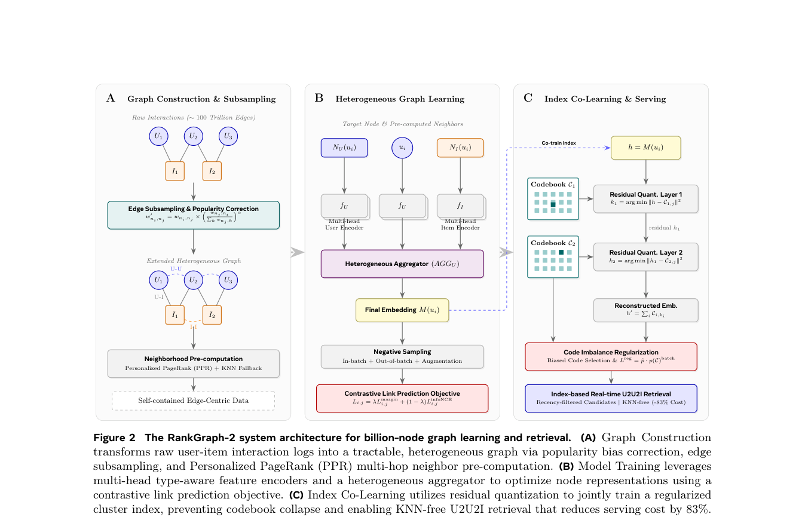

# RankGraph-2: Scalable Industrial Graph Retrieval

<!-- source-sha256: 5d0e4f13427f15aa7a52978920676e2b8f51a8a123e8f633000f44e1c01f6a18 -->

[简体中文](README.md)

> **Core-mechanism reproduction.** Popularity correction, offline PPR, and cluster indexing execute.

## Paper information

| Field | Value |
| --- | --- |
| Paper | [arXiv 2606.18379](https://arxiv.org/abs/2606.18379) |
| Affiliations | Meta |
| First public release | 2026-06-16 (arXiv v1) |
| Authors' code | No official author code linked as of 2026-08-09. |
| Adapter / method | `rankgraph2` |
| Local code | [`src/auto_research/reproductions/rankgraph2/`](https://github.com/daiwk/auto-research/tree/main/src/auto_research/reproductions/rankgraph2/) |

## Original paper

### Background and contribution

Online multi-layer GNNs are costly and can overemphasize popular edges. Correct edge popularity, precompute multihop PPR, and compress serving with a jointly learned residual cluster index.


<!-- paper-figure:start -->
### Key figure from the paper

[](https://arxiv.org/pdf/2606.18379#page=5)

Original Figure 2: graph retrieval and serving. From the [paper](https://arxiv.org/abs/2606.18379); copyright belongs to the authors. Not a local result.
<!-- paper-figure:end -->

### Core mechanism

$$
\pi_i=\alpha e_i+(1-\alpha)\pi_i\tilde P,\qquad
\tilde P_{uv}\propto P_{uv}/\sqrt{1+\operatorname{pop}(v)}.
$$

### Paper results

The paper reports 83% less compute, 3.8×/2.1× recall, and production CTR +0.96%, CVR +2.75%, across more than 20 launches.

## Local reproduction

On a MovieLens item graph, debiased transitions, multihop PPR, and PPR clustering run. Against one-hop retrieval, debiased PPR plus two-stage residual cluster indexing gives NDCG@10 0.03540→0.07421 (+109.65%), in `metrics/movielens-100k-seed42.json`.

```bash
auto-research reproduce --paper rankgraph2 --dataset-dir data --seed 42
```

## Reproduction limits

MovieLens evidence is distinct from the paper's online results.
