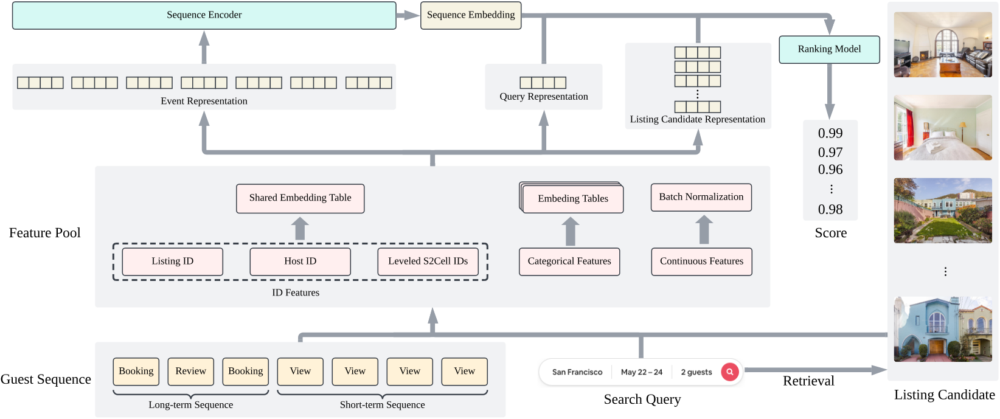

# JourneyFormer: Encoding Airbnb Guest Journey with Sequence Modeling

<!-- source-sha256: 0c8ceac49034112024ff30ddd4425e6171cb19ef92276b5246b63ed7e53a8867 -->

[简体中文](README.md)

> **Fidelity: core mechanism.** Paper results, local public-data measurements, and omissions are separate.

## Paper information

| Field | Details |
|---|---|
| Paper | [arXiv 2606.19108](https://arxiv.org/abs/2606.19108) |
| Organization | Airbnb |
| First public release | 2026-06-17 (arXiv v1) |
| Authors' code | The paper did not provide official or author code when checked on 2026-08-24. |
| Adapter / method | `journeyformer` |
| Local reproduction code | [`src/auto_research/reproductions/journeyformer/`](https://github.com/daiwk/auto-research/tree/main/src/auto_research/reproductions/journeyformer/) |

## Original paper

### Motivation and method

Encode Airbnb's long- and short-term guest journey with event type, time, and listing representations. Caching and sparse computation meet serving latency.


<!-- paper-figure:start -->
### Key figure from the paper

[](https://arxiv.org/html/2606.19108v1/overview.png)

> **Figure 2:** Overview of the paper's method and key components. From the [original paper](https://arxiv.org/abs/2606.19108); copyright remains with the authors.
<!-- paper-figure:end -->

### Core equations

$$
h_u=\operatorname{Transformer}([e_i+e_{type}+e_{time}]_{i=1}^{L})
$$

### Paper results

The main online result is **bookers +0.55%** in a three-week A/B test (p<0.01). Offline tables and online metrics use private or paper-specific protocols. The private paper protocol is not directly comparable with local MovieLens measurements.

## Local reproduction

> **Local comparison:** The baseline is the shared transition + content scorer. The treatment adds only journeyformer on the same users, items, full-catalog candidates, and seed.

MovieLens-100K, 220 users and 360 items, seed 42: NDCG@10 0.0540 → **0.0525 (-2.77%)**; Hit@10 0.1091 → 0.1091. Validation selects mixture weights only; the test set is not used for tuning.

```bash
auto-research reproduce --paper journeyformer --dataset-dir data --seed 42
```

See the [fixed metrics](metrics/public-seed42.json).

## Reproduction boundaries

The core mechanism runs on MovieLens-100K with the same split, fixed full-catalog candidates, and seed. Private features, the production foundation model, and online traffic are unavailable. The implementation has independent model state and scoring, rather than mapping a paper name to a shared weighted formula. See the adapter's `omitted_core_components` for omissions. Local changes and paper A/B gains are reported separately.
