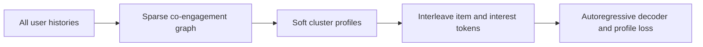
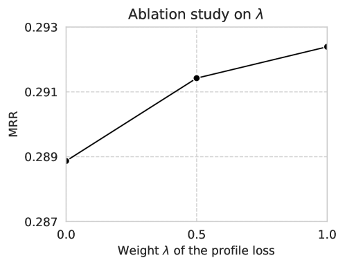

# G2Rec: Graph interest tokens for generative recommendation

<!-- source-sha256: 22568d8bc30a2964306b4979b4ed6c498084bf72d73bd41b4884f118374b2210 -->

[简体中文](README.md)

> **Fidelity: complete core pipeline.** Optimizes sparse soft modularity and trains the interleaved autoregressive Transformer with both losses.

## Paper information

| Field | Details |
|---|---|
| Paper | [Paper or original source](https://arxiv.org/abs/2606.20554) |
| Institution | Meta |
| First public release | 2026-06-18 (arXiv v1) |
| Author code | No official author code identified (checked 2026-08-09). |
| Local adapter or method key | `g2rec` |
| Local reproduction code | [`src/auto_research/reproductions/g2rec/`](https://github.com/daiwk/auto-research/tree/main/src/auto_research/reproductions/g2rec/) |

## Paper method and evidence

Item-only sequences cannot express overlapping interest clusters or co-engagement from other users. G2Rec builds a sparse item graph, learns soft membership in multiple interest prototypes through differentiable modularity, and alternates item and continuous interest-profile tokens in the decoder. An auxiliary profile loss complements next-item prediction.



<!-- paper-figure:start -->
### Original paper figure

[](https://arxiv.org/html/2606.20554v1/x5.png)

Figure 2 shows the method and its main components. From the [original paper](https://arxiv.org/abs/2606.20554); copyright remains with the authors.
<!-- paper-figure:end -->

### Core equation

$$
Q_{soft}(P)=\frac1{|E|}\sum_{(i,j)\in E}p_i^Tp_j-\gamma\frac{\|P^Tk\|_2^2}{|E|^2}.
$$

$$
v_a=\frac{\sum_i p_{i,a}x_i}{\sum_i p_{i,a}},\qquad y_i=\sum_a p_{i,a}v_a,
$$

$$
\mathcal L^t=\underbrace{-\log F(i_{t+1}\mid R_{u,\le2t+1})}_{\mathcal L_{item}^t}
+\lambda\underbrace{\left[-\sum_a p_{i_t,a}\log F(a\mid R_{u,\le2t})\right]}_{\mathcal L_{profile}^t}.
$$

$P\in\mathbb R^{|I|\times C}$ stores soft memberships, $k$ is the degree vector and $|E|$ counts edges with repeated directions. The decoder receives $R_u=[BOS,x_{i_1},y_{i_1},\ldots,x_{i_N},y_{i_N}]$.

### Reported results

On Beauty, Sports, Toys and Yelp, the authors use 5-core leave-one-out data, 99 negatives, Llama 2 13B LoRA and three epochs. G2Rec leads on all six metrics in all four datasets.

| Dataset | Best baseline NDCG@5 | G2Rec NDCG@5 | G2Rec NDCG@10 | MRR |
|---|---:|---:|---:|---:|
| Beauty | 0.2848 | 0.3035 | 0.3334 | 0.3034 |
| Sports | 0.2497 | 0.2869 | 0.3254 | 0.2867 |
| Toys | 0.2820 | 0.2931 | 0.3225 | 0.2942 |
| Yelp | 0.4252 | 0.4398 | 0.4927 | 0.4180 |

Soft modularity vs Leiden is 0.419→0.499, 0.365→0.452, 0.437→0.550 and 0.691→0.757, respectively. Added train/inference time is 0.043s/0.0027s per batch. Meta's seven-day and longer online A/B reports in-session lift >+0.03% and engagement (time spent, likes and shares) +0.06% to +0.19%.

## Local reproduction

The runner downloads Amazon Beauty 5-core (22,363 users, 12,101 items) and builds 265,133 sparse edges using a three-step window. It optimizes modularity across 12 clusters. Matched item-only and interleaved decoders use 96 dimensions, two causal Transformer layers and 240 steps, adding a 0.1 profile-loss weight for G2Rec. Test fixes 1,000 users with one positive and 99 random negatives each.

| Variant | Hit@10 | NDCG@10 | Head share@10 |
|---|---:|---:|---:|
| Item-only decoder | 0.1100 | 0.0474 | 0.1107 |
| Item + interest decoder | 0.1130 | 0.0530 | 0.1177 |

Soft modularity reaches 0.3286; final losses are 9.8684 vs 11.2813. NDCG improves 11.92%, with +0.3 percentage points on Hit@10 but +0.7 on head share. This verifies the joint tokenization/loss pipeline, not a DIN comparison, and possible popularity bias and the small decoder preclude inferring production lift. [Stable metrics](metrics/beauty-seed42.json). Downloaded data and raw runs remain ignored; only code, tests, documentation and sanitized metrics are committed.

```bash
pip install -e '.[neural-recs]'
auto-research reproduce --paper g2rec --dataset-dir data --seed 42
```
