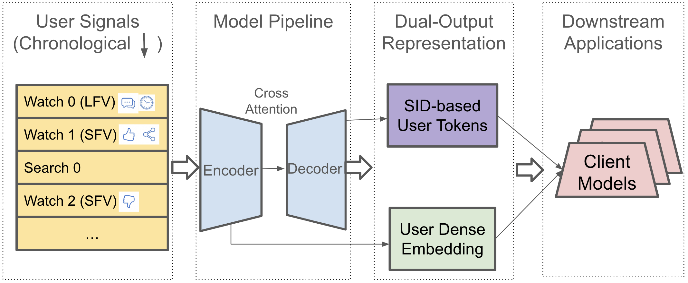

# TokenMinds: Discrete user tokens and dense user vectors for large-scale recommendation

<!-- source-sha256: 587ed1772c65f28d3ac68d2be0492b3a9615be25b43503bf5aacecda0d92ff8d -->

[简体中文](README.md)

> **Fidelity: core mechanism reproduction.** Trains a shared sequence encoder, dense vector, hierarchical SID prediction heads and downstream fusion. This is not a recreation of Google's Gemini MoE, private YouTube data or asynchronous service.

## Paper information

| Field | Details |
|---|---|
| Paper | [Paper or original source](https://arxiv.org/abs/2606.25147) |
| Institution | Google DeepMind / YouTube |
| First public release | 2026-06-23 (arXiv v1) |
| Author code | No official author code identified (checked 2026-08-09). |
| Local adapter or method key | `tokenminds` |
| Local reproduction code | [`src/auto_research/reproductions/tokenminds/`](https://github.com/daiwk/auto-research/tree/main/src/auto_research/reproductions/tokenminds/) |

## Paper method and evidence

A single dense vector loses fine-grained, multimodal user interests, while natural-language profiles are difficult to align with non-text item IDs. TokenMinds extends PLUM's item SIDs to user modeling. The encoder consumes video SIDs, watch features and search text and produces a pooled dense user vector. A decoder emits multiple future-interest SID prefixes; the downstream ranker uses dense features and learnable token embeddings. Multiple targets from a 24-hour look-ahead window and coarse SID prefixes counter next-event overfitting. The decoder cross-attention trains the encoder. Reward signals measure engagement; the paper prefers sampling proportional to reward and then equal training weights. An LFV/SFV context token supports one encoder prefill and parallel context-specific decoding. Production caches asynchronous heavy-model outputs for real-time rankers.


<!-- paper-figure:start -->
### Original paper figure

[](https://arxiv.org/html/2606.25147v1/figures/framework.png)

Figure 1 shows the dense encoder output, autoregressive SID decoder and downstream fusion. From the [original paper](https://arxiv.org/abs/2606.25147); copyright remains with the authors.
<!-- paper-figure:end -->

### Core equation

$$
\mathcal L=-\sum_{i=1}^{N}r(W_i)\sum_{j=1}^{L}
\log P\!\left(\operatorname{SID}_{i,j}\mid W_{1:t},W_{<i},
\operatorname{SID}_{i,<j}\right).
$$

### Reported results

Table 1 gives Session Recall@10 0.291 and Cold-Start Recall@10 0.210. Removing multiple targets, look-ahead or SID truncation hurts; removing truncation yields 15.1% and 17.1% relative drops. Table 2's CPT initialization and search text improve these metrics by 23.5% and 31.5% over random initialization without search. In Table 4's seven-day A/B, Embed+Token increases SFV engaged users 0.11% and satisfied engagement 0.62%, and LFV by 0.02% and 0.08%; bold paper results pass the 95% significance test. Table 6 reports joint LFV/SFV training compute −50%, upstream serving compute −31%, and fresh engagement +0.33%/+0.19% for SFV/LFV. The system rolled out to full traffic on multiple major YouTube surfaces serving billions, separate from the measured A/B gains.

## Local reproduction

MovieLens-1M uses 320 users, 480 items, 32 history events and full-catalog ranking. Two-stage residual quantization of genre vectors provides SIDs. A dense-only GRU and the two-stage SID+learnable-embedding/gated-residual variant share the data, seed and 120-step budget. Test Hit@10/NDCG@10 is 0.03438/0.02027 vs 0.03438/0.02020 (NDCG −0.35%); head share drops 0.1050 → 0.1034. A single small seed with short histories and no PLUM CPT offers no evidence of stable lift and does not refute production results. [Stable metrics](metrics/movielens-1m-seed42.json). The local GRU substitutes for the Gemini 370M MoE encoder plus 370M decoder. No YouTube search or 1,200-watch sequences, 15-target look-ahead data, 40-beam multi-context decoding, 24-hour refresh, 1.44M reads/s KV service or production ranker client.

```bash
auto-research reproduce --paper tokenminds --dataset-dir data --seed 42
```
