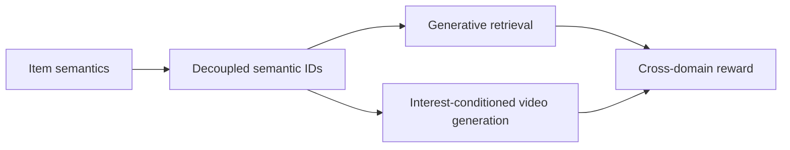
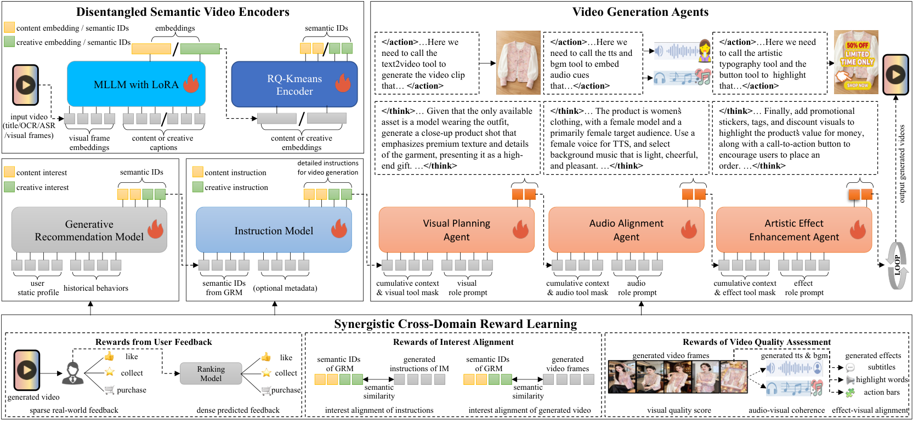

# RaG: Recommendation as Generation

<!-- source-sha256: 148b8e4d9936a8abd4056e4cfc1a0307a231abb9b138649766f0f2a7e106b953 -->

[简体中文](README.md)

> Core D-SID interface only; no production video generator.

## Paper information

| Field | Details |
|---|---|
| Paper | [arXiv 2606.25496](https://arxiv.org/abs/2606.25496) |
| Institution | Kuaishou / Beihang University. |
| First public release | 2026-06-24 (arXiv v1) |
| Author code | No official author code linked by the paper as checked on 2026-09-02. |
| Local adapter or method key | `rag-generation` |
| Local reproduction code | [`src/auto_research/reproductions/rag_generation/`](https://github.com/daiwk/auto-research/tree/main/src/auto_research/reproductions/rag_generation/) |

## Paper method and evidence

Decoupled semantic IDs connect generative recommendation with interest-conditioned video generation; cross-domain rewards align candidate selection and content creation.



<!-- paper-figure:start -->
### Original paper figure

[](https://arxiv.org/html/2606.25496v1/framework.png)

The original figure connects retrieval and creation. From the [original paper](https://arxiv.org/abs/2606.25496); copyright remains with the authors.
<!-- paper-figure:end -->

### Core equation

$$
z_i=(z_i^{content},z_i^{creative}),\qquad v\sim p_\theta(v|z_{interest}).
$$

### Reported results

Kuaishou ad A/B reports revenue +1.870% versus strong GRM and +5.462% versus DLRM. Paper evidence only.

## Local reproduction

```bash
auto-research reproduce --paper rag-generation --dataset-dir data --seed 42
```

Same MovieLens-1M public-subset full-catalog protocol: NDCG@10 **0.05401→0.04235 (-21.59%)**. [Three-seed measurements, mean, SD and 95% CI](metrics/public-seeds42-44.json). Proxy objectives verify only the interface, not private logs, traffic assignment, model scale, serving, or video synthesis.
