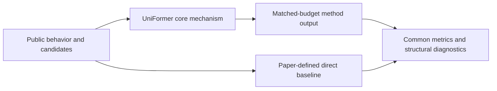
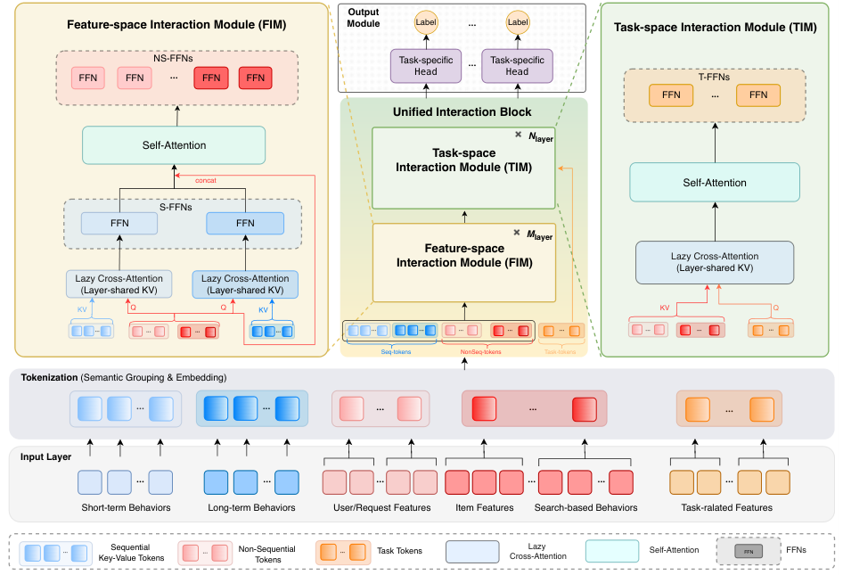

# UniFormer: unified model-centric scaling for industrial recommendation

<!-- source-sha256: 2d68a9ea101deb77c77cc4188e5ca420631cf4fe9cad5ab2d6911150d9f99ff1 -->

[简体中文](README.md)

> **Fidelity: core mechanism.** Runs the defining mechanism verifiable on public data. Private data, production models, and serving remain outside scope.

## Paper information

| Field | Details |
|---|---|
| Paper | [arXiv 2606.27058](https://arxiv.org/abs/2606.27058) |
| Organization | Kuaishou |
| First public release | 2026-06-25 (arXiv v1) |
| Authors' code | The paper did not provide official or author code when checked on 2026-09-02. |
| Adapter / method | `uniformer` |
| Local reproduction code | [`src/auto_research/reproductions/uniformer/`](https://github.com/daiwk/auto-research/tree/main/src/auto_research/reproductions/uniformer/) |

## Original paper

### Motivation and method

Separate item-independent and item-dependent features and tasks into semantic tokens. A unified interaction module scales sequences, features, and tasks together.



<!-- paper-figure:start -->
### Key figure from the paper

[](https://arxiv.org/html/2606.27058v1/uniformer.png)

> **Figure 2:** Core architecture, modules, and connections. From the [original paper](https://arxiv.org/abs/2606.27058); copyright remains with the authors.
<!-- paper-figure:end -->

### Core equations

$$
H'=\\operatorname{Attn}([T_{ind};T_{dep};T_{task}]),\\quad \\hat y_k=g_k(H'_{task,k}).
$$

### Paper results

Over seven days at 5% traffic on the Kuaishou main and Lite apps, Lite dwell time rose +0.260% and watch time +1.113%. User–item decoupling raised QPS +48%. This is paper evidence, not a local public-data outcome.

## Local reproduction

> **Local comparison:** Under the same full-catalog protocol, baseline NDCG@10 is 0.05401 and UniFormer NDCG@10 is 0.04131, **-23.50%** relative, a negative proxy result. The local proxy does not extrapolate to online lift.

See the [three-seed artifact](metrics/public-seeds42-44.json) for complete results, means, standard deviations, and 95% confidence intervals.

```bash
auto-research reproduce --paper uniformer --dataset-dir data --seed 42
```

## Reproduction boundaries

The local run uses a public MovieLens-1M subset and auditable proxies to validate the core computation. It does not reproduce private logs, production models, online traffic assignment, or serving. No claim is made to reproduce absolute paper metrics or online gains.
