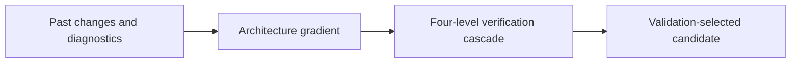
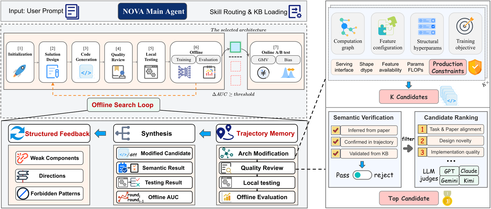

# NOVA: A verifiable agent harness for industrial recommendation architecture evolution

<!-- source-sha256: 52dd1495964d1c94f4964f01d2bb31e781ccc8b129bb3a512adf2d0b0abd9bf9 -->

[简体中文](README.md)

> Four-level checks, failed-direction memory and architecture gradients, not Tencent production reproduction.

## Paper information

| Field | Details |
|---|---|
| Paper | [Paper or original source](https://arxiv.org/abs/2606.27243) |
| Institution | Tencent. |
| First public release | 2026-06-25 (arXiv v1) |
| Author code | No official author code linked by the paper as checked on 2026-08-09. |
| Local adapter or method key | `nova` |
| Local reproduction code | [`src/auto_research/reproductions/nova/`](https://github.com/daiwk/auto-research/tree/main/src/auto_research/reproductions/nova/) |

## Paper method and evidence

Summarize past changes, diagnostics and outcomes in an architecture gradient. Gate changes through L1 structure semantics, L2 execution, L3 offline effectiveness and L4 online impact; escalate high-risk tasks to humans.



<!-- paper-figure:start -->
### Original paper figure

[](https://arxiv.org/html/2606.27243v3/figure/pic_1_v4.png)

Figure shows the verification cascade. From the [original paper](https://arxiv.org/abs/2606.27243); copyright remains with the authors.
<!-- paper-figure:end -->

### Core equation

$$
g_t=\operatorname{Aggregate}(\Delta a_{<t},d_{<t},m_{<t},\mathcal M_t),
\qquad a_{t+1}=\operatorname{AgentUpdate}(a_t,g_t).
$$

### Reported results

Paper L2/L3 passes 54.5%/60.0%, paper-to-production human time over 13× shorter. Three pCVR targets see GMV +1.25%, +1.70%, +2.02% and pCVR bias down 58.8%, 66.7%, 37.3%.

## Local reproduction

On MovieLens-100K propose transition, content, popularity and deliberate shape-error variants. Run all four local gates and select on validation only. Evolve writes verification, successful skills and banned directions in `result.json`. Fixed heuristic ensemble vs selected specialist NDCG@10 **0.03540→0.07119 (+101.13%)**. [Metrics](metrics/movielens-100k-seed42.json). No production canary or live traffic.

```bash
auto-research reproduce --paper nova --dataset-dir data --seed 42
```
