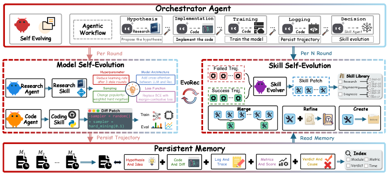

# EvoRec: a self-evolving agentic recommendation system

<!-- source-sha256: dbaf8082488e162a00d70e57a0702605b53197bc066153cb877869761c327630 -->

[简体中文](README.md)

> **Fidelity: core mechanism.** Runs both tracks for model candidates and optimization methods, with skill memory across generations. The production multi-agent toolchain is not reproduced.

## Paper information

| Field | Details |
|---|---|
| Paper | [arXiv 2606.28368](https://arxiv.org/abs/2606.28368) |
| Organization | Alibaba International Digital Commerce Group |
| First public release | 2026-06-15 (arXiv v1) |
| Authors' code | The paper did not supply official or author code when checked on 2026-08-09. |
| Adapter / method | `evorec` |
| Local reproduction code | [`src/auto_research/reproductions/evorec/`](https://github.com/daiwk/auto-research/tree/main/src/auto_research/reproductions/evorec/) |

## Original paper

### Motivation and method

Existing LLM agents translate code each round without accumulating optimization methods. EvoRec's Research and Code Agents iterate models. Its Skill Evolver distills reusable methods from persistent memory so both the model and its optimization methods evolve.


<!-- paper-figure:start -->
### Key figure from the paper

[](https://arxiv.org/html/2606.28368v1/x1.png)

> **Figure 1:** Overview of the paper's method and key components. From the [original paper](https://arxiv.org/abs/2606.28368); copyright remains with the authors.
<!-- paper-figure:end -->

### Core equations

$$
\theta_{t+1}=\operatorname{Optimize}(\theta_t,s_t),\qquad
s_{t+1}=\operatorname{Distill}(\mathcal M_t,\Delta \operatorname{metric}_t).
$$

### Paper results

Up to +5.54% offline over the strongest baseline; online A/B reports revenue +1.85% and CTR +1.02%.

## Local reproduction

Transition, content, and popularity skills compete. Three generations select winners using fixed validation and persist them in memory, which also ranks next-generation candidates in the general evolve controller.

> **Local comparison:** A fixed ensemble is the baseline and the result of three generations of skill-memory evolution is the treatment. NDCG@10 improves from 0.03540 to 0.04650, or +31.36% relative; see `metrics/movielens-100k-seed42.json`.

```bash
auto-research reproduce --paper evorec --dataset-dir data --seed 42
```
