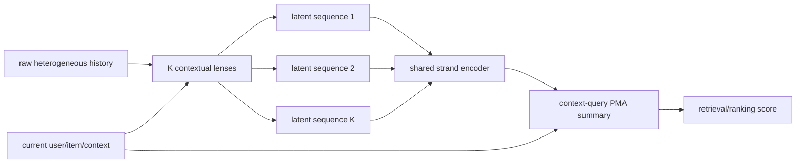
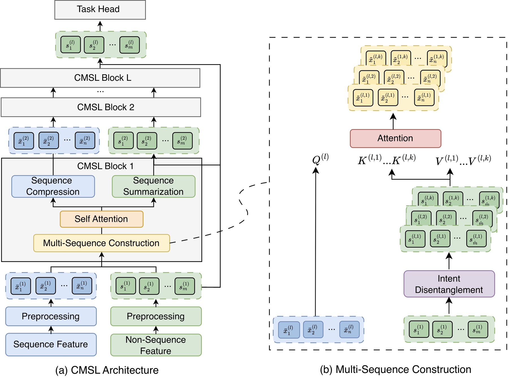

# CMSL: Constructive Multi-Sequence Learning

<!-- source-sha256: 35718da4c1bc5b26f9925b580d22fa77a5dc627f4afbc9648851831210abb876 -->

[简体中文](README.md)

> **Fidelity: Core mechanism.** Contextual lenses, soft sequence construction, and HSTU-style gated attention train jointly. Meta's private features, scale, and distributed serving are not reproduced.

## Paper information

| Field | Value |
| --- | --- |
| Paper link | [arXiv 2606.28533](https://arxiv.org/abs/2606.28533) |
| Organization | Meta |
| First published | 2026-06-26 (arXiv v1) |
| Original author code | No official or author code was provided in the paper (checked 2026-08-09). |
| Adapter | `cmsl` |
| Local reproduction code | [`src/auto_research/reproductions/cmsl/`](https://github.com/daiwk/auto-research/tree/main/src/auto_research/reproductions/cmsl/) |

## Original paper summary

### Background and main changes

Packing clicks, views, and interactions into one long sequence mixes user intents and raises self-attention cost. CMSL learns multiple contextual lenses from current features without a predefined business taxonomy. The lenses construct K latent semantic sequences dynamically. Each strand is encoded independently, then the current non-sequential context queries a pooling-by-multihead-attention (PMA) summary. The paper also describes a linear HSTU approximation with a degree-2 polynomial feature map for long industrial sequences.

<!-- paper-figure:start -->
### Key figure from the paper

**Original Figure 2 (architecture):** Main modules and their connections. Image from the [original paper](https://arxiv.org/abs/2606.28533); copyright belongs to the authors. Click the image for its source.
<!-- paper-figure:end -->

### Core equations

Event $x_t$ is softly assigned across K lenses:

$$
a_{t,k}=\operatorname{softmax}_k(g_k(x_t,c)),\qquad S_k=\{a_{t,k}x_t\}_{t=1}^{T}.
$$

Linear HSTU factorizes the attention kernel with a second-order feature map:

$$
SiLU(QK^T)V\approx\phi(Q)\phi(K)^TV+AV,
$$

Here $\phi(x)$ contains first-order $x_i$ and second-order $x_ix_j$ terms. The contextual query $q(c)$ aggregates strand representations $H_k$:

$$
z=\sum_k\operatorname{softmax}_k(q(c)^TW_KH_k)\,W_VH_k.
$$

### Offline and online results in the paper

Normalized entropy improvements on Meta's private retrieval/ranking datasets:

| Surface | Offline metric | CMSL change |
|---|---|---:|
| 1 | Eval comment NE | -0.62% |
| 1 | Eval like NE | -0.33% |
| 2 | Eval CTR / CVR NE | -0.12% / -0.10% |
| 3 | Eval CTR / CVR NE | -0.09% / -0.06% |
| 4 | Eval CTR / CVR NE | -0.10% / -0.13% |

Surface 5 online A/B reports four engagement changes: **+0.116%, +0.158%, +0.171%, and +0.092%**. Original training data was not made available for download.

## Local reproduction

> **Control:** Embeddings, HSTU block, optimizer, and training budget match. The treatment adds 6 learned contextual lenses and multi-strand aggregation, improving NDCG@10 by **+29.42%**. It is not a comparison with DIN.

On MovieLens positive-feedback sequences, event representations are assigned differentiably to 6 lenses to build latent sequence profiles. HSTU-style SiLU attention and its U-gate are trained. Ratings ≥4, leave-two-out, full catalog, three seeds, and no test-based selection.

| Model | Hit@10 | NDCG@10 |
|---|---:|---:|
| Single-sequence HSTU | 0.0046 ± 0.0005 | 0.0021 ± 0.0004 |
| CMSL learned lenses | **0.0061 ± 0.0010** | **0.0028 ± 0.0003** |

Mean NDCG@10 improves **+29.42%**, but absolute metrics remain low. Learned lenses beat a single sequence at the same small budget. This is not the Meta online gain. Production HSTU kernels and internal features are not included. See [metrics/movielens-100k-seeds42-44.json](metrics/movielens-100k-seeds42-44.json).
