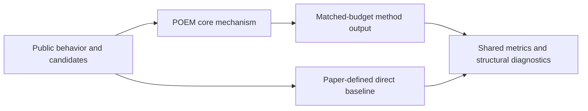
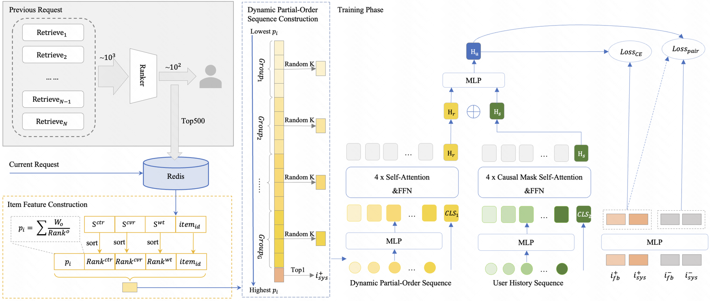

# POEM: partial-order-enhanced real-time sequence modeling

<!-- source-sha256: 2fddd03d65999e00c6c408ca00e6541c1622b4e664a8d182854caec4e2b824f1 -->

[简体中文](README.md)

> **Fidelity: core mechanism.** Runs the defining mechanism verifiable on public data. Private data, production models, and serving are outside scope.

## Paper information

| Field | Details |
|---|---|
| Paper | [arXiv 2606.29946](https://arxiv.org/abs/2606.29946) |
| Organization | Kuaishou |
| First public release | 2026-06-29 (arXiv v1) |
| Authors' code | The paper did not provide official or author code when checked on 2026-09-02. |
| Adapter / method | `poem` |
| Local reproduction code | [`src/auto_research/reproductions/poem/`](https://github.com/daiwk/auto-research/tree/main/src/auto_research/reproductions/poem/) |

## Original paper

### Motivation and method

Convert relative ranks from several ranking objectives on the current request into partial-order signals. Construct training sequences that better reflect current interests than chronology alone.



<!-- paper-figure:start -->
### Key figure from the paper

[](https://arxiv.org/html/2606.29946v1/poem_arch_v4.png)

> **Figure 1:** Overall workflow, key stages, and data flow. From the [original paper](https://arxiv.org/abs/2606.29946); copyright remains with the authors.
<!-- paper-figure:end -->

### Core equation

$$
i\\succ j\\iff \\sum_m\\mathbf1[r_m(i)<r_m(j)]>\\sum_m\\mathbf1[r_m(j)<r_m(i)].
$$

### Paper results

In a seven-day Kuaishou A/B test with 5% traffic per arm, time per user increased +0.249% on the main app and +0.213% on the Lite app. These are paper-reported online measurements only, not local public-data results.

## Local reproduction

> **Local comparison:** Under the same full-catalog protocol, NDCG@10 is 0.05401 for the baseline and 0.05009 for POEM, **-7.25%** relative. This is a negative result on a public proxy task and does not extrapolate to production lift.

See the [three-seed artifact](metrics/public-seeds42-44.json) for complete results, means, standard deviations, and 95% confidence intervals.

```bash
auto-research reproduce --paper poem --dataset-dir data --seed 42
```

## Reproduction boundaries

The local run uses a public MovieLens-1M subset and auditable proxy objectives. It does not reproduce private company logs, online traffic assignments, production model scale, or serving. This is core-mechanism validation, not reproduction of the paper's absolute results or online gain.
