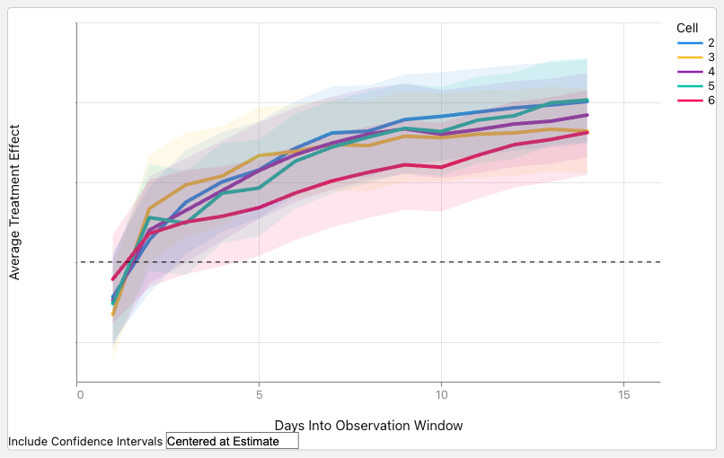

# GenPage: Towards End-to-End Generative Homepage Construction at Netflix

<!-- source-sha256: 5426889516b97cc2320c5173385c8c550453d2840d822be77e723052fb4b69db -->

[简体中文](README.md)

> **Fidelity: core mechanism.** Paper results, public-data measurements, and omissions are separate.

## Paper information

| Field | Details |
|---|---|
| Paper | [arXiv 2606.31031](https://arxiv.org/abs/2606.31031) |
| Organization | Netflix |
| First public release | 2026-06-30 (arXiv v1) |
| Authors' code | The paper did not provide official or author code when checked on 2026-08-24. |
| Adapter / method | `genpage` |
| Local reproduction code | [`src/auto_research/reproductions/genpage/`](https://github.com/daiwk/auto-research/tree/main/src/auto_research/reproductions/genpage/) |

## Original paper

### Motivation and method

Generate the entire homepage with one model rather than cascading retrieval and ranking. After WBC/SFT, RL post-training uses long-term production rewards while handling business rules and cold start.


<!-- paper-figure:start -->
### Key figure from the paper

[](https://arxiv.org/html/2606.31031v2/figures/online_evaluation_core_metric.png)

> **Figure 6:** Training flow and key optimization steps. From the [original paper](https://arxiv.org/abs/2606.31031); copyright remains with the authors.
<!-- paper-figure:end -->

### Core equations

$$
\pi^*=\arg\max_\pi\mathbb E_{Y\sim\pi(\cdot|h)}[R_{page}(Y)]
$$

### Paper results

The main online result is **core engagement +0.24%** in A/B (p<0.001). Offline tables and online metrics use private or paper-specific protocols. The private paper protocol is not directly comparable with local MovieLens measurements.

## Local reproduction

> **Local comparison:** The baseline is the shared transition + content scorer. The treatment adds only genpage on the same users, items, full-catalog candidates, and seed.

MovieLens-100K, 220 users and 360 items, seed 42: NDCG@10 0.0540 → **0.0519 (-3.98%)**; Hit@10 0.1091 → 0.1045. Validation selects mixture weights only; the test set is not used for tuning.

```bash
auto-research reproduce --paper genpage --dataset-dir data --seed 42
```

See the [fixed metrics](metrics/public-seed42.json).

## Reproduction boundaries

The core mechanism runs on MovieLens-100K with the same split, fixed full-catalog candidates, and seed. Private features, the production foundation model, and online traffic are unavailable. The implementation has independent model state and scoring, rather than mapping a paper name to a shared weighted formula. See the adapter's `omitted_core_components` for omissions. Local changes and paper A/B gains are reported separately.
