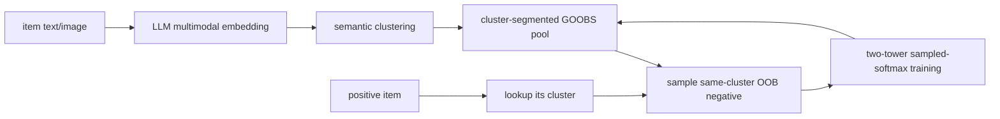
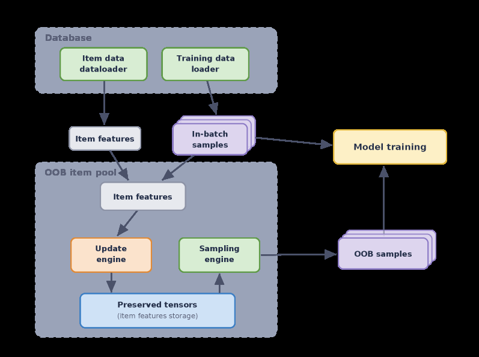

<!-- source-sha256: 45adef3dc3e7cd7c266632cfef02091f69058c56a232284ecd1af562aadb8a23 -->

[简体中文](README.md) · English

# Cluster GOOBS: LLM-clustered hard negatives

> **Fidelity: core-mechanism reproduction.** Runs the cluster-conditioned online hard-negative sampler. MovieLens genres replace private multimodal LLM clusters, and distributed GOOBS serving is not reproduced.

## Paper information

| Field | Details |
| --- | --- |
| Paper | [arXiv 2607.00448](https://arxiv.org/abs/2607.00448) |
| Institution | Meta |
| First public release | 2026-07-01 (arXiv v1) |
| Author code | No official or author-released code found in the paper (checked 2026-08-09). |
| Local adapter or method key | `cluster-goobs` |
| Local reproduction code | [`src/auto_research/reproductions/cluster_goobs/`](https://github.com/daiwk/auto-research/tree/main/src/auto_research/reproductions/cluster_goobs/) |

## Original paper summary

### Background and main changes

Large-scale two-tower retrieval often samples random negatives from an out-of-batch (OOB) pool. Most are too easy to provide a strong gradient, and popular items enter the pool more often, creating an exposure feedback loop. The paper clusters items by LLM/multimodal embeddings, uses the GOOBS update engine to write into real-time OOB pool segments by cluster, and has the sample engine draw hard negatives from the positive item's cluster with high probability. The online model is unchanged and sampling remains O(1).

<!-- paper-figure:start -->
### Key figure from the paper

> **Figure 2:** The core architecture, its main modules, and their connections. From the [paper](https://arxiv.org/abs/2607.00448); copyright belongs to the authors. Click for the source.
<!-- paper-figure:end -->

### Core equations

Two-tower similarity is $s(x_i,y_j)=v_i^Tu_j$, with batch/OOB sampled softmax:

$$
P(y_i\mid x_i;\theta)=\frac{\exp s(x_i,y_i)}{\sum_{j\in\mathcal C_i}\exp s(x_i,y_j)}.
$$

Cluster GOOBS draws candidates from a mixture:

$$
q^-(j\mid i)=\rho\,q_{random}(j)+(1-\rho)q_{cluster}(j\mid c(i)),
$$

with random:cluster 1:15 for MovieLens-1M and 1:31 for Amazon. The change is to sampling and the real-time segmented pool, not the two-tower loss.

### Offline and online results

| Dataset | HR@50 Random | Cluster | Relative gain | HR@100 Random | Cluster | Relative gain |
|---|---:|---:|---:|---:|---:|---:|
| MovieLens-1M | 0.2253 | 0.2415 | +7.2% | 0.3588 | 0.3682 | +2.7% |
| Amazon Grocery | 0.0254 | 0.0301 | +18.5% | 0.0406 | 0.0470 | +15.7% |
| Amazon Electronics | 0.0084 | 0.0131 | +55.6% | 0.0154 | 0.0201 | +30.2% |
| Amazon Home | 0.0050 | 0.0074 | +47.3% | 0.0082 | 0.0118 | +42.3% |

An online A/B test used 3% control, 3% test, and about 18 million items. CTR rose **+53%**, training QPS changed −1.4%, and inference did not regress. The top 100 items' contribution to impressions fell from 50% to 32%. The cohort with at least a thousand impressions saw CTR +50%.

## Local reproduction

> **Local comparison:** Random OOB negative sampling is the baseline and Cluster GOOBS sampling the experimental arm. NDCG@10 **+0.98%**, head share **-1.81%**. This ablates negative sampling; it is not a full two-tower versus DIN comparison.

The run upgraded from MovieLens-100K to the paper's public MovieLens-1M: 1,000,209 ratings, 6,040 users, and 3,706 items. As in the paper's public setting, ratings 3–5 are positive, genres supply public clusters, and random:cluster=1:15. For Mac, each of three seeds samples a fixed 100,000 training transitions and runs 3 epochs. Evaluation uses full-catalog Hit/NDCG@10, not the paper's HR@50/100.

| Sampler | Hit@10 | NDCG@10 | Head share@10 |
|---|---:|---:|---:|
| Random OOB | 0.0377 ± 0.0015 | 0.0190 ± 0.0006 | 0.9435 ± 0.0027 |
| Cluster GOOBS | **0.0381 ± 0.0010** | **0.0191 ± 0.0006** | **0.9265 ± 0.0041** |

NDCG@10 **+0.98%** and head share **-1.81%** reproduce the direction of a small relevance gain with less popularity concentration. Genre clusters are much weaker than the paper's roughly 300 multimodal LLM clusters; the capped transitions and lightweight two-tower model also limit comparison. See [`metrics/movielens-1m-seeds42-44.json`](metrics/movielens-1m-seeds42-44.json).
